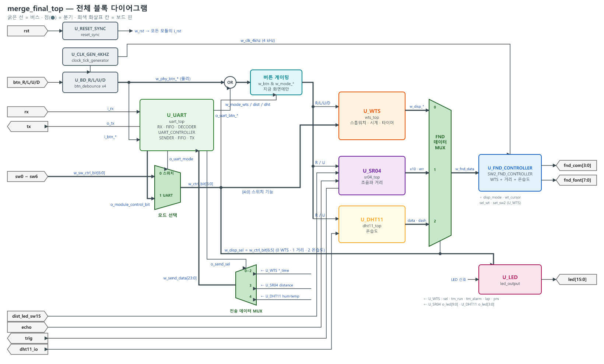
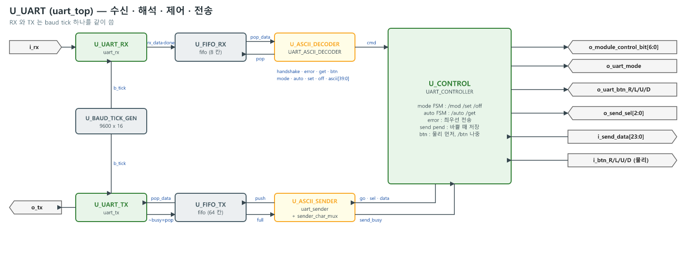
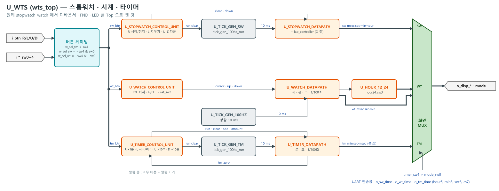
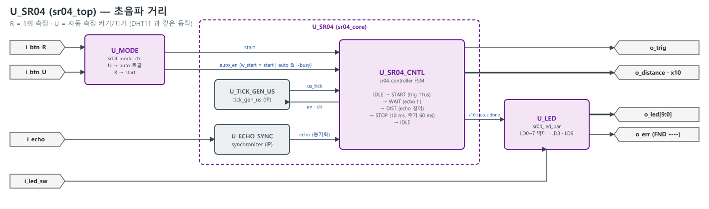
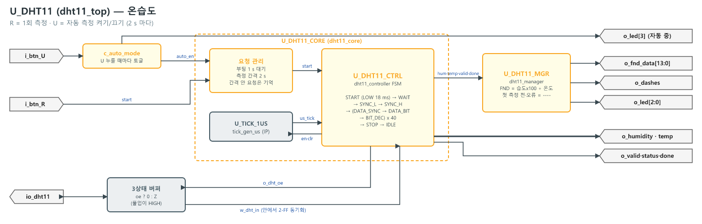
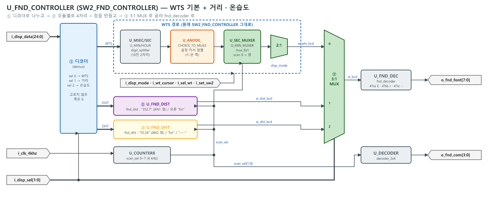
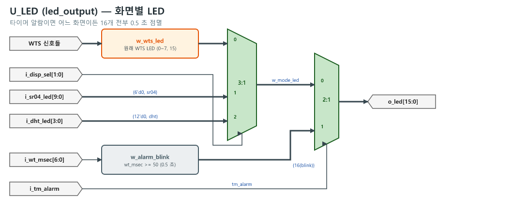
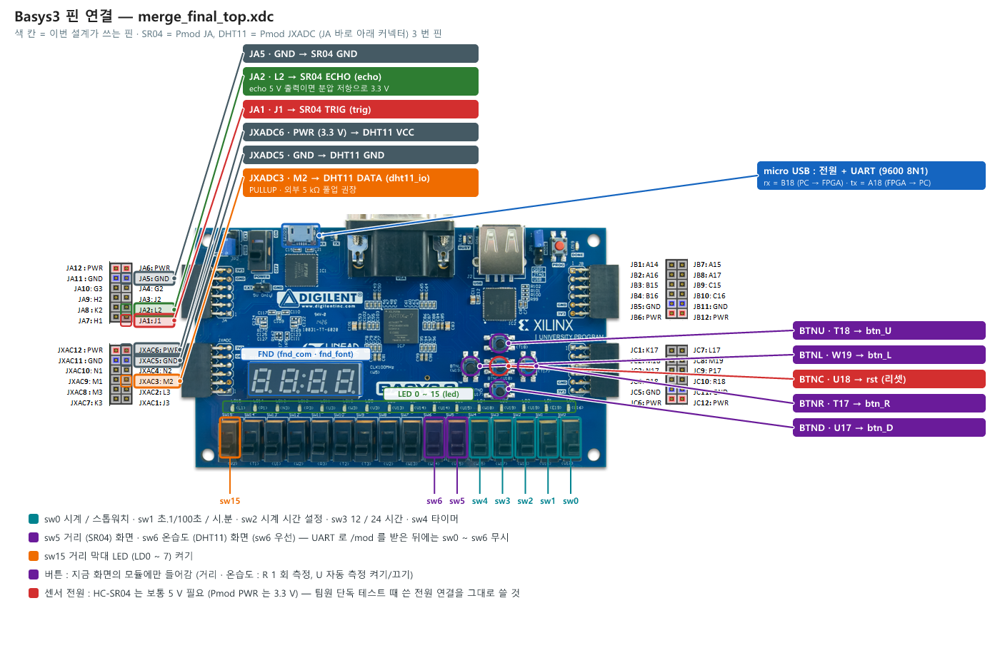

# merge_final — 팀 통합 Top (WTS + SR04 + DHT11 + UART)

Basys3 (Artix-7, 100 MHz) 한 보드에서 **스톱워치 · 시계 · 타이머 (WTS)**, **초음파 거리 (SR04)**, **온습도 (DHT11)** 를 돌리고,
PC 터미널에서 **UART 명령으로 모드 변경 · 버튼 입력 · 데이터 요청 / 자동 전송**을 하는 통합 설계입니다.

- 최종 Top : `source_file/merge_final/merge_final_top.v`
- 제약 파일 : `source_file/merge_final/merge_final_top.xdc`
- 통합 규칙 : `source_file/merge.md`
- 블록 다이어그램 : `docs/*.png` (원본 `docs/*.svg`, 생성 스크립트 `docs/draw_diagrams.py`)

> **검증 상태** : Verilator `--lint-only` 통과 (에러 0, 경고는 팀원 원본 코드의 비트 폭 경고). **통합 시뮬레이션 · 보드 테스트는 아직 안 함.**

---

## 목차

1. [폴더 구조](#1-폴더-구조)
2. [스펙](#2-스펙)
3. [Top 블록 다이어그램](#3-top-블록-다이어그램)
4. [블록 다이어그램 세분화](#4-블록-다이어그램-세분화)
5. [Top 입출력 포트 · 핀](#5-top-입출력-포트--핀)
6. [동작 — 모드 선택](#6-동작--모드-선택)
7. [동작 — 버튼](#7-동작--버튼)
8. [동작 — UART 명령 · 응답](#8-동작--uart-명령--응답)
9. [동작 — FND 표시](#9-동작--fnd-표시)
10. [동작 — LED](#10-동작--led)
11. [하위 Top 포트](#11-하위-top-포트)
12. [통합하면서 바뀐 점](#12-통합하면서-바뀐-점)
13. [주의 · 남은 일](#13-주의--남은-일)

---

## 1. 폴더 구조

```
FINAL/source_file/
├── merge.md                     통합 규칙
├── WTS_MODULE/ SR04/ DHT11_TOP/ UART_PROTOCOL/   ← 팀원 원본 (그대로 둠)
└── merge_final/
    ├── merge_final_top.v        최종 Top
    ├── merge_final_top.xdc
    ├── IP/                      공용 기본 모듈 (중복 제거)
    │   ├── reset_sync.v         리셋 동기화
    │   ├── btn_debounce.v       버튼 디바운서 (4 kHz 샘플)
    │   ├── synchronizer.v       2-FF 동기화
    │   ├── clock_tick_generator.v   4 kHz tick
    │   ├── tick_gen_100hz.v     10 ms tick (항상)
    │   ├── tick_gen_100hz_run.v 10 ms tick (run / clear)
    │   ├── tick_gen_us.v        1 us tick (enable / clear)  ← DHT11 · SR04 공용
    │   ├── baud_tick_gen.v      9600 x 16 tick              ← RX · TX 공용
    │   ├── fifo.v               FIFO                        ← RX · TX 공용
    │   ├── counter8.v  mux_8x1.v  decoder_2x4.v  digit_splitter.v  fnd_decoder.v
    ├── WTS/                     스톱워치 · 시계 · 타이머
    │   ├── wts_top.v            ★ 하위 Top
    │   └── *_control_unit.sv  *_datapath.v  lap_controller.v  hour_12_24.v
    ├── SR04/
    │   ├── sr04_top.v           ★ 하위 Top
    │   └── sr04_core.v (core + controller)  sr04_mode_ctrl.v  sr04_led_bar.v
    ├── DHT11/
    │   ├── dht11_top.v          ★ 하위 Top
    │   └── dht11_core.v  dht11_controller.v  dht11_manager.v
    ├── UART/
    │   ├── uart_top.v           ★ 하위 Top
    │   └── uart_rx.sv  uart_tx.v  02_UART_ASCII_DECODER.sv  01_UART_CONTROLLER.sv
    │       uart_sender.v  sender_char_mux.v
    └── FND_LED/
        ├── SW2_FND_CONTROLLER.v ★ 통합 FND 컨트롤러 (WTS 기본 + 거리 · 온습도)
        ├── fnd_dist.v  fnd_dht.v  SW2_ANODE_CHOICE.v  dot.v
        └── led_output.v         ★ 통합 LED 출력
```

### 계층 (인스턴스 이름)

```
merge_final_top
├── U_RESET_SYNC        reset_sync
├── U_CLK_GEN_4KHZ      clock_tick_generator
├── U_BD_R/L/U/D        btn_debounce x4
├── U_UART              uart_top
│   ├── U_BAUD_TICK_GEN   baud_tick_gen
│   ├── U_UART_RX         uart_rx
│   ├── U_FIFO_RX         fifo (DEPTH 8)
│   ├── U_ASCII_DECODER   UART_ASCII_DECODER
│   ├── U_CONTROL         UART_CONTROLLER
│   ├── U_ASCII_SENDER    uart_sender (+ sender_char_mux)
│   ├── U_FIFO_TX         fifo (DEPTH 64)
│   └── U_UART_TX         uart_tx
├── U_WTS               wts_top
│   ├── U_TICK_GEN_100HZ / U_TICK_GEN_SW / U_TICK_GEN_TM
│   ├── U_STOPWATCH_CONTROL_UNIT / U_STOPWATCH_DATAPATH
│   ├── U_WATCH_CONTROL_UNIT / U_WATCH_DATAPATH / U_HOUR_12_24
│   └── U_TIMER_CONTROL_UNIT / U_TIMER_DATAPATH
├── U_SR04              sr04_top
│   ├── U_MODE  sr04_mode_ctrl
│   ├── U_SR04  sr04_core (U_ECHO_SYNC, U_TICK_GEN_US, U_SR04_CNTL)
│   └── U_LED   sr04_led_bar
├── U_DHT11             dht11_top
│   ├── U_DHT11_CORE  dht11_core (U_TICK_1US, U_DHT11_CTRL)
│   └── U_DHT11_MGR   dht11_manager
├── U_FND_CONTROLLER    SW2_FND_CONTROLLER
│   ├── U_MSEC/U_SEC/U_MIN/U_HOUR, U_COUNTER8, U_DOT, U_ANODE_CHOICE_TO_MUX2
│   ├── U_SEC_MUXER / U_MIN_MUXER
│   ├── U_FND_DIST  fnd_dist
│   ├── U_FND_DHT   fnd_dht
│   └── U_DECODER / U_FND_DEC
└── U_LED               led_output
```

---

## 2. 스펙

| 항목 | 값 |
|---|---|
| 보드 / 클럭 | Basys3, 100 MHz (`clk`, W5) |
| 리셋 | `rst` = btnC, 누르면 바로 리셋 · 뗄 때 클럭 동기 해제 (`reset_sync`) |
| 버튼 디바운스 | 4 kHz 로 8 번 샘플, 8 개 모두 1 이면 눌림 (약 2 ms) → 1 클럭 펄스 |
| FND 스캔 | 4 kHz 마다 한 칸, 8 칸 (숫자 4 + 빈칸 · 점 4), 한 바퀴 2 ms |
| UART | 9600 bps, 8N1, 16 배 오버샘플링, RX FIFO 8 칸, TX FIFO 64 칸 |
| UART 자동 전송 | 1 Hz (`AUTO_FRQ`), 전송 중이면 차례를 저장했다가 바로 이어서 보냄 |
| 스톱워치 | 1/100 초 단위, 최대 23:59:59.99, 업 / 다운, 랩 |
| 시계 | 1/100 초 단위, 12 / 24 시간 표시, 시 · 분 설정 (커서 점멸) |
| 타이머 | 분 · 초 표시 (최대 59:59), +10 초 · +1 분 · +10 분, 0 이 되면 알람 (LED 전체 0.5 초 점멸) |
| SR04 거리 | 0 ~ 400 cm, 0.1 cm 단위 표시, 측정 주기 60 ms (자동), echo 대기 30 ms 넘으면 NO_ECHO |
| DHT11 온습도 | 습도 %RH · 온도 ℃ 정수, 전원 / 리셋 뒤 1 s 대기, 측정 간격 2 s (자동 측정 주기) |
| 센서 핀 | SR04 trig = JA1, echo = JA2 / DHT11 data = JXADC3 (M2, PULLUP, 외부 5 kΩ 권장) |

---

## 3. Top 블록 다이어그램



**신호 흐름 한 줄 요약**

1. 버튼 4 개 → 공용 디바운서 → (물리 | UART `/btn`) → **지금 화면의 모듈에만** 전달
2. 화면 / 스위치 기능 = `w_ctrl_bit` : `/mod` 받기 전엔 보드 스위치, 받은 뒤엔 UART 값
3. 화면 데이터 → FND 데이터 MUX → 통합 FND 컨트롤러 / LED 출력
4. UART `/get` · `/auto` → 컨트롤러가 `o_send_sel` 로 데이터를 고름 → sender 가 ASCII 로 바꿔 전송

---

## 4. 블록 다이어그램 세분화

### 4-1. UART (`uart_top`)



**U_CONTROL 안에서 하는 일**

| 기능 | 내용 |
|---|---|
| mode FSM | `/mod xxxx` → `module_control_bit` 갱신, `/set` · `/off` (시계 설정, 12/24 시간) |
| `o_uart_mode` | 정상 `/mod` 를 한 번이라도 받으면 1 (리셋 전까지) → Top 이 스위치 대신 UART 값 사용 |
| auto FSM | `/auto` → 1 Hz 마다 sel 갱신 + go, `/get` → 지금 모드 sel + go |
| error | 디코더 error → sel 7 (ERROR) 을 최우선으로 전송, sender 가 바쁘면 저장했다가 전송 |
| 전송 대기 | sender 바쁠 때 온 get / auto 차례를 저장 → 끝나면 바로 전송 (데이터 안 빠짐) |
| `/btn` | 물리 버튼이 들어온 클럭에는 UART 버튼을 저장, 물리 버튼 끝난 클럭에 출력 |

### 4-2. WTS (`wts_top`)



### 4-3. SR04 (`sr04_top`)



FSM : `IDLE → START (trig 11 us) → WAIT (echo 상승) → DIST (echo 길이 측정) → STOP (10 ms + 주기 60 ms) → IDLE`

### 4-4. DHT11 (`dht11_top`)



FSM : `IDLE → START (LOW 18 ms) → WAIT (30 us) → SYNC_L → SYNC_H → {DATA_SYNC → DATA_BIT → BIT_DEC} x 40 → STOP → IDLE`

### 4-5. FND (`SW2_FND_CONTROLLER`)



`w_fnd_data[24:0]` 배치 (Top 의 FND 데이터 MUX)

| `w_disp_sel` | 화면 | 배치 |
|---|---|---|
| 0 | WTS | `{hour[5:0], min[5:0], sec[5:0], msec[6:0]}` |
| 1 | 거리 | `{10'd0, status[1:0], err, distance_x10[11:0]}` |
| 2 | 온습도 | `{7'd0, status[1:0], err, dashes, fnd_data[13:0]}` |

### 4-6. LED (`led_output`)



`i_disp_sel` 로 WTS · SR04 · DHT11 LED 중 하나를 고르고, 타이머 알람이면 모드와 상관없이 16 개 전부 점멸.

---

## 5. Top 입출력 포트 · 핀

| 방향 | 포트 | 폭 | 핀 | 설명 |
|---|---|---|---|---|
| in | `clk` | 1 | W5 | 100 MHz |
| in | `rst` | 1 | U18 (btnC) | 리셋 |
| in | `btn_R` | 1 | T17 | 버튼 R |
| in | `btn_L` | 1 | W19 | 버튼 L |
| in | `btn_U` | 1 | T18 | 버튼 U |
| in | `btn_D` | 1 | U17 | 버튼 D |
| in | `mode_sw0` | 1 | V17 | 0 시계, 1 스톱워치 |
| in | `display_mode_sw1` | 1 | V16 | 0 초.1/100초, 1 시.분 |
| in | `set_sw2` | 1 | W16 | 시계 시간 설정 |
| in | `hour24_sw3` | 1 | W17 | 0 12시간, 1 24시간 |
| in | `timer_sw4` | 1 | W15 | 1 타이머 (sw0 보다 우선) |
| in | `dist_sw5` | 1 | V15 | 1 거리 화면 |
| in | `dht_sw6` | 1 | W14 | 1 온습도 화면 (sw5 보다 우선) |
| in | `dist_led_sw15` | 1 | R2 | 거리 막대 LED (LD0~7) ON/OFF |
| in | `rx` | 1 | B18 | USB-UART PC → FPGA |
| out | `tx` | 1 | A18 | USB-UART FPGA → PC |
| out | `trig` | 1 | J1 (JA1) | SR04 TRIG |
| in | `echo` | 1 | L2 (JA2) | SR04 ECHO |
| inout | `dht11_io` | 1 | M2 (JXADC3) | DHT11 DATA (PULLUP) |
| out | `fnd_com` | 4 | U2 U4 V4 W4 | FND 자리 선택 (active-low) |
| out | `fnd_font` | 8 | W7 W6 U8 V8 U5 V5 U7 V7 | FND 세그먼트 `{dp,g,f,e,d,c,b,a}` (active-low) |
| out | `led` | 16 | U16 … L1 | LED |

### 보드 핀 위치



### 센서 배선 (Pmod JA · JXADC)

| Pmod 핀 | FPGA 핀 | 연결 | 비고 |
|---|---|---|---|
| JA1 | J1 | SR04 **TRIG** | FPGA → 센서 |
| JA2 | L2 | SR04 **ECHO** | 센서 → FPGA. 센서 출력이 5 V 면 분압 저항으로 3.3 V 로 낮출 것 |
| JA5 | — | SR04 GND | HC-SR04 VCC 는 보통 **5 V** 필요 (Pmod PWR 는 3.3 V, 팀원 단독 테스트 때 쓴 전원 연결 그대로) |
| JXADC3 | M2 | DHT11 **DATA** | 양방향. xdc 에 PULLUP, 외부 5 kΩ 풀업 권장. **원래 JA1 → JXADC3 으로 옮김** (JA 바로 아래 커넥터의 3 번 핀) |
| JXADC5 | — | DHT11 GND | |
| JXADC6 | — | DHT11 VCC (3.3 V) | |

JXADC 는 아날로그 (XADC) 겸용 핀이지만 xdc 에서 LVCMOS33 으로 잡아 일반 디지털 입출력으로 씁니다.

---

## 6. 동작 — 모드 선택

### module_control_bit

모든 화면 / 스위치 기능은 7 비트 `w_ctrl_bit` 하나로 정해집니다.

| 비트 | [6] | [5] | [4] | [3] | [2] | [1] | [0] |
|---|---|---|---|---|---|---|---|
| 뜻 | 온습도 | 거리 | 타이머 | 24시간 | 시계 설정 | 시.분 표시 | 스톱워치 |
| 스위치 | sw6 | sw5 | sw4 | sw3 | sw2 | sw1 | sw0 |

- **화면** = `[6:5]` : `00` WTS · `01` 거리 · `1x` 온습도
- WTS 안에서는 원래처럼 `timer_sw4` > `mode_sw0` 순서 (타이머 > 스톱워치 > 시계)

### 스위치 ↔ UART 전환

| 상태 | 쓰는 값 |
|---|---|
| 리셋 직후 ~ 정상 `/mod` 받기 전 | 보드 스위치 sw0 ~ sw6 |
| 정상 `/mod` 를 한 번 받은 뒤 (리셋 전까지) | UART 컨트롤러 값 (스위치 무시) |

리셋 (btnC) 하면 다시 스위치 모드로 돌아옵니다.

### `/mod` 명령 → 비트 값

| 명령 | 화면 | `[6:0]` (bit3 은 유지) |
|---|---|---|
| `/mod w_hm` | 시계 시.분 | `000_0010` |
| `/mod w_ms` | 시계 초.1/100초 | `000_0000` |
| `/mod s_hm` | 스톱워치 시.분 | `000_0011` |
| `/mod s_ms` | 스톱워치 초.1/100초 | `000_0001` |
| `/mod t_hm` | 타이머 | `001_0010` |
| `/mod t_ms` | 타이머 | `001_0000` |
| `/mod dist` | 거리 | `010_0000` |
| `/mod temp` | 온습도 | `100_0000` |

타이머 화면은 `t_hm` / `t_ms` 와 상관없이 항상 "분.초" 로 표시됩니다 (원래 WTS 동작).

---

## 7. 동작 — 버튼

- 물리 버튼과 UART `/btn` 은 OR 로 합쳐서 **지금 화면의 모듈에만** 들어갑니다 (다른 모듈은 안 움직임).
- 둘이 같은 클럭에 겹치면 **물리 버튼 먼저**, UART 버튼은 저장했다가 물리 버튼이 끝난 클럭에 나갑니다.

| 화면 | R | L | U | D |
|---|---|---|---|---|
| 스톱워치 | 시작 / 정지 | 지우기 | 업 / 다운 | 랩 |
| 시계 | 커서 → | 커서 ← | + | − |
| 타이머 | +1 분 | 시작 / 취소 | +10 초 | +10 분 |
| 타이머 알람 중 | 아무 버튼 = 알람 끄기 | | | |
| 거리 (SR04) | 1 회 측정 | — | 자동 측정 켜기 / 끄기 | — |
| 온습도 (DHT11) | 1 회 측정 | — | 자동 측정 켜기 / 끄기 | — |

시계 시간 설정 : `set_sw2 = 1` (또는 `/set w_hm`) + 시.분 화면에서 커서 자리가 0.5 초 점멸, U / D 로 값 변경.

---

## 8. 동작 — UART 명령 · 응답

### 터미널 설정

| 항목 | 값 |
|---|---|
| 속도 | 9600 bps |
| 형식 | 8 데이터 비트, 패리티 없음, 스톱 1 (8N1) |
| 줄 끝 | CR 또는 LF (Enter) |
| 대소문자 | 구분함 (명령은 전부 소문자, 버튼만 대문자 `R L U D`) |

### 명령 형식 규칙 (`UART_ASCII_DECODER`)

```
/<명령 3글자> <옵션>
```

- 모든 명령은 `/` 로 시작하고, 명령 뒤에 **공백 1 칸** 이 있어야 합니다.
- 옵션 글자 수가 명령마다 정해져 있고, **정해진 글자 수를 다 받으면 Enter 없이 바로 실행**됩니다.
  글자 수보다 짧은 옵션은 Enter (CR/LF) 로 끝냅니다.
- 형식이 틀리면 (모르는 명령, 공백 없음, 옵션이 비었는데 Enter 등) 그 자리에서 버리고 **`ERROR` 를 전송**합니다.
  다음 `/` 부터 다시 받습니다.
- 명령 사이의 남는 글자 (예 : `/off w_hm` 의 마지막 `m`, 끝의 Enter) 는 `/` 가 아니라서 무시됩니다.

| 명령 | 옵션 길이 | 끝나는 시점 |
|---|---|---|
| `/mod` | 4 글자 (짧으면 Enter) | 4 번째 글자 |
| `/set` | 4 글자 (짧으면 Enter) | 4 번째 글자 또는 Enter |
| `/auto` | 3 글자 | 3 번째 글자 |
| `/off` | 3 글자 | 3 번째 글자 |
| `/btn` | 1 글자 (`R` `L` `U` `D`) | 그 글자 |
| `/get` | 없음 | 공백 뒤 Enter |

### 명령 전체 목록

#### 화면 (모드) 바꾸기 — `/mod`

처음으로 정상 `/mod` 를 받는 순간부터 **보드 스위치 대신 UART 가 화면을 정합니다** (리셋 전까지).

| 입력 | 화면 |
|---|---|
| `/mod w_hm` | 시계, 시.분 |
| `/mod w_ms` | 시계, 초.1/100초 |
| `/mod s_hm` | 스톱워치, 시.분 |
| `/mod s_ms` | 스톱워치, 초.1/100초 |
| `/mod t_hm` | 타이머 (분.초) |
| `/mod t_ms` | 타이머 (분.초) |
| `/mod dist` | 거리 (SR04) |
| `/mod temp` | 온습도 (DHT11) |

목록에 없는 4 글자 (예 : `/mod abcd`) 는 형식은 맞아서 ERROR 는 안 나오지만 아무것도 바뀌지 않고, UART 제어도 시작되지 않습니다.

#### 데이터 1 회 요청 — `/get`

| 입력 | 동작 |
|---|---|
| `/get ` + Enter | 지금 화면의 데이터를 한 줄 전송 (아래 응답 형식) |

- 공백 뒤에 바로 Enter. `/get` 뒤에 다른 글자가 오면 ERROR.
- 자동 전송 (`/auto`) 중에는 무시됩니다. `/auto off` 뒤에 쓰세요.

#### 버튼 누르기 — `/btn`

| 입력 | 동작 |
|---|---|
| `/btn R` | 버튼 R 한 번 |
| `/btn L` | 버튼 L 한 번 |
| `/btn U` | 버튼 U 한 번 |
| `/btn D` | 버튼 D 한 번 |

- 물리 버튼과 완전히 같은 동작입니다 (기능은 [7. 버튼](#7-동작--버튼) 표).
- 지금 화면의 모듈에만 들어갑니다. 예 : 거리 화면에서 `/btn U` = SR04 자동 측정 켜기 / 끄기.
- 물리 버튼과 같은 순간에 겹치면 물리 버튼이 먼저, `/btn` 은 바로 다음 클럭에 들어갑니다.

#### 자동 전송 — `/auto`

| 입력 | 동작 |
|---|---|
| `/auto all` | 1 Hz (1 초) 마다 스톱워치 → 타이머 → 시계 → 거리 → 온습도 돌아가며 한 줄씩 |
| `/auto _sw` | 1 초마다 스톱워치 |
| `/auto _tm` | 1 초마다 타이머 |
| `/auto _wh` | 1 초마다 시계 |
| `/auto dis` | 1 초마다 거리 |
| `/auto tem` | 1 초마다 온습도 |
| `/auto off` | 자동 전송 끄기 |

- 자동 전송 중에도 `/auto xxx` 로 바로 다른 데이터로 바꿀 수 있습니다.
- 자동 전송은 **보내는 데이터만** 정합니다. FND 화면은 `/mod` 로 따로 바꿉니다.
- 센서의 자동 측정 (SR04 60 ms, DHT11 2 s) 과는 별개입니다. 센서 값이 갱신되려면 그 화면에서 버튼 U (`/btn U`) 로 자동 측정을 켜거나 R 로 측정하세요.

#### 설정 — `/set` · `/off` (`/mod` 를 한 번 받은 뒤에만 동작)

| 입력 | 동작 | 조건 |
|---|---|---|
| `/set w_hm` | 시계 시간 설정 켜기 (= `set_sw2` 1) | 시계 시.분 화면 (`/mod w_hm`) 일 때 |
| `/off w_h` | 시계 시간 설정 끄기 | 시계 설정 중일 때 |
| `/set 24h` + Enter | 24 시간 표시 (= `hour24_sw3` 1) | 언제나 |
| `/set 12h` + Enter | 12 시간 표시 (기본) | 언제나 |

- 12 / 24 시간 설정은 `/mod` 로 화면을 바꿔도 유지됩니다.
- 시계 설정 중 커서 이동 · 값 변경은 `/btn R` `/btn L` (커서) · `/btn U` `/btn D` (+ / −).
- `/off` 는 3 글자에서 끝나므로 `/off w_hm` 이라고 쳐도 `/off w_h` 와 같습니다.

### 예시 세션

```
/mod w_hm          → FND : 시계 시.분 (이제부터 UART 제어, 스위치 무시)
/set 24h⏎          → 24 시간 표시
/get ⏎             ← 14:05:09.12
/set w_hm          → 시계 설정 시작 (커서 자리 점멸)
/btn U             → 커서 자리 +1
/btn L             → 커서 왼쪽으로
/off w_h           → 시계 설정 끝
/mod dist          → FND : 거리
/btn U             → SR04 자동 측정 켜기 (60 ms 마다)
/auto dis          ← 045cm  (1 초마다 계속)
/auto all          ← 00:00:00.00 / 00:00:00.00 / 14:05:10.30 / 045cm / 55%24C / ...
/auto off          → 자동 전송 끄기
/mod temp          → FND : 온습도
/btn R             → DHT11 1 회 측정
/get ⏎             ← 55%24C
/gxt               ← ERROR  (모르는 명령)
```

(⏎ = Enter, → = FPGA 동작, ← = FPGA 가 보낸 줄)

### 응답 (FPGA → PC)

| sel | 데이터 | 형식 | 예 |
|---|---|---|---|
| 0 | 스톱워치 | `HH:MM:SS.CC` CR LF | `00:01:23.45` |
| 1 | 타이머 | `00:MM:SS.CC` CR LF | `00:02:30.00` |
| 2 | 시계 (24시간 값) | `HH:MM:SS.CC` CR LF | `14:05:09.12` |
| 3 | 거리 | `123cm` CR LF | `045cm` |
| 4 | 온습도 | `45%25C` CR LF | `55%24C` |
| 7 | 오류 | `ERROR` CR LF | |

전송 우선순위 : **ERROR > get / auto**. sender 가 바쁠 때 들어온 요청은 버리지 않고 저장했다가 바로 이어서 보냅니다.

---

## 9. 동작 — FND 표시

| 화면 | 표시 | 점 | 오류 / 측정 전 |
|---|---|---|---|
| 시계 · 스톱워치 (sw1 = 0) | 초.1/100초 `SS.CC` | 가운데 0.5 초 점멸 | — |
| 시계 · 스톱워치 (sw1 = 1) | 시.분 `HH.MM` | 가운데 0.5 초 점멸 | — |
| 타이머 | 분.초 `MM.SS` | 가운데 점멸 | — |
| 시계 설정 중 | 시.분, 커서 자리 0.5 초 점멸 | | — |
| 거리 | `352.7` (0.1 cm) | AN1 | 측정 실패 `Err1` ~ `Err3` (아래 표) |
| 온습도 | `55.24` (습도.온도) | AN2 | 측정 실패 `Err1` ~ `Err3` (아래 표), 첫 측정 전 `----` |

### 오류 코드 (`Err1` ~ `Err3`)

측정에 실패하면 FND 왼쪽 세 자리에 `Err`, 맨 오른쪽 자리에 **오류 번호** 가 나옵니다.
번호는 센서 컨트롤러의 상태 코드 (`status`) 그대로이고, 다음 측정이 성공하면 숫자 표시로 돌아옵니다.

#### 거리 (SR04) — `sr04_controller` status

| 표시 | status | 이름 | 뜻 | 확인할 것 |
|---|---|---|---|---|
| `Err1` | `01` | NO_ECHO | trig 뒤 30 ms 안에 echo 가 안 올라옴 | ECHO 선 (JA2) · TRIG 선 (JA1) 이 바뀌었거나 빠짐, 센서 전원 (5 V), GND 공통 |
| `Err2` | `10` | OUT_RANGE | echo 가 23.2 ms (= 400 cm) 넘게 1 | 앞에 물체 없음 / 너무 멂, 센서 방향 |
| `Err3` | `11` | ECHO_STUCK | 측정 뒤에도 echo 가 50 ms 넘게 계속 1 | ECHO 선이 HIGH 에 붙음, 센서 불량 · 배선 단락 |

LED : LD9 = 오류, LD8 = 측정 중 (거리 화면).

#### 온습도 (DHT11) — `dht11_controller` status

| 표시 | status | 이름 | 뜻 | 확인할 것 |
|---|---|---|---|---|
| `Err1` | `01` | NO_RESPONSE | 시작 신호 (LOW 18 ms) 뒤 센서 응답이 없음 | DATA 선이 **JXADC3 (M2)** 에 있는지 (JA1 아님), 센서 VCC · GND, 풀업 |
| `Err2` | `10` | TIMEOUT | 응답은 왔는데 40 비트 받는 도중 끊김 | 선 접촉 불량, 선이 너무 김, 풀업 약함 (외부 5 kΩ) |
| `Err3` | `11` | CHECKSUM | 40 비트는 다 받았지만 체크섬 틀림 | 노이즈 · 풀업, 다시 측정 (R) 해 보기 |

LED : LD1 = 오류, LD0 = 측정 중, LD2 = 정상값 있음 (온습도 화면).
DHT11 은 리셋 후 1 s, 측정 사이 2 s 를 기다려야 하므로 그 안에 누른 R 은 기억했다가 나중에 측정합니다.

---

## 10. 동작 — LED

### WTS 화면 (원래 그대로)

| LED | 뜻 |
|---|---|
| 0 | 시계 화면 |
| 1 | 스톱워치 화면 |
| 2 | 시.분 표시 중 |
| 3 | 초.1/100초 표시 중 |
| 5 | 타이머 화면 |
| 6 | 타이머 진행 중 |
| 7 | 랩타임 표시 중 |
| 15 | 오후 (시계 화면 + 12시간 표시) |

### 거리 화면 (SR04)

| LED | 뜻 |
|---|---|
| 0 ~ 7 | 거리 막대 (가까울수록 많이 켜짐, `dist_led_sw15 = 1` 일 때), 10 cm 이하면 8 개 점멸 (12 cm 넘으면 해제) |
| 8 | 측정 중 |
| 9 | 마지막 측정 실패 |

### 온습도 화면 (DHT11)

| LED | 뜻 |
|---|---|
| 0 | 측정 중 |
| 1 | 오류 |
| 2 | 정상값 있음 |
| 3 | 자동 측정 중 |

### 공통

타이머 알람 중에는 **어느 화면이든** LED 16 개 전부 0.5 초 점멸 (타이머는 다른 화면에서도 계속 돌기 때문).

---

## 11. 하위 Top 포트

### `wts_top`

| 방향 | 포트 | 폭 | 설명 |
|---|---|---|---|
| in | `i_clk`, `i_rst` | 1 | |
| in | `i_btn_R/L/U/D` | 1 | 디바운스된 버튼 (WTS 화면일 때만) |
| in | `i_mode_sw0` ~ `i_timer_sw4` | 1 | `w_ctrl_bit[4:0]` |
| out | `o_disp_msec` / `o_disp_sec` / `o_disp_min` / `o_disp_hour` | 7 / 6 / 6 / 6 | 화면 MUX 출력 |
| out | `o_disp_mode` | 1 | 0 초.1/100초, 1 시.분 |
| out | `o_wt_cursor` | 2 | 시계 설정 커서 |
| out | `o_sel_sw` / `o_sel_wt` / `o_sel_tm` | 1 | 화면 선택 |
| out | `o_sw_lap`, `o_wt_msec[6:0]`, `o_wt_pm`, `o_tm_run`, `o_tm_alarm` | | LED 용 |
| out | `o_sw_time` / `o_tm_time` / `o_wt_time` | 24 | UART 전송 `{hour5, min6, sec6, cs7}` |

### `uart_top`

| 방향 | 포트 | 폭 | 설명 |
|---|---|---|---|
| in | `i_clk`, `i_rst`, `i_rx` | 1 | |
| in | `i_btn_R/L/U/D` | 1 | 물리 버튼 (디바운서 출력) |
| in | `i_send_data` | 24 | `o_send_sel` 로 고른 전송 데이터 |
| out | `o_tx` | 1 | |
| out | `o_module_control_bit` | 7 | UART 모드 값 |
| out | `o_uart_mode` | 1 | 1 = 첫 `/mod` 받음 |
| out | `o_send_sel` | 3 | 0 SW, 1 TM, 2 WH, 3 DIST, 4 TEMP, 7 ERROR |
| out | `o_uart_btn_R/L/U/D` | 1 | `/btn` (물리 버튼 끝난 뒤) |

파라미터 : `AUTO_FRQ = 1`, `RX_DEPTH = 8`, `TX_DEPTH = 64`, `DATA_WIDTH = 40`

### `sr04_top`

| 방향 | 포트 | 폭 | 설명 |
|---|---|---|---|
| in | `i_clk`, `i_rst` | 1 | |
| in | `i_btn_R` / `i_btn_U` | 1 | 1 회 측정 / 자동 토글 (거리 화면일 때만) |
| in | `i_led_sw` | 1 | 거리 막대 LED ON/OFF |
| in | `i_echo` | 1 | |
| out | `o_trig` | 1 | |
| out | `o_distance` | 9 | cm (UART) |
| out | `o_distance_x10` | 12 | 0.1 cm (FND) |
| out | `o_err`, `o_auto_en`, `o_done` | 1 | |
| out | `o_status` | 2 | 01 NO_ECHO · 10 OUT_RANGE · 11 ECHO_STUCK (FND 오류 번호) |
| out | `o_led` | 10 | LD0~9 |

### `dht11_top`

| 방향 | 포트 | 폭 | 설명 |
|---|---|---|---|
| in | `i_clk`, `i_rst` | 1 | |
| in | `i_btn_R` / `i_btn_U` | 1 | 1 회 측정 / 자동 토글 (온습도 화면일 때만) |
| inout | `io_dht11` | 1 | 3상태 버퍼는 이 모듈 안 |
| out | `o_fnd_data` | 14 | 습도 x 100 + 온도 |
| out | `o_dashes` | 1 | 1 = `----` |
| out | `o_led` | 4 | |
| out | `o_humidity` / `o_temperature` | 8 / 8 | UART 전송용 |
| out | `o_valid`, `o_status[1:0]`, `o_done` | | 00 OK · 01 응답 없음 · 10 중간 끊김 · 11 체크섬 |

파라미터 : `BOOT_CYCLES`, `INTERVAL_CYCLES`, `TICK_F_COUNT`, `START_US` (시뮬레이션에서 줄여 쓰기), `USE_ILA = 0`

### `SW2_FND_CONTROLLER`

| 방향 | 포트 | 폭 | 설명 |
|---|---|---|---|
| in | `i_rst`, `i_clk_4khz` | 1 | |
| in | `i_disp_sel` | 2 | 0 WTS, 1 거리, 2 온습도 |
| in | `i_disp_data` | 25 | [4-5 표](#4-5-fnd-sw2_fnd_controller) 배치 |
| in | `i_disp_mode`, `i_wt_cursor[1:0]`, `i_sel_wt`, `i_set_sw2` | | WTS 표시용 (원래 그대로) |
| out | `o_fnd_com` / `o_fnd_font` | 4 / 8 | |

### `led_output`

| 방향 | 포트 | 폭 |
|---|---|---|
| in | `i_disp_sel` | 2 |
| in | `i_tm_alarm`, `i_tm_run`, `i_wt_msec[6:0]`, `i_wt_pm`, `i_sel_wt/sw/tm`, `i_sw_lap`, `i_display_mode_sw1`, `i_timer_sw4`, `i_hour24_sw3` | |
| in | `i_sr04_led` / `i_dht_led` | 10 / 4 |
| out | `o_led` | 16 |

---

## 12. 통합하면서 바뀐 점

| 항목 | 원래 | 지금 |
|---|---|---|
| 포트 이름 | SR04 · DHT11 · UART 가 `clk` `rst` `echo` `i_reset` 등 섞임 | 모든 하위 모듈 `i_*` / `o_*` / `i_clk` / `i_rst` (안의 로직은 그대로) |
| 리셋 | WTS 는 버튼 그대로, DHT11 만 `reset_sync` | Top 의 `reset_sync` 하나를 모두 사용 |
| 디바운서 | WTS · DHT11 · SR04 각자 | WTS `btn_debounce` 4 개를 Top 에서 공용 (DHT11 버튼 판정 8 ms → 약 2 ms) |
| 1 us tick | DHT11 `tick_gen_1us`, SR04 `tick_gen_us` | IP `tick_gen_us` 하나 (주기 · 동작 같음) |
| FIFO | RX `fifo.sv`, TX `fifo.v` (포트 이름만 다름) | IP `fifo.v` 하나, 하위 모듈 이름 `fifo_control_unit` / `fifo_register_file` |
| baud tick | RX · TX 각자 | `uart_top` 안 하나를 같이 씀 |
| uart_tx | — | TS-44 고친 판 (`boyun/uart_fifo_ascii_hw_20261028`) : start 받는 클럭에 바로 busy |
| FND / LED | WTS · SR04 · DHT11 각자 | `SW2_FND_CONTROLLER` (WTS 기본) + `fnd_dist` / `fnd_dht`, `led_output` 하나 |
| `fnd_decoder` | `4'ha` ~ `4'hc` = "0" (default) | `4'ha` = "E", `4'hb` = "r", `4'hc` = "-" 추가 |
| 센서 오류 표시 | FND `----` | `Err1` ~ `Err3` (오류 번호 = 센서 status), 온습도 첫 측정 전만 `----` |
| SR04 버튼 U | 누르고 있는 동안 자동 측정 | 누를 때마다 자동 켜기 / 끄기 (DHT11 과 같음) |
| SR04 버튼 R | 자동 중이면 자동 해제 | 1 회 측정 |
| DHT11 핀 | JA1 (SR04 trig 와 겹침) | JXADC3 (M2) |
| UART 컨트롤러 | — | `o_uart_mode` 추가, `/set 24h` · `/set 12h` 추가, `/mod` 해도 12/24 시간 유지 |

---

## 13. 주의 · 남은 일

- **통합 시뮬레이션 / 보드 테스트 안 함.** Verilator lint 만 통과한 상태입니다.
- 스위치 입력은 원래 WTS 처럼 싱크로나이저 없이 바로 씁니다.
- `dht11_controller` 안의 데이터선 싱크로나이저 (리셋 값 1) 는 FSM 과 묶여 있어 IP `synchronizer` 로 바꾸지 않았습니다.
- `/off w_h` 는 명령 문자열을 보지 않아서, 시계 설정 중에 `/off` 뒤 아무 3 글자나 와도 설정이 꺼집니다 (원래 동작).
- 거리 · 온습도 화면에서는 시계 / 타이머가 계속 돌지만 버튼은 들어가지 않습니다 (알람 LED 만 보임).
- DHT11 데이터선은 내부 PULLUP 만으로 약할 수 있으니 외부 5 kΩ 풀업을 권장합니다.
