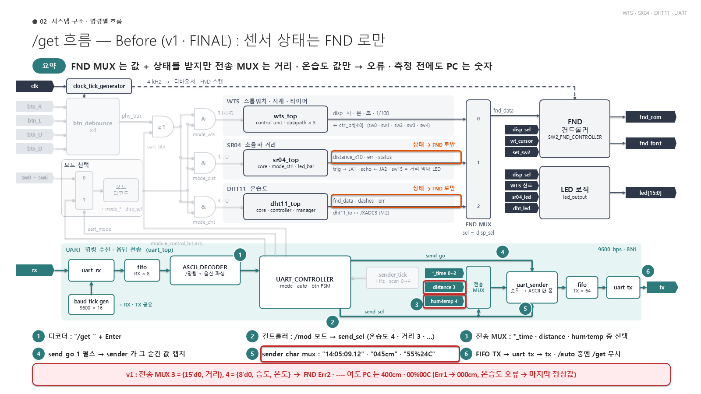
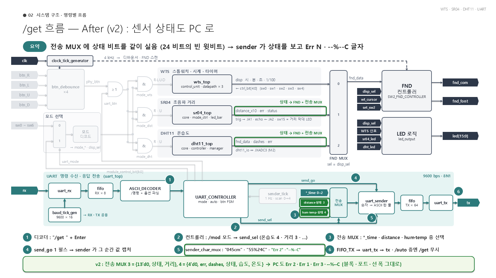

# v1 → v2 : 어디가 어떻게 바뀌나 (상세)

> 이 문서는 GitHub 에서 바로 보이도록 그림 2 장 (`img/`) 을 같이 둠. 코드 전체 설명은 `5_수정내용_B2B3.md`, 바뀐 줄만은 `merge_final_v1_vs_v2.diff`.

## 0. 한 줄 요약

- **블록 · 모듈 · 포트 · 선 폭은 하나도 안 바뀜.** 바뀌는 것은 ① Top 의 **전송 MUX 입력 2 개에 상태 비트가 더 실림** ② sender 의 **글자 고르기**가 그 비트를 봄 — 이 두 곳뿐.
- 그 결과 FND 가 `Err1~3` · `----` 일 때 **PC 도 `Err 1~3` · `--%--C`** 를 받는다 (v1 은 `400cm` · `000cm` · `00%00C` · 마지막 정상값 같은 숫자).

## 1. 블록도 Before / After (팀 블록도 6 장 "/get 흐름" 그대로 사용)

### Before (v1 · FINAL)



### After (v2)



| 표시 | 뜻 |
|---|---|
| 주황 상자 (Before) | 센서 출력 중 **상태** (`status` · `err` · `dashes`) — v1 은 FND MUX 로만 감 |
| 빨간 상자 (Before) | 전송 MUX 입력 `distance 3` · `hum·temp 4` 와 sender 예시 — 값만 실림 |
| 초록 상자 (After) | 같은 자리 — 상태가 FND MUX **와 전송 MUX 둘 다**로 감, sender 예시에 `Err 2` · `--%--C` 추가 |

## 2. 블록도에서 바뀌는 곳 · 안 바뀌는 곳

| 블록도 위치 | v1 | v2 | 왜 |
|---|---|---|---|
| sr04_top 오른쪽 라벨 `distance_x10 · err · status` | FND MUX 로만 | FND MUX **+ 전송 MUX** (상태 2 비트) | PC 도 오류를 알아야 함 |
| dht11_top 오른쪽 라벨 `fnd_data · dashes · err` | FND MUX 로만 | FND MUX **+ 전송 MUX** (err · dashes · 상태) | 〃 |
| 전송 MUX 입력 3 | `distance 3` | `distance·상태 3` | 거리 9 비트 + 상태 2 비트 |
| 전송 MUX 입력 4 | `hum·temp 4` | `hum·temp·상태 4` | 습도 · 온도 16 비트 + err · dashes · 상태 4 비트 |
| ⑤ sender_char_mux 예시 | `"14:05:09.12"` · `"045cm"` · `"55%24C"` | + `"Err 2"` · `"--%--C"` | 오류 · 측정 전 줄이 새로 생김 |

**안 바뀌는 것** : 모든 블록 (WTS · SR04 · DHT11 · FND 컨트롤러 · LED 로직 · uart_rx · FIFO · ASCII_DECODER · UART_CONTROLLER · sender_tick · uart_sender · uart_tx), 모든 포트, `send_sel` · `send_go` 선, 전송 데이터 선 폭 24 비트, FND MUX, 버튼 게이팅, 모드 선택, 핀 (XDC).

## 3. 새로 전송 MUX 로 가는 신호 (전부 이미 있던 선)

| Top 의 선 | 나오는 곳 (모듈 · 포트) | 비트 | 값의 뜻 | v1 에서 쓰던 곳 |
|---|---|---|---|---|
| `w_dist_status` | `sr04_top.o_status` | 2 | 00 정상 · 01 무응답 (Err1) · 10 범위 밖 (Err2) · 11 echo 고착 (Err3) | FND MUX (`w_fnd_data` 거리 칸) |
| `w_dht_status` | `dht11_top.o_status` | 2 | 00 정상 · 01 응답 없음 (Err1) · 10 중간 끊김 (Err2) · 11 체크섬 (Err3) | FND MUX (온습도 칸) |
| `w_dht_err` | `dht11_top.o_led[1]` | 1 | 1 = 마지막 측정 실패 | FND MUX · LED |
| `w_dht_dashes` | `dht11_top.o_dashes` | 1 | 1 = 정상값이 아직 없음 (첫 측정 전) 또는 오류 | FND MUX |

→ **새 선 · 새 포트 없음.** FND 가 쓰던 선을 전송 MUX 에도 이어 준 것.

## 4. 전송 MUX (`merge_final_top.v` 송신 `case (w_send_sel)`) — 24 비트가 어떻게 채워지나

| sel | 데이터 | v1 (24 비트) | v2 (24 비트) |
|---|---|---|---|
| 0 · 1 · 2 | 스톱워치 · 타이머 · 시계 | `{hour 5, min 6, sec 6, cs 7}` | 같음 |
| 3 | 거리 | `{15'd0, 거리 9}` | `{13'd0, 상태 2, 거리 9}` |
| 4 | 온습도 | `{8'd0, 습도 8, 온도 8}` | `{4'd0, err 1, dashes 1, 상태 2, 습도 8, 온도 8}` |
| 7 | ERROR | `24'd0` | 같음 |

비트 자리 (v2)

```
sel 3 거리   : 23 ............. 11 | 10  9 | 8 ............ 0
               0 0 0 0 0 0 0 0 0 0 0 0 0 | 상태  | 거리 cm (0~400)

sel 4 온습도 : 23 22 21 20 | 19  | 18     | 17 16 | 15 ...... 8 | 7 ...... 0
               0  0  0  0  | err | dashes | 상태  | 습도        | 온도
```

- 원래 비어 있던 (0 으로 채우던) 윗비트를 쓴 것이라 **선 폭 · UART_CONTROLLER · uart_sender 는 그대로** 24 비트를 받아 넘긴다.

## 5. sender_char_mux — 받은 24 비트로 글자 고르기

### 5-1. 새로 꺼내는 비트 이름

| 이름 | 자리 | 뜻 |
|---|---|---|
| `w_dst` | `i_data[10:9]` | 거리 상태 |
| `w_hst` | `i_data[17:16]` | 온습도 상태 (오류 번호) |
| `w_hdash` | `i_data[18]` | 온습도 정상값 없음 |
| `w_herr` | `i_data[19]` | 온습도 마지막 측정 실패 |

### 5-2. 거리 줄 (sel 3) — 글자 번호별

| `i_idx` | 0 | 1 | 2 | 3 | 4 | 5 | 6 |
|---|---|---|---|---|---|---|---|
| `w_dst` = 00 (정상, v1 과 같음) | 백 | 십 | 일 | `c` | `m` | CR | LF |
| `w_dst` ≠ 00 (v2 새로) | `E` | `r` | `r` | 공백 | `1`~`3` | CR | LF |

- 줄 길이 7 글자 (`o_last_idx = 6`) 그대로.

### 5-3. 온습도 줄 (sel 4) — 우선순위 `err` → `dashes` → 숫자 (FND `fnd_dht.v` 와 같은 순서)

| 상황 | 보내는 줄 | `o_last_idx` |
|---|---|---|
| `w_herr` = 1 (마지막 측정 실패) | `Err 1` ~ `Err 3` + CR LF | 6 (7 글자) |
| `w_herr` = 0, `w_hdash` = 1 (첫 측정 전) | `--%--C` + CR LF | 7 (8 글자) |
| 둘 다 0 (정상, v1 과 같음) | `45%25C` + CR LF | 7 (8 글자) |

- 오류 줄만 한 글자 짧다. `o_last_idx` 는 원래부터 형식마다 다르게 정하는 출력이고, uart_sender 는 send_go 순간 24 비트를 `c_data` 에 잡아 두고 그 값으로 줄 끝까지 보내므로 **줄 도중에 길이가 바뀌지 않는다.**

## 6. `/get` 한 번이 지나가는 길 — 바뀐 단계만 표시

| 단계 (블록도 번호) | 하는 일 | v2 에서 바뀜? |
|---|---|---|
| ① 디코더 | `"/get " + Enter` 해석 | 아니요 |
| ② 컨트롤러 | 지금 모드 → `send_sel`, `send_go` 1 펄스 | 아니요 |
| ③ 전송 MUX | `send_sel` 로 24 비트 고르기 | **예 — 거리 · 온습도에 상태 비트 포함** |
| ④ send_go → sender | 그 순간 24 비트 · sel 을 잡아 둠 | 아니요 (잡는 폭 같음) |
| ⑤ sender_char_mux | 글자 만들기 | **예 — 상태 보고 `Err N` · `--%--C`** |
| ⑥ FIFO_TX → uart_tx → tx | 한 글자씩 송신 | 아니요 |

`/auto` 도 ③ 부터 같은 길이라 `/auto dis` · `tem` · `all` 의 거리 · 온습도 줄도 똑같이 바뀐다.

## 7. PC 에서 보이는 차이

| 상황 | FND | v1 PC | v2 PC |
|---|---|---|---|
| 거리 범위 밖 (Err2) | `Err2` | `400cm` | `Err 2` |
| 거리 무응답 (Err1) | `Err1` | `000cm` | `Err 1` |
| 거리 echo 고착 (Err3) | `Err3` | 직전 거리 숫자 | `Err 3` |
| 온습도 첫 측정 전 | `----` | `00%00C` | `--%--C` |
| 온습도 오류 (Err1~3) | `Err1` ~ `Err3` | 마지막 정상값 (없으면 `00%00C`) | `Err 1` ~ `Err 3` |
| 정상 · 시간 · ERROR 줄 | 같음 | 같음 | 같음 |

## 8. 같이 바꿔야 할 문서 · TB 기대값 (v2 를 쓰기로 하면)

| 대상 | 위치 | v1 기대 | v2 기대 |
|---|---|---|---|
| README 응답 형식 표 | `FINAL/README.md` 433 ~ 434 줄 | `123cm` · `45%25C` 만 | 오류 `Err N` · 측정 전 `--%--C` 줄 추가 |
| 블록도 | `FINAL/block_diagram/merge_final_block_diagram.pptx` 1 ~ 9 장 | `distance 3` · `hum·temp 4` | `distance·상태 3` · `hum·temp·상태 4`, ⑤ 예시 추가 |
| TB 시나리오 I3 · H10 | `FINAL/sim_file/tb_scenario.md` | `400cm` | `Err 2` |
| TB 시나리오 I4 · H10 | 〃 | `000cm` | `Err 1` |
| TB 시나리오 J6 | 〃 | 오류 중 `55%24C` (마지막 정상값) | `Err 3` |
| TB 시나리오 J12 · H10 | 〃 | `00%00C` | `--%--C` |

## 9. 비용과 확인

| 항목 | v1 | v2 |
|---|---|---|
| LUT · FF | 1,473 · 737 | 1,489 (+16) · 737 |
| WNS · WHS (100 MHz) | +1.387 · +0.050 ns | +0.320 · +0.078 ns (위반 0) |
| 가장 빠듯한 경로 | 리셋 배선 → DHT11 레지스터 CLR | 리셋 배선 → SR04 카운터 CLR (로직 0 단, 배치 차이로 보임) |
| 통합 TB (20 시나리오 · 랜덤 명령 120) | 검사 560 · 불일치 0 | 검사 560 · 불일치 0 |
| 보드 (10/31) | `400cm` · `00%00C` 확인 | `Err 2` · `--%--C` · `Err 1` · `Err 3` 확인 |

- LUT +16 = 글자 고르는 MUX 에 오류 · 측정 전 경우가 더해진 만큼.
- 보드 참고 : ECHO 선만 뽑으면 JA2 핀이 떠서 1 로 읽혀 `Err3` (echo 고착) 이 뜰 수 있음 (핀에 풀다운 없음). 이때도 FND `Err3` = PC `Err 3` 로 같게 나오는 것을 확인.
