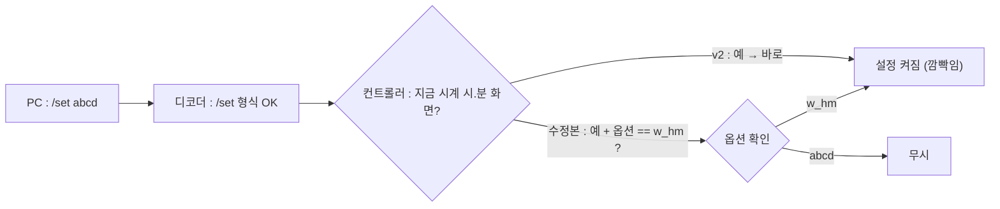
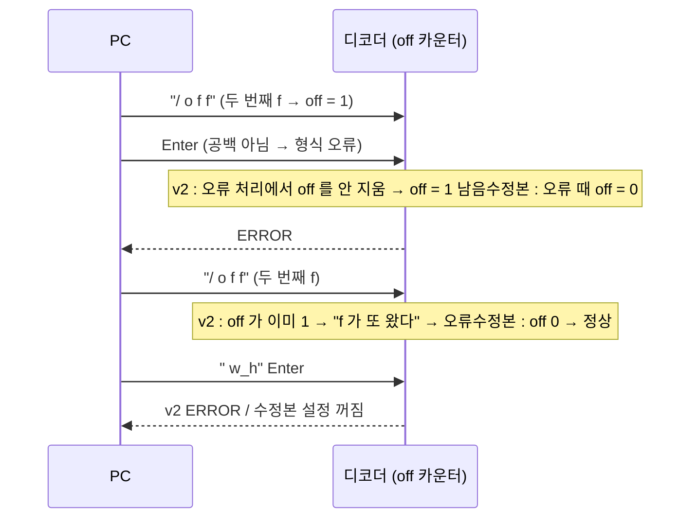
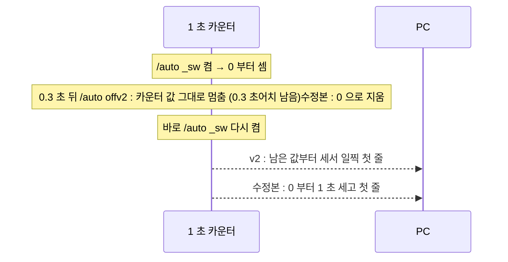
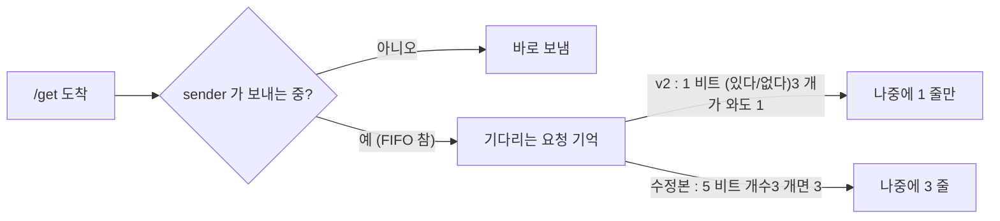
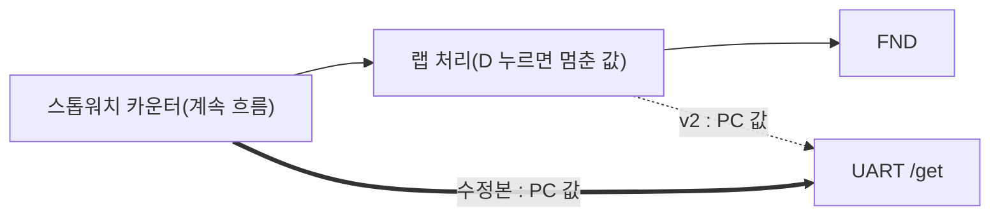
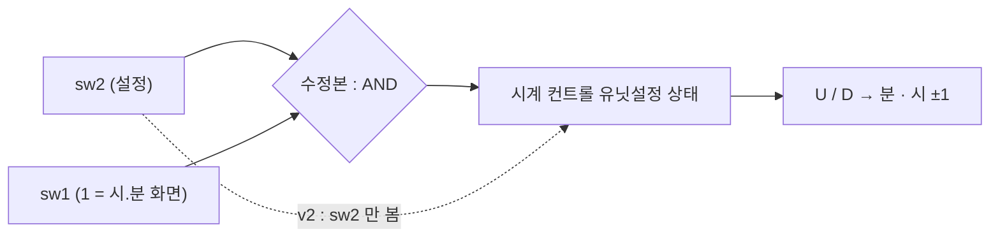
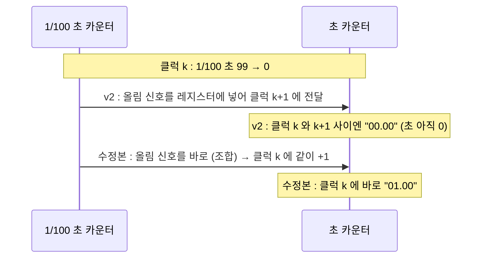
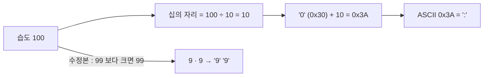

# 그룹 TB 가 찾은 결함 8 건과 고친 코드 (11/01)

팀 그룹 TB 12 개가 "README 스펙과 다르게 동작" (ISSUE) 으로 잡은 8 건을 FINAL v2 사본에서 고친 내역. 건마다 상황 → 그림 → 원인 → 바뀐 코드 → 보드 확인.

## 결과 한눈에

|  | v2 (지금 FINAL) | 수정본 |
|---|---|---|
| 그룹 TB 12 개 (검사 305) | PASS 297 · 결함 8 | PASS 305 · 결함 0 |
| 보윤 통합 TB | 560 검사 · 불일치 0 | 558 검사 · 불일치 0 |
| LUT / FF | 1,489 / 737 | 1,476 / 738 |
| 타이밍 여유 WNS | +0.320 ns | +1.442 ns |

- Vivado 2022.2 xsim · 100 MHz · 비트스트림까지 생성. 통합 TB 검사가 2 개 준 것은 H7 수정으로 /auto 첫 줄이 1 주기 뒤로 가 받은 줄이 1 줄 줄었기 때문 (틀린 줄 0).
- 바뀐 파일 5 개 : 01_UART_CONTROLLER.sv · 02_UART_ASCII_DECODER.sv · sender_char_mux.v · stopwatch_datapath.v · wts_top.v

## G3 — /set 뒤에 아무 4 글자나 와도 시계 설정이 켜짐

담당 : UART 컨트롤러 (안성)

| v2 (원본) | 수정본 |
|---|---|
| /mod w_hm → /set abcd → FND 자리가 깜빡임 (설정 켜짐). ERROR 도 없음. | /set abcd → 아무 변화 없음. /set w_hm 일 때만 깜빡임. |



원인 : /set 처리 조건에 "옵션 글자가 w_hm 인가" 비교가 빠져 있었음. 화면만 맞으면 옵션과 상관없이 켜짐.

바뀐 코드 : `UART/01_UART_CONTROLLER.sv 296 줄`

```diff
- else if(i_set&&((c_module_control_bit & 7'b1110_111) == 7'b0000_010)) n_module_control_bit = c_module_control_bit | 7'b0000_100;
+ else if(i_set && (i_con_ascii == "w_hm") && ((c_module_control_bit & 7'b1110_111) == 7'b0000_010)) n_module_control_bit = c_module_control_bit | 7'b0000_100;
```

보드 : btnC → /mod w_hm → /set abcd → 안 깜빡이면 OK → /set w_hm → 깜빡이면 OK

## G7 — /off 를 한 번 잘못 보내면, 그 뒤 제대로 보내도 계속 ERROR

담당 : 디코더 (안성)

| v2 (원본) | 수정본 |
|---|---|
| 설정 중 /off 만 보내고 Enter → ERROR (정상). 이어서 /off w_h → 또 ERROR , 설정 안 꺼짐. 리셋 전까지 계속. | /off → ERROR (정상), /off w_h → 설정 꺼짐 (깜빡임 멈춤). |



원인 : /off 의 두 번째 f 를 세는 카운터 off 를, 형식 오류 처리 블록이 다른 상태는 다 지우면서 이것만 안 지웠음.

바뀐 코드 : `UART/02_UART_ASCII_DECODER.sv 384 줄 (if(bad) 블록)`

```diff
   n_error = 1;
+ n_off = 0;   // 오류 때 /off 글자 세던 값도 지움
   n_data_reg = 0;
```

보드 : /mod w_hm → /set w_hm (깜빡임) → /off (ERROR) → /off w_h → 깜빡임이 멈추면 OK

## H7 — /auto 를 껐다 바로 켜면 첫 줄이 1 초보다 일찍 옴

담당 : UART 컨트롤러 (안성)

| v2 (원본) | 수정본 |
|---|---|
| 켜고 0.3 초 뒤 끄고 바로 다시 켬 → 첫 줄이 약 0.54 주기 만에 옴 (TB 측정). | 다시 켜면 첫 줄은 정확히 1 주기 (1 초) 뒤. |



원인 : 자동 전송 주기를 만드는 카운터 ( sender_tick_generator ) 가 끌 때 0 으로 안 돌아감.

바뀐 코드 : `UART/01_UART_CONTROLLER.sv 524 줄 (i_enable 이 0 일 때)`

```diff
   o_clk <= 0;
+ r_counter <= 0;   // 끌 때 카운터도 0
```

보드 : 1 초와 0.5 초 차이라 눈으로는 어려움 (시각 찍히는 터미널 · ILA 필요) → 시뮬로 확인

## H9 — /get 을 쉬지 않고 20 번 보내면 15 줄만 옴

담당 : UART 컨트롤러 (안성)

| v2 (원본) | 수정본 |
|---|---|
| 명령은 6.25 ms 마다 들어오는데 응답 한 줄은 13.5 ms → 보낼 게 쌓여 TX FIFO 가 참 → 기다리는 동안 온 /get 이 하나로 합쳐짐 → 15 줄. | 기다리는 /get 을 개수로 셈 → 20 번이면 20 줄. |



원인 : "아직 못 보낸 요청" 표시 c_send_pend 가 1 비트라 몇 개인지 못 셈.

바뀐 코드 : `UART/01_UART_CONTROLLER.sv 72 · 353 ~ 357 · 370 줄`

```diff
- reg c_send_pend, n_send_pend;
+ reg [4:0] c_send_pend, n_send_pend;   // get 은 개수로 셈
  
- n_send_pend = c_send_pend | (i_handshake && i_get);
+ n_send_pend = c_send_pend + ((i_handshake && i_get && (c_send_pend != 5'd31)) ? 5'd1 : 5'd0);
- if(n_send_pend && !w_sender_busy && !n_err_pend)begin
+ if((n_send_pend != 0) && !w_sender_busy && !n_err_pend)begin
       n_sender_go  = 1;
-     n_send_pend  = 0;
+     n_send_pend  = n_send_pend - 5'd1;   // 하나 보냈으면 하나만 뺌
  
- n_send_pend = c_send_pend | w_clk_5hz;
+ n_send_pend = {4'd0, (c_send_pend != 0) | w_clk_5hz};   // auto 는 전처럼 1 비트
```

보드 : ComPortMaster Send Multiple 20 · Interval 최소로 /get → Recv 20 줄이면 OK (그 간격으로 보내지는지는 미확인)

## D7 — 스톱워치 랩을 띄운 채 /get 하면 흐르는 시간 대신 랩 값이 감

담당 : 스톱워치 (WTS)

| v2 (원본) | 수정본 |
|---|---|
| 랩 07.41 에 멈춘 화면에서 /get → PC ← 00:00:07.41 (시연 영상 C 에 나온 장면). | FND 는 그대로 랩 07.41, PC 로는 뒤에서 흐르는 값 (예 00:00:10.xx). |



원인 : PC 로 보내는 스톱워치 값이 랩 처리 뒤 (화면에 보이는 값) 에서 나옴. 스펙은 "진행 값".

바뀐 코드 : `WTS/stopwatch_datapath.v · WTS/wts_top.v`

```diff
+ output [23:0] o_sw_run_time,   // 랩과 상관없이 지금 흐르는 값 (UART 용)
+ assign o_sw_run_time = {w_cnt_hour, w_cnt_min, w_cnt_sec, w_cnt_msec};
  
# wts_top.v
+ wire [23:0] w_sw_run_time;
+     .o_sw_run_time(w_sw_run_time)
- assign o_sw_time = {w_sw_hour, w_sw_min, w_sw_sec, w_sw_msec};
+ assign o_sw_time = w_sw_run_time;   // 랩 표시 중에도 PC 로는 흐르는 값
```

보드 : /mod s_ms → /btn R → 몇 초 뒤 /btn D (LD7) → 2 ~ 3 초 기다림 → /get → PC 값이 FND 랩 값보다 2 ~ 3 초 크면 OK. 이걸 고치면 시연 영상 C 의 이 장면만 다시 찍기

## E6 — 시계 초 화면에서 설정 스위치 + U → 화면에 안 보이는 분이 바뀜

담당 : 시계 (WTS)

| v2 (원본) | 수정본 |
|---|---|
| sw1 0 (초.1/100 화면) · sw2 1 · btnU → FND 변화 없어 보이는데 분이 +1. sw1 1 로 보면 분이 늘어 있음. | 시계 설정은 시.분 화면 (sw1 1) 일 때만. 초 화면에서는 U 를 눌러도 분 그대로. |



원인 : 시계 컨트롤 유닛의 설정 조건에 "지금 시.분 화면인가" 가 없었음.

바뀐 코드 : `WTS/wts_top.v 167 줄 (U_WATCH_CONTROL_UNIT)`

```diff
-     .i_set_sw2  (i_set_sw2),
+     .i_set_sw2  (i_set_sw2 & i_display_mode_sw1),   // 시.분 화면일 때만 설정
```

보드 : 스위치 모두 0 → sw1 1 로 분 기억 → sw1 0 → sw2 1 → btnU → sw1 1 → 분 그대로면 OK (시.분 화면에선 U 로 +1 되는 것도 확인)

## L6 — 초가 넘어가는 바로 그 클럭에 /get 이 걸리면 1 초 늦은 값

담당 : 스톱워치 카운터 (WTS)

| v2 (원본) | 수정본 |
|---|---|
| 00:00:00.99 → 01.00 으로 넘어가는 순간 값을 잡으면 00:00:00.00 (1/100 초는 0 이 됐는데 초는 아직 안 올라감). | 1/100 초와 초가 같은 클럭에 바뀜 → 00.99 아니면 01.00, 틀린 값 없음. |



원인 : 자리 올림 신호 o_tick 가 레지스터라 한 클럭 늦게 윗자리로 감. 그 틈에 값을 잡으면 어긋남 (1 초에 10 ns 동안만).

바뀐 코드 : `WTS/stopwatch_datapath.v (stopwatch_tick_counter)`

```diff
- output reg             o_tick
+ output                 o_tick   // 조합 : 마지막 값에서 tick 오는 그 클럭에 바로
+ assign o_tick = i_tick & ((i_down) ? (counter_reg == 0) : (counter_reg == TIMES - 1));
-     o_tick <= 1'b1;   (always 안의 o_tick 대입 6 줄 삭제)
```

보드 : 10 ns 순간을 손으로 맞출 수 없음 → 시뮬로 확인

## J14 — 습도가 100 이면 PC 로 :0%24C 가 감

담당 : sender 글자 MUX (보윤)

| v2 (원본) | 수정본 |
|---|---|
| 습도 100 · 온도 24 → FND 99.24 인데 PC ← :0%24C | PC ← 99%24C (FND 와 같은 규칙) |



원인 : 글자 MUX 가 습도 · 온도를 2 자리로 가정. FND 쪽 ( dht11_manager.v ) 은 이미 99 로 자르고 있었음. DHT11 습도 범위가 20 ~ 90 % 라 실제 센서로는 안 나오는 값.

바뀐 코드 : `UART/sender_char_mux.v 22 ~ 23 줄`

```diff
- wire [7:0] w_hum  = i_data[15:8];
- wire [7:0] w_temp = i_data[7:0];
+ wire [7:0] w_hum  = (i_data[15:8] > 8'd99) ? 8'd99 : i_data[15:8];
+ wire [7:0] w_temp = (i_data[7:0]  > 8'd99) ? 8'd99 : i_data[7:0];
```

보드 : 실제 DHT11 로는 100 이 안 나와 확인 불가 → 시뮬 (J14-2 got "99%24C")

## 보드 Before / After 결과

| ID | 어떻게 | Before | After |
|---|---|---|---|
| G3 | /mod w_hm → /set abcd | 깜빡임 | 안 깜빡임 |
| G7 | /set w_hm → /off → /off w_h | 또 ERROR | 깜빡임 멈춤 |
| E6 | 초 화면 · sw2 1 · btnU | 분 +1 | 분 그대로 |
| D7 | 랩 (D) 뒤 /get | 랩 값 (영상 C) | 랩보다 큰 값 |
| H7 | 로거 uart_timing.py h7 | 1000 ms 보다 짧음 | 약 1000 ms |
| H9 | 로거 uart_timing.py h9 | 20 줄보다 적음 | 20 줄 |
| L6 | ILA 트리거 tick=1 & msec=99 | 초가 1 샘플 늦게 | 같은 샘플 |

- 실측 : H7 730 → 1,048 ms · H9 15 → 20 줄 · L6 ILA 513 칸 sec 5 → 6 · E6 12.01 → 12.00 (영상 · 캡처 : `board_result/`)
