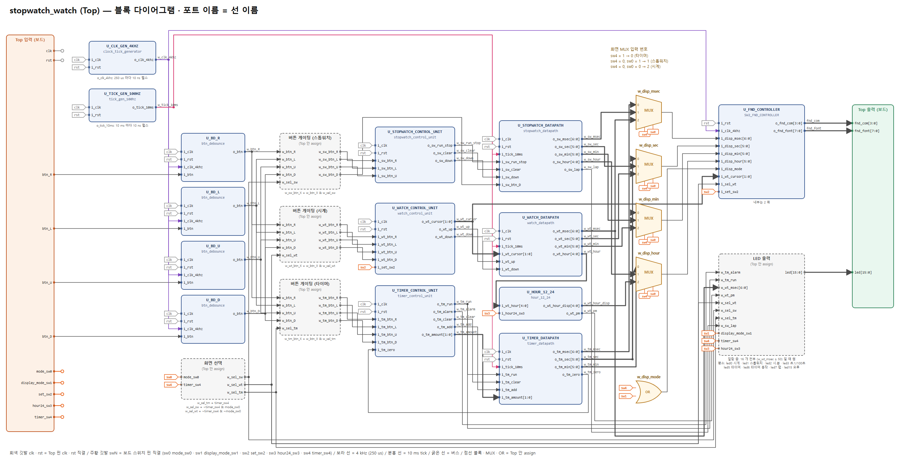
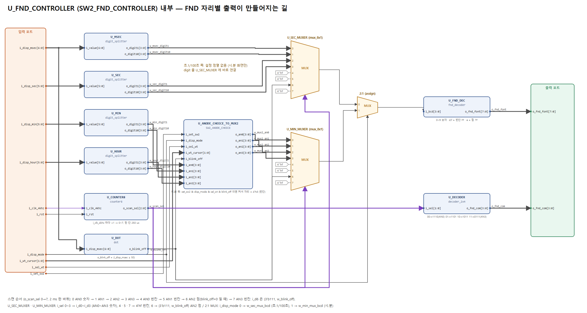

# BEST Stop_watch project (Basys-3, Verilog)

## 팀원

정보윤 · 이종혁 · 정안성 · 견다혜

## 프로젝트 목록

| # | 주제 | 상태 | 설계 | 검증 |
|---|---|---|---|---|
| 1 | [STOPWATCH 기능 구현](#1-stopwatch-기능-구현) — 스톱워치 · 시계 · 타이머 | 설계 · 보드 확인 완료, 검증 진행 | `boyun/merged_v4/` | `verification_v2/` |
| 2 | [UART](#2-uart-예정) | 예정 | — | — |

---

## 1. STOPWATCH 기능 구현

Basys-3 (xc7a35t, 100 MHz) 하나로 **스톱워치 · 시계 · 타이머** 세 기능을 스위치로 골라 쓰는 설계. 시뮬레이션은 주파수를 줄이지 않고 실제 시간(100 MHz) 기준으로 확인한다.

### 1-1. 블록 다이어그램

FND 컨트롤러 내부 (자리별 출력이 만들어지는 길):

- PDF: [`verification_v2/block_diagram.pdf`](verification_v2/block_diagram.pdf) · 포트 연결표: [`verification_v2/source_file/PORT_MAP.md`](verification_v2/source_file/PORT_MAP.md)
- 선 이름 = 포트 이름, 블록의 선 개수 = 포트 개수. `verification_v2/diagram/gen_diagram.py` 가 Verilog 와 대조해서 다르면 그림을 만들지 않는다
- 흐름: 버튼 → 디바운서 (4 kHz 샘플) → 화면 선택 · 버튼 게이팅 → 컨트롤 유닛 (FSM) → 데이터패스 (공용 10 ms tick) → 화면 MUX → FND 컨트롤러 → FND · LED

### 1-2. 조작 (보드)

| 스위치 | 0 | 1 |
|---|---|---|
| sw0 `mode_sw0` | 시계 | 스톱워치 |
| sw1 `display_mode_sw1` | 초.1/100초 | 시.분 |
| sw2 `set_sw2` | 보통 | 시계 시간 설정 |
| sw3 `hour24_sw3` | 12 시간 표시 (기본) | 24 시간 표시 |
| sw4 `timer_sw4` | — | 타이머 화면 (sw0 보다 우선) |

btnC = 리셋 (시계는 12:00:00.00, 오후 12 시부터)

| 버튼 | 스톱워치 | 시계 (sw2 = 1 설정 중) | 타이머 |
|---|---|---|---|
| R | 시작 ↔ 정지 | 커서 → | +1 분 |
| L | 정지 중 0 으로 지우기 + 랩 해제 | 커서 ← | 시작 / 동작 중 취소 |
| U | 정지 중 업 ↔ 다운 | 커서 자리 + | +10 초 |
| D | 랩 (화면 고정 ↔ 실시간) | 커서 자리 − | +10 분 |

- 스톱워치: 00:00:00.00 ~ 23:59:59.99 순환. 다른 화면으로 가도 계속 돈다
- 시계: 커서 = 분 일 · 분 십 · 시, 그 자리만 돌고 윗자리로 올림 없음. 설정 중 커서 자리 0.5 초 점멸
- 타이머: 최대 59:59, 화면은 항상 "분.초". 0 이 되면 LED 16 개 0.5 초 점멸 (아무 버튼 = 끄기)

| LED | 의미 |
|---|---|
| led0 · led1 · led5 | 시계 · 스톱워치 · 타이머 화면 |
| led2 · led3 | 시.분 · 초.1/100초 표시 |
| led6 · led7 | 타이머 동작 중 · 스톱워치 랩 |
| led15 | 오후 (시계 화면 · 12 시간 표시) |

### 1-3. 설계 파일

| 위치 | 내용 |
|---|---|
| `boyun/merged_v4/` | **보드에 올린 최종 설계** (`src/`, `bit/stopwatch_watch_merged_v4.bit`, `build/build.tcl`). Vivado 2022.2: LUT 346 · FF 186 · WNS +3.682 ns. 변경 이력은 그 폴더 README |
| `verification_v2/source_file/` | 위 설계의 **포트 이름 통일판** (동작 동일). 입력 `i_` · 출력 `o_` · 선 `w_`, 기능 접두어 `sw_` `wt_` `tm_`, 스위치 `*_swN`, 버튼 `*_btn_R/L/U/D` |
| `ahnsung/`, `jonghyuk/`, `boyun/merged_v3/`, `Stop_watch_lib/` | 팀원별 모듈 · 이전 통합판 |

| 모듈 | 하는 일 |
|---|---|
| `clock_tick_generator` | 4 kHz 펄스 (250 us) — 디바운서 샘플, FND 스캔 |
| `tick_gen_100hz` | 10 ms tick — 스톱워치 · 시계 · 타이머 공용 |
| `btn_debounce` × 4 | 8 샘플 (약 2 ms) 연속 눌림 → 1 클럭 펄스 |
| `stopwatch_control_unit` · `stopwatch_datapath` (`lap_controller`) | 스톱워치 FSM (STOP / RUN) · 업/다운 카운터 · 랩 |
| `watch_control_unit` · `watch_datapath` · `hour_12_24` | 시계 설정 FSM (NORMAL / SET_x) · 시각 카운터 · 12/24 변환 |
| `timer_control_unit` · `timer_datapath` | 타이머 FSM (SET / RUN / ALARM) · 남은 시간 · 59:59 상한 |
| `SW2_FND_CONTROLLER` | 10 진 분리 · 설정 점멸 · 자리 스캔 · 7 세그먼트 |

처음 역할 분담 (각자 모듈 설계)

| 담당 | 모듈 / 기능 |
|---|---|
| 이종혁 | SW3 입력 시 12시 → 24시 전환 기능을 STW-CONT UNIT에 추가 (랩 타임) |
| 정보윤 | 워치 스테이트 머신 |
| 정안성 | SW2 assert 시 FND 점멸 기능 |
| 견다혜 | 학교 시험 공부 |

### 1-4. 검증 (`verification_v2/`)

- Vivado 에서 Top (`stopwatch_watch`) 을 인스턴스한 TB 로 실행. 100 MHz 그대로, 경계값은 경계 바로 앞 값을 넣고 (프리로드) 실제 tick 으로 넘김
- 폴더마다 **안내서 README** — 블록 다이어그램 입력 → 출력 순서로 "어느 블록의 어느 포트를 파형에 넣을지", 시간 단위 (4 kHz · 10 ms), 마지막에 FND 자리별 출력으로 판정. TB 별 색칠 그림 포함

| 폴더 | TB | 확인하는 것 |
|---|---|---|
| [`tb/top`](verification_v2/tb/top/README.md) | 2 | 디바운서 (누름 시간 · 바운스), FND 스캔 · 자리별 출력 |
| [`tb/01_stopwatch`](verification_v2/tb/01_stopwatch/README.md) | 3 | 시작 · 정지 · 지우기, 올림 · 빌림 경계, 랩 |
| [`tb/02_timer`](verification_v2/tb/02_timer/README.md) | 3 | 더하기 · 59:59 상한, 실제 10 초 카운트다운 · 알람, 취소 · 백그라운드 |
| [`tb/03_watch`](verification_v2/tb/03_watch/README.md) | 3 | 설정 UI, 1 초 정확도 · 자정 올림, 12/24 표시 · 점멸 · LED |
| `tb/defect_1~4` | 4 | 결함 주입: FND com 지연 (고스팅) · 스위치 채터링 · 누름 시점 오차 · 리셋 글리치 |

자세한 것: [`verification_v2/README.md`](verification_v2/README.md)

### 1-5. 진행 방식

1. 시뮬레이션 검증 — tick 주파수를 올리지 않고 실제 시간 기준으로 기능 확인
2. 보드 동작 확인 — 안 되면 보드 교체 · 트러블슈팅 토의 · 될 때까지 시뮬레이션 확인
3. Top 검증 — 시나리오(TB) 별 역할 분담 후 각자 검증 (스톱워치 이종혁 · 타이머 정보윤 · 시계 정안성)
4. 발표 자료 — 파형 캡처에 무엇을 보여주려 했는지 박스 · 화살표로 표시

---

## 2. UART (예정)

_다음 프로젝트. 내용 추가 예정._
