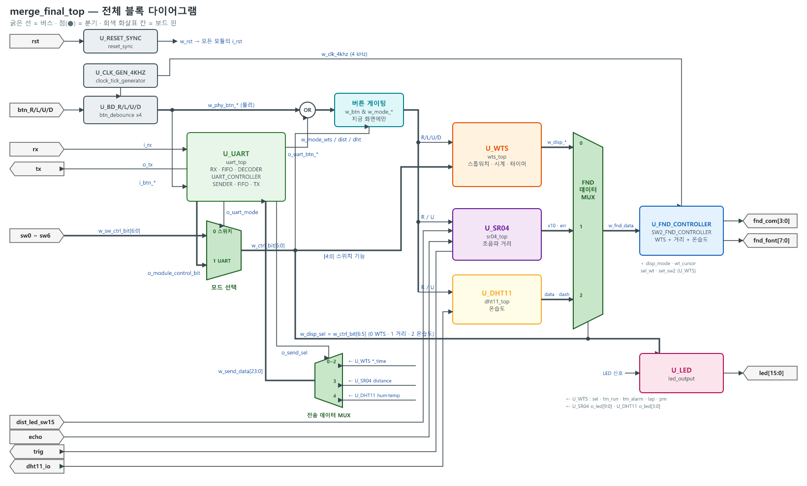

# BEST Stop_watch project (Basys-3, Verilog)

## 팀원

정보윤 · 이종혁 · 정안성 · 견다혜

## 프로젝트 목록

| # | 주제 | 상태 | 폴더 |
|---|---|---|---|
| 1 | [MINI — 스톱워치 · 시계 · 타이머 (WTS)](#1-mini--스톱워치--시계--타이머-wts) | 설계 · 보드 확인 · 검증 · 발표 완료 | [`PROJECT_MINI_WTS/`](PROJECT_MINI_WTS/README.md) |
| 2 | [FINAL — WTS + SR04 + DHT11 + UART 통합](#2-final--wts--sr04--dht11--uart-통합) | 설계 · 보드 확인 · 검증 · 발표 완료 | [`PROJECT_FINAL/`](PROJECT_FINAL/README.md) |

## 저장소 구조

```
BEST_Stop_watch_project/
├── PROJECT_MINI_WTS/   1 차 미니 프로젝트 (WTS) — 설계 · 블록도 · FSM · TB · 발표 자료
├── PROJECT_FINAL/      최종 프로젝트 (WTS + SR04 + DHT11 + UART) — 설계 · 블록도 · TB · 비트스트림 · 발표 PDF
└── Member/             팀원별 작업 폴더 (모듈 개발 · 단독 TB · 수정 이력 · 발표 파트)
    └── ahnsung/  boyun/  dahye/  jonghyuk/
```

---

## 1. MINI — 스톱워치 · 시계 · 타이머 (WTS)

Basys-3 (xc7a35t, 100 MHz) 하나로 **스톱워치 · 시계 · 타이머** 세 기능을 스위치로 골라 쓰는 설계. 시뮬레이션은 주파수를 줄이지 않고 실제 시간 (100 MHz) 기준으로 확인한다.

### 1-1. 블록 다이어그램


FND 컨트롤러 내부 (자리별 출력이 만들어지는 길):


- PDF : [`block_diagram.pdf`](PROJECT_MINI_WTS/block_diagram.pdf) · FSM 상태도 · ASM : [`control_unit_fsm.pdf`](PROJECT_MINI_WTS/control_unit_fsm.pdf) · 포트 연결표 : [`source_file/PORT_MAP.md`](PROJECT_MINI_WTS/source_file/PORT_MAP.md)
- 선 이름 = 포트 이름, 블록의 선 개수 = 포트 개수. `diagram/gen_diagram.py` 가 Verilog 와 대조해서 다르면 그림을 만들지 않는다
- 흐름 : 버튼 → 디바운서 (4 kHz 샘플) → 화면 선택 · 버튼 게이팅 → 컨트롤 유닛 (FSM) → 데이터패스 (10 ms tick) → 화면 MUX → FND 컨트롤러 → FND · LED

### 1-2. 조작 (보드)

| 스위치 | 0 | 1 |
|---|---|---|
| sw0 `mode_sw0` | 시계 | 스톱워치 |
| sw1 `display_mode_sw1` | 초.1/100초 | 시.분 |
| sw2 `set_sw2` | 보통 | 시계 시간 설정 |
| sw3 `hour24_sw3` | 12 시간 표시 (기본) | 24 시간 표시 |
| sw4 `timer_sw4` | — | 타이머 화면 (sw0 보다 우선) |

btnC = 리셋 (시계는 12:00:00.00, 오후 12 시부터)

| 버튼 | 스톱워치 | 시계 (sw2 = 1 설정 중) | 타이머 |
|---|---|---|---|
| R | 시작 ↔ 정지 | 커서 → | +1 분 |
| L | 정지 중 0 으로 지우기 + 랩 해제 | 커서 ← | 시작 / 동작 중 취소 |
| U | 정지 중 업 ↔ 다운 | 커서 자리 + | +10 초 |
| D | 랩 (화면 고정 ↔ 실시간) | 커서 자리 − | +10 분 |

- 스톱워치 : 00:00:00.00 ~ 23:59:59.99 순환. 다른 화면으로 가도 계속 돈다
- 시계 : 커서 = 분 일 · 분 십 · 시, 그 자리만 돌고 윗자리로 올림 없음. 설정 중 커서 자리 0.5 초 점멸
- 타이머 : 최대 59:59, 화면은 항상 "분.초". 0 이 되면 LED 16 개 0.5 초 점멸 (아무 버튼 = 끄기)

| LED | 의미 |
|---|---|
| led0 · led1 · led5 | 시계 · 스톱워치 · 타이머 화면 |
| led2 · led3 | 시.분 · 초.1/100초 표시 |
| led6 · led7 | 타이머 동작 중 · 스톱워치 랩 |
| led15 | 오후 (시계 화면 · 12 시간 표시) |

### 1-3. 폴더 (`PROJECT_MINI_WTS/`)

| 위치 | 내용 |
|---|---|
| `source_file/` | **포트 이름 통일판 설계** (입력 `i_` · 출력 `o_` · 선 `w_`, 기능 접두어 `sw_` `wt_` `tm_`, 스위치 `*_swN`). 10/17 스톱워치 · 타이머 100 Hz tick 분리 (`tick_gen_100hz_run.v`) 반영 |
| `source_file_demo/` | 시연 영상용 — 리셋값만 경계 앞 (시계 23:59:50, 스톱워치 23:59:55). TB 는 돌리지 않음 |
| `tb/` | 기능 TB 11 개 + 결함 주입 TB 4 개, 폴더마다 안내서 README |
| `diagram/` | 블록도 · FSM · TB 안내 그림 · 시연 시나리오 생성 스크립트 |
| `ppt_make/` | 발표 자료 (`stopwatch_Miniproject_Team4.pptx` 등) · 생성 스크립트 · `PPT_GUIDE.md` |
| `demo_scenario.pdf` · `AIcampus_feedback.pdf` | 시연 시나리오 · 발표 피드백 |

보드에 올린 원본 설계는 `Member/boyun/merged_v4/` (Vivado 2022.2 : LUT 346 · FF 186 · WNS +3.682 ns, 변경 이력은 그 폴더 README). 자세한 것 : [`PROJECT_MINI_WTS/README.md`](PROJECT_MINI_WTS/README.md)

| 모듈 | 하는 일 |
|---|---|
| `clock_tick_generator` | 4 kHz 펄스 (250 us) — 디바운서 샘플, FND 스캔 |
| `tick_gen_100hz` / `tick_gen_100hz_run` | 10 ms tick — 시계 (항상) / 스톱워치 · 타이머 (run · clear, 시작 뒤 정확히 10 ms) |
| `btn_debounce` × 4 | 8 샘플 (약 2 ms) 연속 눌림 → 1 클럭 펄스 |
| `stopwatch_control_unit` · `stopwatch_datapath` (`lap_controller`) | 스톱워치 FSM (STOP / RUN) · 업/다운 카운터 · 랩 |
| `watch_control_unit` · `watch_datapath` · `hour_12_24` | 시계 설정 FSM (NORMAL / SET_x) · 시각 카운터 · 12/24 변환 |
| `timer_control_unit` · `timer_datapath` | 타이머 FSM (SET / RUN / ALARM) · 남은 시간 · 59:59 상한 |
| `SW2_FND_CONTROLLER` | 10 진 분리 · 설정 점멸 · 자리 스캔 · 7 세그먼트 |

### 1-4. 검증 (`PROJECT_MINI_WTS/tb/`)

- Vivado 에서 Top (`stopwatch_watch`) 을 인스턴스한 TB 로 실행. 100 MHz 그대로, 경계값은 경계 바로 앞 값을 넣고 (프리로드) 실제 tick 으로 넘김
- 폴더마다 **안내서 README** — 블록 다이어그램 입력 → 출력 순서로 "어느 블록의 어느 포트를 파형에 넣을지", 마지막에 FND 자리별 출력으로 판정

| 폴더 | TB | 확인하는 것 |
|---|---|---|
| [`tb/top`](PROJECT_MINI_WTS/tb/top/README.md) | 2 | 디바운서 (누름 시간 · 바운스), FND 스캔 · 자리별 출력 |
| [`tb/01_stopwatch`](PROJECT_MINI_WTS/tb/01_stopwatch/README.md) | 3 | 시작 · 정지 · 지우기, 올림 · 빌림 경계, 랩 |
| [`tb/02_timer`](PROJECT_MINI_WTS/tb/02_timer/README.md) | 3 | 더하기 · 59:59 상한, 실제 10 초 카운트다운 · 알람, 취소 · 백그라운드 |
| [`tb/03_watch`](PROJECT_MINI_WTS/tb/03_watch/README.md) | 3 | 설정 UI, 1 초 정확도 · 자정 올림, 12/24 표시 · 점멸 · LED |
| `tb/defect_1~4` | 4 | 결함 주입 : FND com 지연 (고스팅) · 스위치 채터링 · 누름 시점 오차 · 리셋 글리치 |

처음 역할 분담 (각자 모듈 설계)

| 담당 | 모듈 / 기능 |
|---|---|
| 이종혁 | SW3 입력 시 12시 → 24시 전환 기능을 STW-CONT UNIT에 추가 (랩 타임) |
| 정보윤 | 워치 스테이트 머신 |
| 정안성 | SW2 assert 시 FND 점멸 기능 |
| 견다혜 | 학교 시험 공부 |

---

## 2. FINAL — WTS + SR04 + DHT11 + UART 통합

Basys-3 한 보드에서 **스톱워치 · 시계 · 타이머 (WTS)**, **초음파 거리 (SR04)**, **온습도 (DHT11)** 를 돌리고,
PC 터미널에서 **UART 명령 (9600 8N1) 으로 모드 변경 · 버튼 입력 · 데이터 요청 / 1 Hz 자동 전송**을 하는 통합 설계.

### 2-1. 블록 다이어그램



- 하위 블록도 : [UART](PROJECT_FINAL/docs/02_uart.png) · [WTS](PROJECT_FINAL/docs/03_wts.png) · [SR04](PROJECT_FINAL/docs/04_sr04.png) · [DHT11](PROJECT_FINAL/docs/05_dht11.png) · [FND](PROJECT_FINAL/docs/06_fnd.png) · [LED](PROJECT_FINAL/docs/07_led.png) · [보드 핀](PROJECT_FINAL/docs/basys3_pinmap.png)
- 발표용 블록도 : [`block_diagram/merge_final_block_diagram.pdf`](PROJECT_FINAL/block_diagram/merge_final_block_diagram.pdf)
- 흐름 : 버튼 4 개 → 공용 디바운서 → (물리 | UART `/btn`) → **지금 화면의 모듈에만** 전달 / 화면 선택 = `w_ctrl_bit` (`/mod` 받기 전엔 스위치, 받은 뒤엔 UART) / `/get` · `/auto` → 컨트롤러가 데이터 선택 → sender 가 ASCII 로 전송

### 2-2. 조작 요약

| 입력 | 내용 |
|---|---|
| sw0 ~ sw4 | MINI 와 같음 (WTS) |
| sw5 `dist_sw5` · sw6 `dht_sw6` | 거리 화면 · 온습도 화면 (sw6 > sw5 > WTS) |
| sw15 `dist_led_sw15` | 거리 막대 LED ON / OFF |
| 버튼 (거리 · 온습도 화면) | R = 1 회 측정, U = 자동 측정 켜기 / 끄기 |
| UART `/mod` | `w_hm` `w_ms` `s_hm` `s_ms` `t_hm` `t_ms` `dist` `temp` — 첫 정상 `/mod` 뒤로는 스위치 대신 UART 가 화면을 정함 (리셋 전까지) |
| UART `/btn R·L·U·D` | 물리 버튼과 같은 동작 |
| UART `/get ⏎` · `/auto all·_sw·_tm·_wh·dis·tem·off` | 1 회 전송 · 1 Hz 자동 전송 |
| UART `/set w_hm` · `/off w_h` · `/set 24h⏎` · `/set 12h⏎` | 시계 설정 켜기 / 끄기 · 12/24 시간 |
| 응답 예 | `00:01:23.45` · `045cm` · `55%24C` · 센서 오류 `Err 1~3` · 측정 전 `--%--C` · 형식 오류 `ERROR` |

센서 핀 : SR04 trig = JA1 (J1), echo = JA2 (L2) / DHT11 data = JXADC3 (M2, PULLUP). 명령 형식 · FND 오류 표시 `Err1` ~ `Err3` · LED 표는 [`PROJECT_FINAL/README.md`](PROJECT_FINAL/README.md) 8 ~ 10 장.

### 2-3. 폴더 (`PROJECT_FINAL/`)

| 위치 | 내용 |
|---|---|
| `source_file/merge_final/` | 최종 Top `merge_final_top.v` · `.xdc` + 하위 `IP/` `WTS/` `SR04/` `DHT11/` `UART/` `FND_LED/` (`merge_final_v2` 와 같음) |
| `source_file/merge_final_v2/` · [`v2_modified.md`](PROJECT_FINAL/source_file/v2_modified.md) | v1 → v2 : 센서 오류 · 측정 전에 PC 도 `Err N` · `--%--C` 받도록 전송 MUX 에 상태 비트 추가 |
| `source_file/merge_final_v3/` · [`v3_modified.md`](PROJECT_FINAL/source_file/v3_modified.md) | 그룹 TB 가 찾은 ISSUE 8 건 수정본 (UART 컨트롤러 · 디코더 · sender · 스톱워치) |
| `sim_file/` | 공통 하네스 + 그룹 TB 12 개 (A ~ L) · 실제 시간 TB (`top_tb/`) · 발표용 TB (`tb_P*_present.sv`) · 버그 주입 (`mutants/`) · wcfg · 실행 bat. 안내 : [`sim_file/README.md`](PROJECT_FINAL/sim_file/README.md) |
| `bitstream_file/FINAL.bit` | 보드용 비트스트림 |
| `block_diagram/` · `docs/` | 블록도 (PDF · PPTX · PNG · SVG) 와 생성 스크립트 |
| `Team4_Final.pdf` | 최종 발표 자료 |

### 2-4. 검증 결과 ([`TB_RESULT_SUMMARY_1031.md`](PROJECT_FINAL/sim_file/TB_RESULT_SUMMARY_1031.md))

Vivado 2022.2 xsim, 공통 하네스 (버튼 · 스위치 · PC UART · SR04 · DHT11 핀 모델 + 스코어보드).

| 구분 | 결과 |
|---|---|
| 그룹 TB 12 개 (A 리셋 ~ L 통합, 시나리오 92) | 검사 **305 / 305 PASS**, FAIL 0, ISSUE 8 (스펙과 다른 동작) |
| 통합 TB (정보윤) | 검사 292 PASS (그룹 TB 와 중복 제외) |
| 실제 시간 TB (`top_tb/`, 시간 단축 없음) | 9 개 중 7 개 실행 — 검사 13 PASS, FAIL 2 는 TB 대기 코드 문제 |
| ISSUE 8 건 → `merge_final_v3` | D7 · E6 · G3 · G7 · H7 · H9 · J14 · L6 수정 → 그룹 TB 305 PASS · ISSUE 0, LUT 1,476 · FF 738 · WNS +1.442 ns |
| 버그 주입 (`sim_file/mutants/`, M1 ~ M10) | 설계에 일부러 버그를 넣고 같은 TB 를 돌려 FAIL 로 잡히는지 확인 (`list.txt` · `*.log`) |

---

## 3. 팀원 폴더 (`Member/`)

| 폴더 | 주요 내용 |
|---|---|
| `Member/ahnsung/` | UART 디코더 (`01_UART_Decoder/`), 발표 PPT 생성 스크립트 · 파형 캡처 (`FINAL/ppt_make/`), 발표용 시뮬 (`P4~P6.sim/`) |
| `Member/boyun/` | MINI 통합판 (`merged_v3/` · `merged_v4/`), UART · sender 개발 단계별 폴더, SR04 컨트롤러, 수정 이력 (`fix_*_1031` · `fix_*_1101`), 발표 파트 · 시연 영상 (`ppt_1101/` · `videos_1101/`) |
| `Member/dahye/` | UART · BRAM · FIFO · UART+FIFO, SR04 (`stopwatchproject_SR04*/`) |
| `Member/jonghyuk/` | 스톱워치 초기 모듈, DHT11 (`DHT11/` · `DHT11_TOP/`) |
