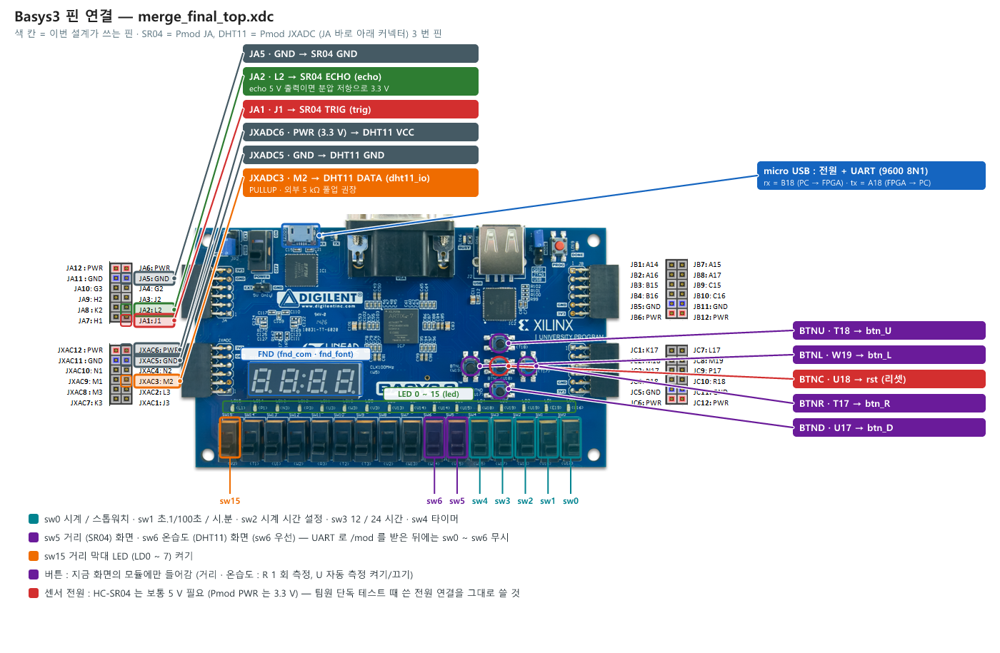
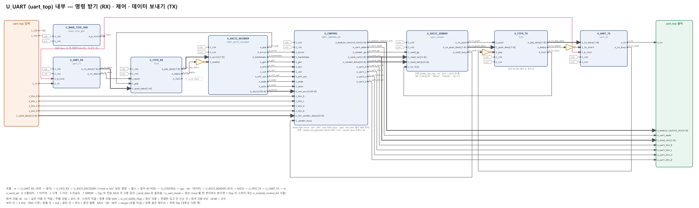
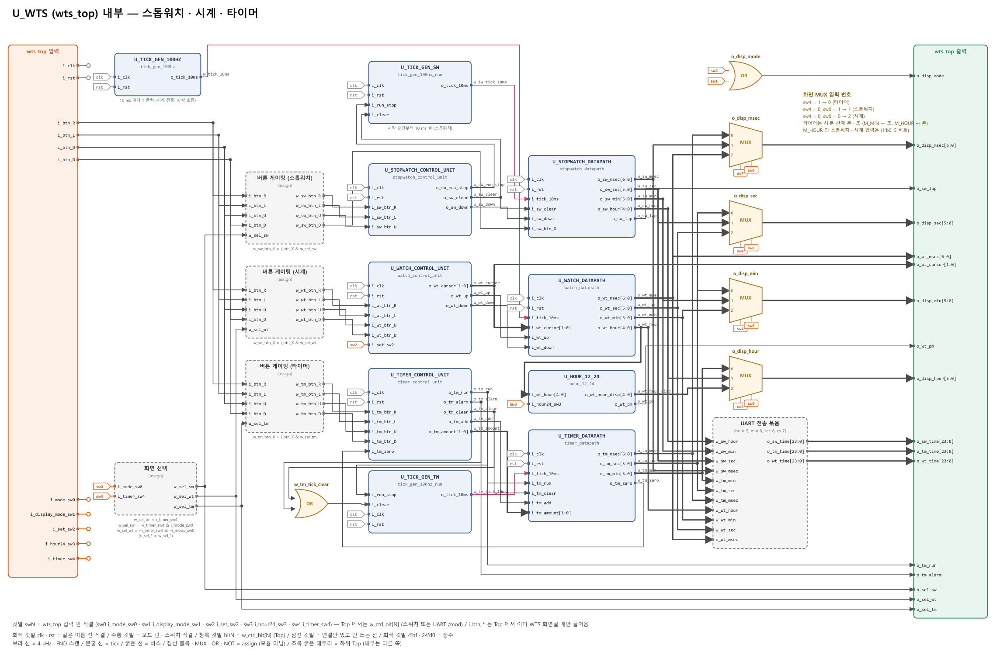
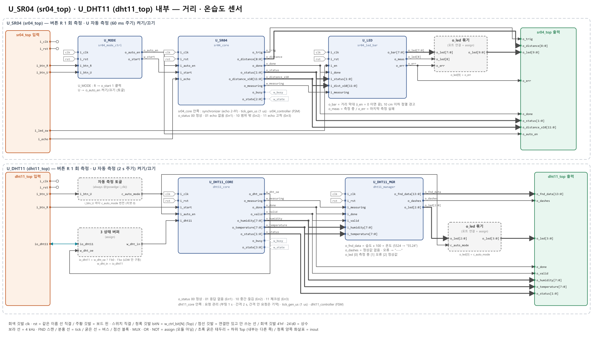
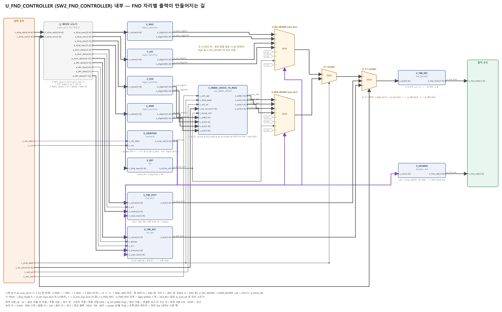
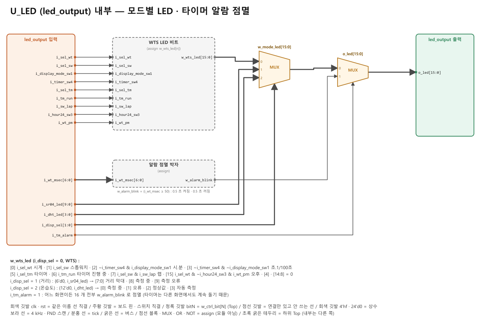
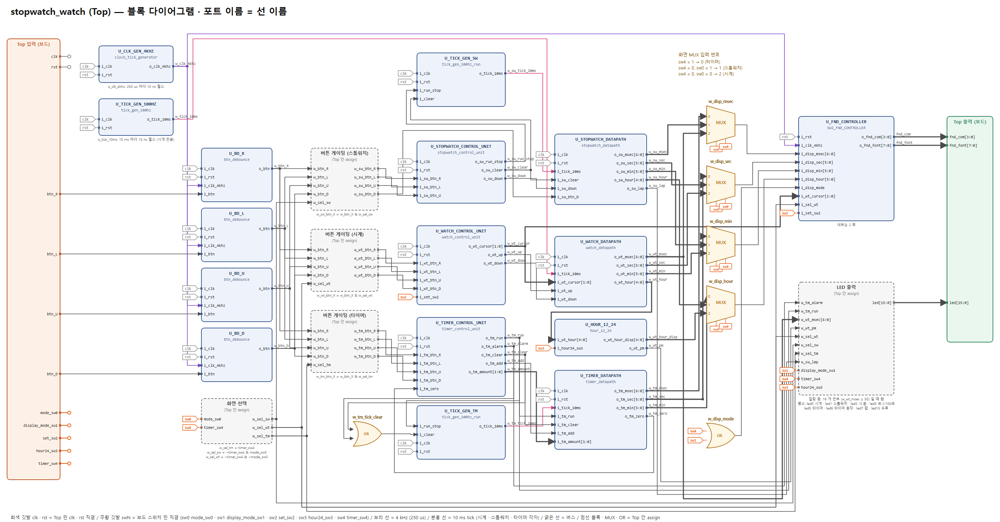
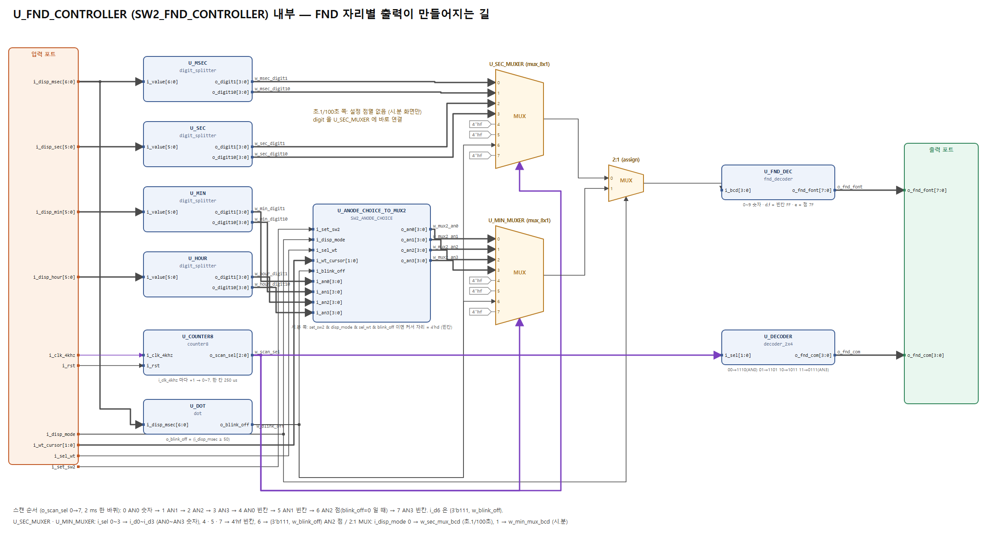

# STOPWATCH · SENSOR · UART — Basys-3 통합 시스템 (Team 4)

Basys-3 (Artix-7 XC7A35T, 100 MHz) 한 보드에서 **스톱워치 · 시계 · 타이머 (WTS)**, **초음파 거리 (SR04)**, **온습도 (DHT11)** 를 돌리고,
PC 터미널에서 **UART 명령으로 화면 바꾸기 · 버튼 누르기 · 데이터 1 회 요청 / 1 Hz 자동 전송**을 하는 Verilog 설계와 그 검증 기록입니다.

**팀원** : 정보윤 · 이종혁 · 정안성 · 견다혜

| 목표 | 결과 |
|---|---|
| UART 명령으로 통합 기능 제어 | 명령 6 종 · 명령 + 옵션 24 개 조합, 버튼 · 스위치와 함께 제어 |
| 상태 · 센서 데이터를 PC 에서 확인 | `/get` 1 회 요청 · `/auto` 1 Hz 자동 전송, 센서 오류는 FND · PC 모두 `Err1~3` |
| 센서 오류 처리 | SR04 3 종 · DHT11 3 종을 상태 코드 (`status`) 로 구분 |
| TB 검증 | 그룹 TB 12 개 · 시나리오 92 · 검사 **305 / 305 PASS**, TB 가 찾은 결함 8 건 수정 → 남은 결함 0 |
| 자원 · 타이밍 | LUT 1,476 (7.1 %) · FF 738 (1.8 %) · WNS **+1.442 ns** @ 100 MHz (배치 · 배선 후) |
| 보드 | 시연 A ~ I (스위치 모드 · UART 시계 · 스톱워치 · 타이머 · 거리 · 온습도 · 자동 전송 · ERROR · 리셋) |

최종 발표 자료 : [`PROJECT_FINAL/Team4_Final.pdf`](PROJECT_FINAL/Team4_Final.pdf) · 블록 다이어그램 : [`PROJECT_FINAL/block_diagram/merge_final_block_diagram.pdf`](PROJECT_FINAL/block_diagram/merge_final_block_diagram.pdf)

---

## 목차

0. [저장소 구조](#0-저장소-구조)
1. [시스템 스펙](#1-시스템-스펙)
2. [블록 다이어그램 상세](#2-블록-다이어그램-상세)
3. [사용법 — 스위치 · 버튼 · UART 명령](#3-사용법--스위치--버튼--uart-명령)
4. [우리의 발자취 — 날짜별 진행](#4-우리의-발자취--날짜별-진행)
5. [검증 — TB 를 어떻게 짰나](#5-검증--tb-를-어떻게-짰나)
6. [검증 결과](#6-검증-결과)
7. [디벨롭 — 트러블슈팅 두 번 (v1 → v2 → v3)](#7-디벨롭--트러블슈팅-두-번-v1--v2--v3)
8. [결론 · 고찰](#8-결론--고찰)
9. [실행 방법](#9-실행-방법)
- [부록 A. MINI 프로젝트 — 스톱워치 · 시계 · 타이머 (WTS)](#부록-a-mini-프로젝트--스톱워치--시계--타이머-wts)
- [부록 B. 팀원 폴더](#부록-b-팀원-폴더-member)

---

## 0. 저장소 구조

```
BEST_Stop_watch_project/
├── PROJECT_FINAL/                 ★ 최종 프로젝트 (WTS + SR04 + DHT11 + UART)
│   ├── source_file/
│   │   ├── merge_final/           최종 Top merge_final_top.v · .xdc + IP/ WTS/ SR04/ DHT11/ UART/ FND_LED/
│   │   ├── merge_final_v2/        v1 → v2 : 센서 오류를 PC 로도 (트러블슈팅 1)      ← merge_final 과 같음
│   │   ├── merge_final_v3/        v2 → v3 : TB 가 찾은 결함 8 건 수정 (트러블슈팅 2)
│   │   └── v2_modified.md · v3_modified.md   바뀐 곳 · 원인 · 코드 diff · 보드 확인 순서
│   ├── sim_file/                  top_tb/ (하네스 · 그룹 TB 12 개 · 실제 시간 · 발표용) · wcfg/ · docs/ · tools/ · mutants/ (버그 주입) · bat
│   ├── block_diagram/             블록 다이어그램 PDF · PPTX · 쪽별 PNG (img/) · 생성 스크립트
│   ├── docs/                      모듈별 블록도 SVG · PNG, 보드 핀 그림
│   ├── bitstream_file/FINAL.bit   보드용 비트스트림
│   ├── Team4_Final.pdf            최종 발표 자료 (122 쪽, 부록 포함)
│   └── README.md                  설계 설명서 (포트 · 핀 · 명령 · 표시 · LED 전체)
├── PROJECT_MINI_WTS/              1 차 미니 프로젝트 (WTS) — 부록 A
└── Member/                        팀원별 작업 폴더 — 부록 B
```

---

## 1. 시스템 스펙

| 항목 | 값 |
|---|---|
| FPGA · 클럭 | Basys-3 (Artix-7 XC7A35T), W5 100 MHz 단일 클럭 |
| 리셋 | btnC, `reset_sync` 하나로 모든 모듈 동기 해제 (2-FF) |
| 버튼 디바운스 | 4 kHz 로 8 샘플 모두 1 → 약 2 ms 뒤 1 클럭 펄스 |
| FND | 4 kHz 마다 한 칸, 8 칸 (숫자 4 + 점 · 빈칸 4), 한 바퀴 2 ms |
| 시간 해상도 | 1/100 s (스톱워치 · 시계 · 타이머) |
| UART | 9600 bps 8N1, 16 배 오버샘플링, RX FIFO 8 · TX FIFO 64, 형식 오류 → `ERROR` |
| 전송 | `/auto` 1 Hz, 전송 중 들어온 요청은 저장했다가 이어서 전송, 우선순위 ERROR > get · auto |
| SR04 | 2 ~ 400 cm (0.1 cm 표시), 자동 측정 60 ms 주기, echo 30 ms 안 오면 Err1 |
| DHT11 | 습도 ± 5 %RH · 온도 ± 2 ℃ (데이터시트), 전원 후 1 s 대기 · 측정 간격 2 s |
| 센서 핀 | SR04 trig = JA1 (J1) · echo = JA2 (L2) / DHT11 data = JXADC3 (M2, PULLUP) |



---

## 2. 블록 다이어그램 상세

[`merge_final_block_diagram.pdf`](PROJECT_FINAL/block_diagram/merge_final_block_diagram.pdf) 6 쪽 그대로입니다. **선 이름 = 포트 이름, 블록의 선 개수 = 포트 개수**가 원칙이라, 그림의 이름을 Vivado 파형 Scope 에서 그대로 찾을 수 있습니다.

<details>
<summary><b>그림 범례 (모든 쪽 공통)</b></summary>

| 표시 | 뜻 |
|---|---|
| 회색 깃발 `clk` · `rst` | 같은 이름 선에 바로 연결 |
| 주황 깃발 | 보드 핀 · 스위치 직결 |
| 청록 깃발 `bitN` | `w_ctrl_bit[N]` (Top 의 모드 비트 — 스위치 또는 UART `/mod`) |
| 점선 깃발 | 연결만 있고 안 쓰는 선 |
| 회색 깃발 `4'hf` · `24'd0` | 상수 |
| 보라 선 / 분홍 선 / 굵은 선 | 4 kHz · FND 스캔 / tick / 버스 |
| 점선 블록 · MUX · OR · NOT | `assign` 로직 (모듈 아님) |
| 초록 굵은 테두리 | 하위 Top (내부는 다른 쪽) |
| 청록 양쪽 화살표 | inout (DHT11 데이터선) |

</details>

### 2-1. Top — `merge_final_top` (1 쪽)


왼쪽 보드 입력에서 오른쪽 보드 출력으로, 아래 순서로 읽습니다.

| # | 블록 | 하는 일 |
|---|---|---|
| ① | `U_RESET_SYNC` (reset_sync) | btnC 를 2-FF 로 동기화 → `w_rst` 하나를 모든 모듈이 같이 씀 |
| ② | `U_CLK_GEN_4KHZ` (clock_tick_generator) | 250 us 마다 10 ns 펄스 `w_clk_4khz` → 디바운서 4 개 + FND 스캔 (보라 선) |
| ③ | `U_BD_R/L/U/D` (btn_debounce × 4) | 4 kHz 로 8 번 샘플 → `w_phy_btn_X` 1 클럭 펄스. WTS · SR04 · DHT11 이 따로 갖고 있던 디바운서를 하나로 합침 |
| ④ | `U_UART` (uart_top, 2 쪽) | rx → 명령 해석 → `o_module_control_bit[6:0]` · `o_uart_mode` · `o_uart_btn_X` · `o_send_sel[2:0]`, 전송 MUX 값 `i_send_data` 를 받아 → tx |
| ⑤ | 모드 선택 (assign) | `w_ctrl_bit = w_uart_mode ? w_uart_ctrl_bit : {dht_sw6 … mode_sw0}` — **첫 정상 `/mod` 뒤로는 스위치 대신 UART 값**. `w_mode_dht = bit6`, `w_mode_dist = bit5 & ~bit6`, `w_mode_wts = ~bit5 & ~bit6`, `w_disp_sel = {dht, dist}` (0 WTS · 1 거리 · 2 온습도) |
| ⑥ | 버튼 합치기 (OR) | `w_btn_X = w_phy_btn_X \| w_uart_btn_X`. 같은 클럭에 겹치면 물리 버튼 먼저, UART 버튼은 `U_UART` 가 한 클럭 미룸 |
| ⑦ | 버튼 → 지금 화면 모듈만 (AND) | WTS 에는 R · L · U · D & `w_mode_wts`, SR04 · DHT11 에는 R · U & 각 모드 (R = 1 회 측정, U = 자동 측정 켜기 / 끄기) |
| ⑧ | `U_WTS` (wts_top, 3 쪽) | 스톱워치 · 시계 · 타이머. 스위치 입력은 `bit0 ~ bit4`. 화면용 `o_disp_*` 와 전송용 `o_sw/tm/wt_time[23:0]` 을 따로 냄 |
| ⑨ | `U_SR04` (sr04_top, 4 쪽) | trig / echo → `o_distance_x10` (FND) · `o_distance` (UART) · `o_status` · `o_led[9:0]` |
| ⑩ | `U_DHT11` (dht11_top, 4 쪽) | `dht11_io` (inout) → `o_fnd_data` · `o_dashes` · `o_status` · 습도 · 온도 · `o_led[3:0]`. `w_dht_err = w_dht_led[1]` |
| ⑪ | FND 데이터 MUX `w_fnd_data[24:0]` | `w_disp_sel` 로 고름 — 0 WTS `{hour 6, min 6, sec 6, msec 7}` · 1 거리 `{10'd0, status 2, err 1, x10 12}` · 2 온습도 `{7'd0, status 2, err 1, dashes 1, data 14}` |
| ⑫ | 전송 데이터 MUX `w_send_data[23:0]` | `w_send_sel` (U_UART 가 고름) — 0 스톱워치 · 1 타이머 · 2 시계 `{hour 5, min 6, sec 6, cs 7}` · 3 거리 `{13'd0, status 2, cm 9}` · 4 온습도 `{4'd0, err, dashes, status 2, hum 8, temp 8}` · 7 ERROR `24'd0`. **상태 비트는 v2 에서 추가** ([7 장](#7-1-트러블슈팅-1--fnd-는-오류인데-pc-는-정상값-v1--v2)) |
| ⑬ | `U_FND_CONTROLLER` (5 쪽) · `U_LED` (6 쪽) | FND `fnd_com[3:0]` · `fnd_font[7:0]`, LED `led[15:0]` |

### 2-2. UART — `uart_top` (2 쪽)



**흐름** : `rx → U_UART_RX (비트 → 글자) → U_FIFO_RX → U_ASCII_DECODER ("/mod w_hm" → 펄스 + 글자 40 비트) → U_CONTROL → (go · sel · 데이터) → U_ASCII_SENDER (숫자 → ASCII) → U_FIFO_TX → U_UART_TX → tx`

| 블록 | 하는 일 |
|---|---|
| `U_BAUD_TICK_GEN` | 9600 × 16 tick, RX · TX 가 같이 씀 (분홍 선) |
| `U_UART_RX` | 16 배로 쪼개 보고 비트 가운데에서 읽음 → `o_rx_data` · `o_rx_done` |
| `U_FIFO_RX` (깊이 8) | 받은 글자 저장. 비어 있지 않으면 (NOT) 디코더 `i_enable` |
| `U_ASCII_DECODER` | 글자 하나에 상태 하나, `/` 부터 옵션까지 따라가며 명령 판별 → `o_get` · `o_btn` · `o_set` · `o_off_set` · `o_mode` · `o_auto` 펄스 + `o_ascii[39:0]` (옵션 글자), 형식 오류면 `o_error` |
| `U_CONTROL` (UART_CONTROLLER) | **mode FSM** (`/mod` 4 글자 → 스위치 7 개 값, `/set` · `/off`), **auto FSM** (`/auto` · `/get`, 안쪽 `sender_tick_generator` 1 Hz · 차례 카운터 0 ~ 4), **btn** (`/btn`, 물리 버튼 먼저), **송신** (겹치면 ERROR 먼저, sender 가 바쁘면 저장했다가 전송) |
| `U_ASCII_SENDER` (uart_sender + sender_char_mux) | `send_go` 순간 값을 저장 → 형식별 한 줄 (`"12:34:56.78"` · `"045cm"` · `"55%24C"` · `"Err 2"`) 을 한 클럭에 한 글자씩 TX FIFO 로. FIFO 가 차면 그 글자에서 멈췄다 이어서 |
| `U_FIFO_TX` (깊이 64) | 가장 긴 연속 전송 (5 종 54 글자) 도 담는 깊이 |
| `U_UART_TX` | FIFO 가 비어 있지 않고 안 바쁘면 시작, 1 글자 1.04 ms |

`/get ⏎` 의 마지막 글자 수신에서 TX 시작까지 **7 clk** 입니다 (발표 부록 49 쪽).

### 2-3. WTS — `wts_top` (3 쪽)



| 블록 | 하는 일 |
|---|---|
| 화면 선택 (assign) | `w_sel_tm = sw4`, `w_sel_sw = ~sw4 & sw0`, `w_sel_wt = ~sw4 & ~sw0` (타이머 > 스톱워치 > 시계) |
| 버튼 게이팅 × 3 | `w_sw/wt/tm_btn_X = i_btn_X & w_sel_*` — 보이는 화면의 FSM 에만 버튼 |
| `U_TICK_GEN_100HZ` | 시계 전용 10 ms tick (항상 흐름) |
| `U_TICK_GEN_SW` · `U_TICK_GEN_TM` (tick_gen_100hz_run) | 스톱워치 · 타이머 전용. **시작 순간부터 10 ms** 를 세서 첫 tick 이 정확히 10.000 ms (MINI 때 결정, 부록 A). 타이머 tick clear = 취소 OR 알람 |
| 컨트롤 유닛 3 개 (SystemVerilog enum FSM) | 스톱워치 STOP / RUN (run_stop · clear · down), 시계 NORMAL / SET (커서 · up · down), 타이머 SET / RUN / ALARM (run · alarm · clear · add · amount) |
| 데이터패스 3 개 + `U_HOUR_12_24` | 스톱워치 업 / 다운 · 랩 (`lap_controller`), 시계 시각 + 12/24 변환 · 오후 표시, 타이머 남은 시간 · 59:59 상한 · `o_tm_zero` |
| 화면 MUX × 4 | 0 타이머 · 1 스톱워치 · 2 시계. 타이머는 시.분 칸에 분 · 초 |
| UART 전송 묶음 | `o_sw/tm/wt_time[23:0] = {hour 5, min 6, sec 6, cs 7}` — 화면과 별개로 늘 세 개 다 나감 (`/auto all` 용) |

### 2-4. SR04 · DHT11 — `sr04_top` · `dht11_top` (4 쪽)



| 블록 | 하는 일 |
|---|---|
| `U_MODE` (sr04_mode_ctrl) | R → `o_start` 1 클럭, U → `o_auto_en` 토글 |
| `U_SR04` (sr04_core) | 안쪽 = echo 2-FF 동기화 · 1 us tick · FSM `IDLE → START (trig 11 us) → WAIT → DIST → STOP (주기 60 ms)`. 58 us/cm 로 거리 계산. `o_status` 00 정상 · 01 echo 없음 (Err1) · 10 범위 밖 (Err2) · 11 echo 고착 (Err3) |
| `U_LED` (sr04_led_bar) | 거리 막대 `o_bar[7:0]` (sw15 로 끔, 10 cm 이하 점멸 경고) · `o_meas` 측정 중 · `o_err` 실패 → `o_led[9:0]` |
| 3 상태 버퍼 · 자동 측정 토글 (DHT11) | `io_dht11 = w_dht_oe ? 1'b0 : 1'bz` (LOW 만 구동, HIGH 는 풀업), U 마다 `c_auto_mode` 반전 |
| `U_DHT11_CORE` | 안쪽 = 요청 관리 (부팅 1 s · 간격 2 s, 간격 안 요청은 기억) · 1 us tick · FSM `IDLE → START (LOW 18 ms) → WAIT → SYNC_L → SYNC_H → {DATA_SYNC → DATA_BIT → BIT_DEC} × 40 → STOP`. `o_status` 00 정상 · 01 응답 없음 (Err1) · 10 중간 끊김 (Err2) · 11 체크섬 (Err3) |
| `U_DHT11_MGR` | `o_fnd_data` = 습도 × 100 + 온도 (5524 → `55.24`), `o_dashes` = 정상값 없음 → `----`, LED [0] 측정 중 · [1] 오류 · [2] 정상값 · [3] 자동 |

### 2-5. FND — `SW2_FND_CONTROLLER` (5 쪽)



1. **데이터 나누기** : `i_disp_sel` 로 `w_disp_data[24:0]` 을 WTS (시 · 분 · 초 · 1/100) / 거리 / 온습도 필드로 나눔 (고르지 않은 쪽은 0)
2. **WTS 경로** : `digit_splitter` × 4 → `SW2_ANODE_CHOICE` (시계 설정 중이면 커서 자리를 `4'hd` 빈칸으로 0.5 초 점멸, `dot` 이 1/100 ≥ 50 판정) → `U_SEC_MUXER` / `U_MIN_MUXER` (8:1) → 2:1 (`i_disp_mode` 0 초.1/100초 · 1 시.분)
3. **거리 · 온습도 경로** : `U_FND_DIST` → `352.7` (AN1 점) / `ErrN`, `U_FND_DHT` → `55.24` (AN2 점) / `----` / `ErrN`
4. **3:1 MUX** → `fnd_decoder` (0 ~ 9, `a` E · `b` r · `c` - · `d,f` 빈칸 · `e` 점) → `o_fnd_font`
5. **스캔** : `U_COUNTER8` 가 4 kHz 마다 0 → 7 (칸당 250 us, 한 바퀴 2 ms), `decoder_2x4` 가 AN0 ~ AN3 선택 (active-low). 0 ~ 3 숫자, 4 ~ 7 점 · 빈칸

### 2-6. LED — `led_output` (6 쪽)



| 화면 (`i_disp_sel`) | LED |
|---|---|
| 0 WTS | [0] 시계 · [1] 스톱워치 · [2] 시.분 · [3] 초.1/100초 · [5] 타이머 · [6] 타이머 진행 · [7] 랩 · [15] 오후 (12 시간 표시) |
| 1 거리 | [7:0] 거리 막대 · [8] 측정 중 · [9] 측정 오류 |
| 2 온습도 | [0] 측정 중 · [1] 오류 · [2] 정상값 · [3] 자동 측정 |
| 타이머 알람 | **어느 화면이든** 16 개 전부 0.5 초 점멸 (`w_alarm_blink = i_wt_msec ≥ 50`) — 타이머는 다른 화면에서도 계속 돌기 때문 |

---

## 3. 사용법 — 스위치 · 버튼 · UART 명령

### 보드 입력

| 입력 | 0 | 1 |
|---|---|---|
| sw0 `mode_sw0` | 시계 | 스톱워치 |
| sw1 `display_mode_sw1` | 초.1/100초 | 시.분 |
| sw2 `set_sw2` | — | 시계 시간 설정 |
| sw3 `hour24_sw3` | 12 시간 | 24 시간 |
| sw4 `timer_sw4` | — | 타이머 (sw0 보다 우선) |
| sw5 `dist_sw5` · sw6 `dht_sw6` | — | 거리 · 온습도 화면 (sw6 > sw5 > WTS) |
| sw15 `dist_led_sw15` | — | 거리 막대 LED 켜기 |

| 화면 | R | L | U | D |
|---|---|---|---|---|
| 스톱워치 | 시작 / 정지 | 지우기 | 업 / 다운 | 랩 |
| 시계 (설정 중) | 커서 → | 커서 ← | + | − |
| 타이머 | +1 분 | 시작 / 취소 | +10 초 | +10 분 |
| 거리 · 온습도 | 1 회 측정 | — | 자동 측정 켜기 / 끄기 | — |

### UART 명령 (9600 8N1, `/<명령> <옵션>`, 정해진 글자 수를 다 받으면 Enter 없이 실행)

| 명령 | 옵션 | 동작 |
|---|---|---|
| `/mod` | `w_hm` `w_ms` `s_hm` `s_ms` `t_hm` `t_ms` `dist` `temp` | 화면 바꾸기. **첫 정상 `/mod` 부터 리셋 전까지 스위치 대신 UART 가 화면을 정함** |
| `/btn` | `R` `L` `U` `D` | 물리 버튼과 같은 동작 (지금 화면 모듈에만) |
| `/get` | 공백 + Enter | 지금 화면 값 한 줄 |
| `/auto` | `all` `_sw` `_tm` `_wh` `dis` `tem` `off` | 1 초마다 전송 (`all` = 스톱워치 → 타이머 → 시계 → 거리 → 온습도 차례) |
| `/set` · `/off` | `w_hm` · `w_h` | 시계 설정 켜기 / 끄기 (시계 시.분 화면) |
| `/set` | `24h⏎` · `12h⏎` | 12 / 24 시간 (`/mod` 해도 유지) |

| 응답 | 형식 | 예 |
|---|---|---|
| 스톱워치 · 타이머 · 시계 | `HH:MM:SS.CC` | `00:01:23.45` · `00:02:30.00` · `14:05:09.12` |
| 거리 / 오류 | `NNNcm` / `Err N` | `045cm` / `Err 2` |
| 온습도 / 측정 전 · 오류 | `HH%TTC` / `--%--C` · `Err N` | `55%24C` |
| 형식 오류 | `ERROR` | `/gxt` → `ERROR` |

| FND 오류 | SR04 | DHT11 |
|---|---|---|
| `Err1` | NO_ECHO — trig 뒤 30 ms 안에 echo 없음 | NO_RESPONSE — 시작 신호 뒤 응답 없음 |
| `Err2` | OUT_RANGE — echo 23.2 ms (400 cm) 넘음 | TIMEOUT — 40 비트 받는 도중 끊김 |
| `Err3` | ECHO_STUCK — echo 가 50 ms 넘게 1 | CHECKSUM — 체크섬 틀림 |

전체 표 (명령 형식 규칙 · 예시 세션 · 포트 · 핀) : [`PROJECT_FINAL/README.md`](PROJECT_FINAL/README.md)

---

## 4. 우리의 발자취 — 날짜별 진행

| 날짜 | 단계 | 한 일 |
|---|---|---|
| 10/13 ~ 10/16 | MINI 설계 | 스톱워치 lib · 버튼 디바운서 · FND 점멸 · 시계 커서 (자리 단위 설정) · 랩 · 12/24 → 팀 통합판 `merged_v3` → `merged_v4` (FSM 을 SystemVerilog enum 으로, RUN 중 L · U 무시) · 보드 확인 |
| 10/16 ~ 10/18 | MINI 검증 | TB 15 개 · 결함 주입 4 개 → `verification_v2` (포트 이름 통일, **블록 다이어그램 = 코드** 자동 대조), 100 Hz tick 분리 (첫 tick 정확히 10 ms), 시연용 소스 · 발표 |
| 10/20 ~ 10/23 | UART 기초 | UART 송수신 루프백 (baud tick × 16), FIFO 설계 · TB, UART + FIFO + 루프백 |
| 10/27 ~ 10/29 | 모듈 개발 | UART ASCII 디코더 설계 · 검증 완성, sender 초안, HC-SR04 컨트롤러 + ILA 보드 확인 (trig 11.01 us, 상태 천이 5 개) |
| 10/30 | 모듈 개발 | UART sender + TB 3 개 (불일치 0), DHT11 소스 · `DHT11_TOP` · U 자동 갱신, SR04 Top, UART 컨트롤러 수정 |
| 10/31 | **통합 v1** | UART 컨트롤러 (error 대기 · get · 물리 버튼 우선 + 스코어보드), **`merge_final` 통합 Top** + README, 센서 오류 `Err1~3`, DHT11 핀 JA1 → JXADC3 (SR04 trig 와 겹침), 자동 전송 5 Hz → 1 Hz, 그룹 TB 12 개 · 블록 다이어그램 |
| 10/31 | **v2** (트러블슈팅 1) | 보드에서 "FND 는 오류인데 PC 는 숫자" 발견 → 전송 MUX 에 상태 비트 → `Err N` · `--%--C`, 통합 TB S01 ~ S20 |
| 11/01 | 결과 정리 | 그룹 TB 305 검사 집계 (PASS 297 + 스펙과 다름 8 로 정정), 실제 시간 TB 9 개, 블록도 v2 변경 슬라이드, 버그 주입으로 TB 신뢰성 확인 |
| 11/01 | **v3** (트러블슈팅 2) | 결함 8 건 수정 → 305 / 305 PASS, WNS +0.320 → +1.442 ns. ILA (L6) · UART 시각 로거 (H7 · H9) 로 보드 Before / After 확인 |
| 11/02 | 발표 | `Team4_Final.pdf` (개요 견다혜 · 시스템 구조 이종혁 · UART · Top 시뮬 · 검증 정안성 · sender · 트러블슈팅 · 시연 · 결론 정보윤) |

**모듈 출처** : WTS = MINI 팀 통합판, UART 디코더 · 컨트롤러 · 통합 Top · 그룹 TB = 정안성, UART sender · SR04 컨트롤러 · v2 · v3 수정 = 정보윤, DHT11 = 이종혁, SR04 Top = 견다혜 (각자 폴더는 부록 B).

**통합하면서 바꾼 것** : 포트 이름 `i_*` / `o_*` 로 통일, 리셋 · 디바운서 · 1 us tick · FIFO · baud tick 을 공용 IP 하나로, FND · LED 를 통합 컨트롤러 하나로, `fnd_decoder` 에 `E` `r` `-` 추가, SR04 버튼 U 를 "누르는 동안" → "토글" (DHT11 과 같게), UART 컨트롤러에 `o_uart_mode` · `/set 24h` · `/set 12h` 추가 (자세히 : [`PROJECT_FINAL/README.md` 12 장](PROJECT_FINAL/README.md#12-통합하면서-바뀐-점)).

---

## 5. 검증 — TB 를 어떻게 짰나

### 5-1. 구조 : 공통 하네스 + 그룹 TB

```
tb_merge_harness.sv  (h)
 ├─ DUT = merge_final_top (팀 전체)
 ├─ 핀 모델 : 버튼 (채터링 포함) · 스위치 · PC UART (보내기 / 받은 줄 파싱) · SR04 (거리 → echo 폭, 무응답 · 고착) · DHT11 (40 비트 · 체크섬 · 끊김)
 ├─ 모니터 : FND 문자열 (W_FND) · 받은 UART 줄 (W_LINE) · LED
 └─ 스코어보드 : OK / FAIL / ISSUE 집계 → [SUMMARY] ... => PASS
tb_A_reset.sv ~ tb_L_integration.sv  : 하네스를 두고 시나리오만 적음 (+only=D3 로 하나만 실행)
```

- **기대값은 README 스펙 표에서** 만들었습니다 (명령 표 · LED 표 `0x8009` · 데이터시트 58 us/cm · 체크섬 mod 256 · 9600 baud 13 B = 13.6 ms 등).
- `FAST = 1` 이면 시간 파라미터만 줄입니다 (WTS 1 초 = 1 ms, `/auto` 200 Hz, UART 115200, DHT 대기 3 / 5 ms, SR04 tick 10 배). 판정은 같은 파라미터로 계산하므로 판정 코드는 그대로. `FAST = 0` (실제 시간) 은 `top_tb/` 로 따로 돌림.
- 각 TB 마다 wcfg (시나리오 · 판정 · UART 줄 · FND 문자열 ASCII + 그룹 내부 신호) 를 같이 만들어 FAIL 시각을 파형에서 바로 찾게 함.

### 5-2. 그룹 TB 12 개 · 시나리오 92 개

| TB | 영역 | 시나리오 (ID) | 기준 근거 |
|---|---|---|---|
| A | 리셋 · 공통 | A1 전원 · 리셋 직후 · A2 동작 중 리셋 | 해제 2 clk 뒤 초기값, 리셋 즉시 tx 1 · trig 0 · DHT 선 해제 |
| B | 버튼 · 디바운스 | B1 정상 누름 · B2 채터링 · B3 1.5 / 2.25 ms 경계 · B4 길게 누름 · B5 화면 게이팅 | 4 kHz × 8 샘플 = 2 ms → 1.5 ms 무시 · 2.25 ms 통과 |
| C | 모드 선택 | C1 스위치 우선순위 · C2 `/mod` 뒤 스위치 무시 · C3 틀린 `/mod` · C4 `/mod` 8 종 · C5 12/24 유지 · C6 `/set w_hm` 조건 · C7 `/mod` 전 `/set` · C8 설정 중 `/mod` | 화면 진리표 · `/mod` 표, 마지막 바이트 뒤 1 us 안 전환 |
| D | 스톱워치 | D1 시작 정확도 · D2 짧은 run 누적 · D3 최대값 wrap · D4 다운 wrap · D5 RUN 중 U · L · D6 랩 · D7 랩 + 지우기 / `/get` | R 뒤 정확히 10.00 ms, 23:59:59.99 ↔ 0 |
| E | 시계 | E1 초기 · 1 초 · E2 12/24 경계 · E3 커서 순환 · E4 값 wrap · E5 동시 입력 · E6 초 화면에서 설정 | 자정 = 12 AM, 자리 단위 wrap (올림 없음) |
| F | 타이머 | F1 10 초 알람 · F2 0 에서 시작 · F3 포화 · 올림 · F4 RUN 중 더하기 · 취소 · F5 알람 끄기 · F6 다른 화면 알람 | L 뒤 10.000 s (± 5 clk), 최대 59:59 |
| G | UART 수신 · 디코더 | G1 정상 명령 전부 · G2 형식 오류 10 종 · G3 모르는 옵션 · G4 `/` 로 복구 · G5 꼬리 문자 · G6 짧은 옵션 · G7 `/off` 오타 뒤 · G8 RX 물리층 (baud ± 2 %) · G9 바이트 30 개 연속 | 명령 표 24 개, ERROR 정확히 1 줄 |
| H | UART 컨트롤러 · 전송 | H1 화면별 `/get` · H2 스위치 모드 `/get` · H3 auto 중 `/get` · H4 1 Hz 주기 · H5 `/auto all` 순서 · H6 auto 중 전환 · H7 off 뒤 재시작 · H8 ERROR 우선 · H9 `/get` 20 연타 · H10 응답 형식 경계 · H11 `/btn` · H12 물리 + UART 같은 clk | 줄 끝 ≤ 13.6 ms, 간격 1.000 s ± 10 us |
| I | SR04 | I1 trig 폭 · I2 거리 5 점 · I3 범위 초과 · I4 echo 없음 · I5 echo 고착 · I6 측정 중 R · I7 자동 60 ms · I8 LED 막대 · 경고 · I9 오류 → 정상 · I10 화면 밖 · I11 echo 글리치 | 데이터시트 58 us/cm, 한계 23.2 ms, 주기 60 ms |
| J | DHT11 | J1 부팅 1 s · J2 시작 18 ms · J3 정상 측정 · J4 비트 경계 · J5 체크섬 wrap · J6 체크섬 오류 · J7 응답 없음 · J8 중간 끊김 · J9 간격 안 R · J10 측정 중 R · J11 자동 2 s · J12 측정 전 표시 · J13 화면 밖 · J14 습도 ≥ 100 | 데이터시트 비트 40 us 기준, 체크섬 mod 256 |
| K | FND · LED | K1 WTS FND · K2 설정 점멸 · K3 거리 FND · K4 온습도 FND · K5 화면별 LED · K6 스캔 | LED 표, com one-hot 칸당 250 us |
| L | 통합 · 교차 | L1 배경 스톱워치 · L2 화면 전환 직후 버튼 · L3 전송 중 화면 변경 · L4 동시 부하 (soak) · L5 랜덤 리셋 20 회 · L6 캐리 경계 스냅샷 | 화면 밖도 계속, 누락 · hang 0, 매번 초기값 |

시나리오마다 명령어 조합 · 스펙 목표 · 결과 전체 : [`TB_RESULT_SUMMARY_1031.md`](PROJECT_FINAL/sim_file/docs/TB_RESULT_SUMMARY_1031.md) · 시나리오 원본 : [`tb_scenario.md`](PROJECT_FINAL/sim_file/docs/tb_scenario.md)

### 5-3. 그 밖의 TB

| TB | 목적 |
|---|---|
| 통합 TB (정보윤, `tb_top_full`) | 랜덤 명령 120 개 · 전송 MUX 100 번, v2 기대값과 매 줄 비교 (그룹 TB 와 안 겹치는 292 검사) |
| UART sender 단위 TB | 글자 MUX → sender → + FIFO · uart_tx → 팀 Top 순으로 넓혀 감. 0 · 23:59:59.99 · 0 · 400 cm · 습도 온도 0 · 99 경계, FIFO 꽉참 (줄 처음 · 끝), busy 내려가는 클럭의 send_go, 보내는 중 리셋, 무작위 200 줄 |
| 실제 시간 TB (`top_tb/`, `FAST = 0`) | 시간 단축 없이 B4 3 s 누름 · D1 · D6 · E1 · F1 10 초 타이머 · F6 · H4 · L4 · L5 (시뮬 49.6 s, 실행 약 8 시간) |
| 발표용 TB (`tb_P_present.sv`) | 실제 1 Hz 로 P1 `/mod` · P2 `/btn` · P3 `/auto all` · P4 ERROR · P5 SR04 Err1 ~ 3 · P6 DHT11 Err1 ~ 3 파형 캡처 |
| 버그 주입 (`mutants/`) | 소스 사본에 버그를 하나씩 넣고 같은 TB 를 다시 돌려 **TB 가 정말 버그를 잡는지** 확인 ([6-3](#6-3-tb-신뢰성--버그를-일부러-넣어-보기)) |

---

## 6. 검증 결과

### 6-1. 그룹 TB (v2 기준, Vivado 2022.2 xsim)

| TB | 검사 | PASS | 스펙과 다름 | 시뮬 시간 (FAST) |
|---|:-:|:-:|:-:|---:|
| A 리셋 | 14 | 14 | 0 | 42.3 ms |
| B 버튼 | 14 | 14 | 0 | 841.1 ms |
| C 모드 | 30 | 30 | 0 | 25.9 ms |
| D 스톱워치 | 15 | 14 | 1 (D7) | 5.8 ms |
| E 시계 | 23 | 22 | 1 (E6) | 1.1 ms |
| F 타이머 | 16 | 16 | 0 | 63.7 ms |
| G UART 수신 | 52 | 50 | 2 (G3 · G7) | 87.3 ms |
| H UART 전송 | 31 | 29 | 2 (H7 · H9) | 286.9 ms |
| I SR04 | 26 | 26 | 0 | 250.2 ms |
| J DHT11 | 30 | 29 | 1 (J14) | 152.3 ms |
| K FND · LED | 28 | 28 | 0 | 539.2 ms |
| L 통합 | 26 | 25 | 1 (L6) | 315.6 ms |
| **합계** | **305** | **297** | **8** | 2,611 ms (실행 약 41 분) |

→ 8 건은 모두 [7-2](#7-2-트러블슈팅-2--tb-가-찾은-결함-8-건-v2--v3) 에서 고쳐 **v3 = 305 / 305 PASS**. 통합 TB 는 v2 · v3 모두 불일치 0.

### 6-2. 실제 시간 TB (`top_tb/`)

B4 · D1 · E1 · F1 · F6 은 실제 시간으로도 PASS (첫 tick 10.000 ms, 10 초 타이머 10.000 s). D6 · H4 의 FAIL 은 TB 대기 코드 (WATCHDOG) 문제였고 설계는 정상 (줄은 1 s 마다 정확히 옴), L4 · L5 는 xsim 이 `$urandom(seed)` 를 지원하지 않아 실행 못 함.

### 6-3. TB 신뢰성 — 버그를 일부러 넣어 보기

**Top TB : 버그 9 개 → 9 / 9 검출**

| 넣은 버그 | 확인하려던 것 | 결과 |
|---|---|---|
| 디바운서 8 샘플 AND → OR | 채터링 거르기 | 1.5 ms 짧은 누름에도 펄스 → FAIL 6 |
| 모드 MUX 가 `/mod` 무시 | UART 제어권 전환 | `/mod` 뒤 화면 그대로 → FAIL 12 |
| 스톱워치 · 타이머 tick 1 clk 짧음 | 10 ns 시간 오차 | tb_D 는 첫 tick 만 봐서 통과, **tb_F 10 초 누적에서 FAIL** |
| 12 시간 표시 0 시를 `00` | 자정 처리 | FAIL 2 |
| SR04 400 cm 한계 100 us 늦음 | 범위 경계 1.7 cm | `Err2` 대신 `400cm` → FAIL 3 |
| DHT11 체크섬 검사 빠짐 | 깨진 데이터 | `Err3` 대신 `55.24` → FAIL 2 |
| FND 거리 소수점 안 켜짐 | 점 한 칸 | `352.7` → `3527` → FAIL 4 |
| 시계 LED 에 스톱워치 신호 | LED 배선 1 비트 | `8009` → `8008` → FAIL 4 |
| UART 거리 백의 자리 계산 오류 | 송신 자릿값 | tb_H 는 0 cm 라 통과, **tb_I 에서 `110cm` ≠ `010cm`** |

처음 고른 TB 가 놓친 2 개를 다른 그룹 TB 가 잡음 → 그룹 TB 끼리 서로 보완합니다.

**UART sender : 버그 8 개 → 8 / 8 검출** — busy 중 send_go 받기 · FIFO 꽉 차도 push 는 **단위 TB 만** 잡고 (Top 에선 안 생기는 상황), 거리 오류 상태 무시 · 온습도 측정 전 표시 무시는 **Top TB 만** 잡음 (센서 상태 비트는 실제 연결에서만). 단위 TB 와 Top TB 가 서로 못 잡는 것을 보완합니다.

---

## 7. 디벨롭 — 트러블슈팅 두 번 (v1 → v2 → v3)

### 7-1. 트러블슈팅 1 — FND 는 오류인데 PC 는 정상값 (v1 → v2)

| ① 현상 (보드) | FND | PC (v1) | PC (v2) |
|---|---|---|---|
| SR04 범위 밖 (천장) | `Err2` | `400cm` | `Err 2` |
| SR04 ECHO 선 뽑음 | `Err3` | `400cm` | `Err 3` |
| DHT11 리셋 뒤 첫 측정 전 | `----` | `00%00C` | `--%--C` |
| DHT11 DATA 선 뽑음 | `Err1` | `32%24C` (마지막 정상값) | `Err 1` |

- **② 원인** : 센서 상태선 (`status` · `err` · `dashes`) 이 **FND MUX 로만** 가고 전송 MUX 에는 값만 들어가서, sender 는 숫자 글자만 만들 수 있었음.
- **③ 해결** : 블록 · 포트 · 24 비트 폭은 그대로 두고, 전송 MUX 입력 3 · 4 의 **빈 윗비트에 상태를 실음** (거리 + status 2 비트, 온습도 + err · dashes · status 4 비트) → `sender_char_mux` 가 그 비트로 글자를 고름. 바뀐 곳 = Top 전송 MUX 2 줄 + `sender_char_mux`.
- **④ 결과** : 시뮬 불일치 0, 보드에서 FND 와 PC 가 같은 표시. 상세 · Before / After 그림 : [`v2_modified.md`](PROJECT_FINAL/source_file/v2_modified.md)

### 7-2. 트러블슈팅 2 — TB 가 찾은 결함 8 건 (v2 → v3)

그룹 TB 305 검사 중 8 건이 목표 스펙과 다르게 동작했습니다. 원인은 8 곳, 수정한 파일은 5 개입니다.

| ID | 현상 (스펙과 다른 동작) | 원인 | 고친 내용 | 파일 |
|---|---|---|---|---|
| G3 | `/set abcd` 에도 시계 설정이 켜짐 | 옵션 글자 비교 없음 | 옵션이 `w_hm` 일 때만 설정 | 01_UART_CONTROLLER |
| G7 | `/off` 오타 뒤 `/off w_h` 도 계속 ERROR | 오류 처리에서 `/off` 카운터만 안 지움 | 오류 때 카운터도 0 | 02_UART_ASCII_DECODER |
| H7 | `/auto` 를 껐다 바로 켜면 첫 줄이 0.54 초 만에 옴 | 끌 때 1 초 카운터를 안 지움 | 끌 때 1 초 카운터도 0 | 01_UART_CONTROLLER |
| H9 | `/get` 20 번 연속 → 15 줄 | 대기 요청을 1 비트로 기억 (합쳐짐) | 요청을 개수로 기억 | 01_UART_CONTROLLER |
| D7 | 랩 표시 중 `/get` → 랩 값 전송 | PC 값 = 화면값 | PC 는 흐르는 값 (FND 는 랩) | stopwatch_datapath · wts_top |
| E6 | 시계 초 화면에서 설정 + U → 안 보이는 분이 +1 | 설정에 화면 조건 없음 | 시.분 화면에서만 설정 | wts_top |
| L6 | 초가 넘어가는 바로 그 클럭의 `/get` → 1 초 늦은 값 | 올림 신호가 1 클럭 늦음 | 올림 신호를 같은 클럭에 | stopwatch_datapath |
| J14 | 습도 100 → PC 에 `:0%24C` | 두 자리만 가정 | 습도 · 온도 99 상한 (FND 와 같은 규칙) | sender_char_mux |

| | v2 (수정 전) | v3 (수정 후) |
|---|---|---|
| 그룹 TB PASS | 297 / 305 | **305 / 305** |
| 스펙과 다름 | 8 | **0** |
| 통합 TB 불일치 | 0 | 0 |
| LUT | 1,489 | 1,476 |
| WNS | +0.320 ns | **+1.442 ns** |

**보드 확인** : G3 · G7 · D7 · E6 은 터미널에서 Before / After 비트로 직접, L6 은 ILA 로 자리 올림 클럭을, H7 · H9 는 PC UART 시각 로거로 시간 · 줄 수를 확인했습니다 (영상 : `Member/boyun/videos_1101/트러블슈팅2/`). 상세 (상황 → 그림 → 원인 → diff → 보드 순서) : [`v3_modified.md`](PROJECT_FINAL/source_file/v3_modified.md)

---

## 8. 결론 · 고찰

**결론** — 두 목표 모두 시뮬레이션과 보드에서 동작

| 목표 | 시뮬레이션 | 보드 |
|---|---|---|
| ① UART 명령으로 통합 기능 제어 | 그룹 TB 305 PASS | 시연 A ~ F · H |
| ② 상태 · 센서 데이터를 PC 에서 확인 | 통합 TB 558 검사 일치 | 시연 B ~ G · I |

- TB 검증 PASS 596 · FAIL 0 (그룹 305 + 통합 291), TB 신뢰성 : 버그 주입 Top 9 / 9 · sender 8 / 8 검출
- 트러블슈팅 1 : 오류 · 측정 전에도 FND 와 PC 가 같은 표시 / 트러블슈팅 2 : 결함 8 건 수정 → 305 / 305
- 자원 · 타이밍 : LUT 1,476 (7.1 %) · WNS +1.442 ns @ 100 MHz

**고찰 · 개선 방향**

1. **설계** : 결과가 FND 와 PC 두 곳으로 나가는데 FND 만 챙겼다 (트러블슈팅 1). → FND 와 PC 가 같은 상태인지 TB 가 서로 비교하는 **교차 검사**를 넣자.
2. **검증** : 설계자가 만든 통합 TB 는 결함 8 건에서 FAIL 을 내지 못했고 (그 상황을 시나리오에 안 넣음), **목표 스펙대로 짠 그룹 TB 는 FAIL 로 잡았다**. → 시나리오 · 기대값은 DUT 가 아니라 **목표 스펙 표에서** 만들자.

---

## 9. 실행 방법

**보드** : Vivado 에서 `PROJECT_FINAL/bitstream_file/FINAL.bit` 를 프로그램 → 시리얼 터미널 9600 8N1 로 연결 → `/mod w_hm` 부터.
직접 빌드하려면 Design Sources 에 `PROJECT_FINAL/source_file/merge_final_v3/` (또는 `merge_final/`) 아래 `*.v` · `*.sv` 전부 + `merge_final_top.xdc`.

**시뮬레이션** (`PROJECT_FINAL/sim_file/`, 자세히는 [`sim_file/README.md`](PROJECT_FINAL/sim_file/README.md))

```
run_xsim.bat tb_D_stopwatch          :: D 그룹 전부
run_xsim.bat tb_D_stopwatch D3       :: D3 만
run_xsim.bat tb_D_stopwatch D3 wave  :: D3 + 파형 (wcfg 자동)
run_present.bat P3 wave              :: 발표용 장면 P3
```

Vivado GUI 라면 Simulation Sources 에 `tb_merge_harness.sv` + 그룹 TB 하나를 넣고 Set as Top → Run All → 콘솔 마지막 `[SUMMARY] ... => PASS`. **시뮬은 한 번에 하나씩** (동시에 돌리면 PC 가 매우 느려짐).

---

## 부록 A. MINI 프로젝트 — 스톱워치 · 시계 · 타이머 (WTS)

> FINAL 의 `U_WTS` 가 된 1 차 미니 프로젝트입니다. 폴더 : [`PROJECT_MINI_WTS/`](PROJECT_MINI_WTS/README.md)

Basys-3 하나로 **스톱워치 · 시계 · 타이머** 세 기능을 스위치로 골라 쓰는 설계. 시뮬레이션은 주파수를 줄이지 않고 실제 시간 (100 MHz) 기준으로 확인했습니다.

### A-1. 블록 다이어그램





- PDF : [`block_diagram.pdf`](PROJECT_MINI_WTS/block_diagram.pdf) · FSM 상태도 · ASM : [`control_unit_fsm.pdf`](PROJECT_MINI_WTS/control_unit_fsm.pdf) · 포트 연결표 : [`PORT_MAP.md`](PROJECT_MINI_WTS/source_file/PORT_MAP.md)
- `diagram/gen_diagram.py` 가 Verilog 를 직접 읽어 포트 이름 · 개수 · 연결이 그림과 다르면 그림을 만들지 않음

### A-2. 조작

| 스위치 | 0 | 1 |
|---|---|---|
| sw0 | 시계 | 스톱워치 |
| sw1 | 초.1/100초 | 시.분 |
| sw2 | 보통 | 시계 시간 설정 |
| sw3 | 12 시간 | 24 시간 |
| sw4 | — | 타이머 (sw0 보다 우선) |

| 버튼 | 스톱워치 | 시계 (sw2 = 1) | 타이머 |
|---|---|---|---|
| R | 시작 ↔ 정지 | 커서 → | +1 분 |
| L | 정지 중 지우기 + 랩 해제 | 커서 ← | 시작 / 취소 |
| U | 정지 중 업 ↔ 다운 | 커서 자리 + | +10 초 |
| D | 랩 | 커서 자리 − | +10 분 |

btnC = 리셋 (시계 12:00:00.00). 타이머는 최대 59:59, 0 이 되면 LED 16 개 0.5 초 점멸.

### A-3. 진행과 결정

| 날짜 | 한 일 |
|---|---|
| 10/14 ~ 10/16 | 각자 모듈 (12 → 24 시 전환 · 랩 이종혁, 워치 FSM 정보윤, SW2 FND 점멸 정안성) → 통합판 `merged_v3` → `merged_v4` 보드 확인 (LUT 346 · FF 186 · WNS +3.682 ns, `Member/boyun/merged_v4/`) |
| 10/16 | 검증 계획 · TB 15 개 · 결함 주입 4 개 → **포트 이름 통일판** (`i_` · `o_` · `w_`, 기능 접두어 `sw_` `wt_` `tm_`, 스위치 `*_swN`) |
| 10/17 | **100 Hz tick 분리** : tick 하나를 셋이 공유하면 시작 시점에 따라 첫 1/100 초가 최대 10 ms 일찍 바뀜 (10 초 타이머 = 9,998 ms) → 스톱워치 · 타이머 전용 `tick_gen_100hz_run` → 첫 tick 정확히 10.000 ms. 타이머 tick clear = 취소 OR 알람, 스톱워치 데이터패스의 중복 AND 삭제 |
| 10/18 | 시연용 소스 (`source_file_demo/`, 리셋값만 자정 직전) · 발표 |

### A-4. 검증 (`PROJECT_MINI_WTS/tb/`)

Top (`stopwatch_watch`) 을 인스턴스한 TB, 100 MHz 그대로, 경계값은 바로 앞 값을 프리로드하고 실제 tick 으로 넘김. 폴더마다 "어느 블록의 어느 포트를 파형에 넣을지" 안내서 README.

| 폴더 | TB | 확인하는 것 |
|---|---|---|
| [`tb/top`](PROJECT_MINI_WTS/tb/top/README.md) | 2 | 디바운서 (누름 시간 · 바운스), FND 스캔 · 자리별 출력 |
| [`tb/01_stopwatch`](PROJECT_MINI_WTS/tb/01_stopwatch/README.md) | 3 | 시작 · 정지 · 지우기, 올림 · 빌림 경계, 랩 |
| [`tb/02_timer`](PROJECT_MINI_WTS/tb/02_timer/README.md) | 3 | 더하기 · 59:59 상한, 실제 10 초 카운트다운 · 알람, 취소 · 백그라운드 |
| [`tb/03_watch`](PROJECT_MINI_WTS/tb/03_watch/README.md) | 3 | 설정 UI, 1 초 정확도 · 자정 올림, 12/24 표시 · 점멸 · LED |
| `tb/defect_1~4` | 4 | 결함 주입 : FND com 지연 (고스팅) · 스위치 채터링 · 누름 시점 오차 · 리셋 글리치 |

발표 자료 · 피드백 : `PROJECT_MINI_WTS/ppt_make/stopwatch_Miniproject_Team4.pptx` · `AIcampus_feedback.pdf`

---

## 부록 B. 팀원 폴더 (`Member/`)

| 폴더 | 주요 내용 |
|---|---|
| `Member/ahnsung/` (정안성) | UART 디코더 (`01_UART_Decoder/`), 통합 Top · 그룹 TB 작업본, 발표 PPT 생성 스크립트 · 파형 캡처 (`FINAL/ppt_make/`), 발표용 시뮬 (`P4~P6.sim/`) |
| `Member/boyun/` (정보윤) | MINI 통합판 (`merged_v3/` · `merged_v4/`), UART 루프백 → FIFO → ASCII → sender 단계별 폴더, SR04 컨트롤러 (ILA), v2 · v3 수정 (`fix_*_1031` · `fix_*_1101`), 발표 파트 · 시연 영상 (`ppt_1101/` · `videos_1101/`) |
| `Member/dahye/` (견다혜) | UART · BRAM · FIFO · UART+FIFO, SR04 Top (`stopwatchproject_SR04*/`) |
| `Member/jonghyuk/` (이종혁) | 스톱워치 초기 모듈 (lap 포함), DHT11 (`DHT11/` · `DHT11_TOP/`) |
