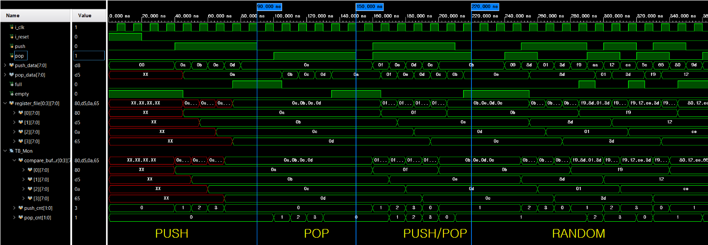

# tb_fifo 쉽게 읽기: 이 테스트벤치는 무엇을 확인하나

> **한 줄 요약**
> FIFO에 넣은 순서대로 데이터가 나오는지, 그리고 `full`과 `empty` 신호가 제때 켜지고 꺼지는지를 **4단계 시나리오**로 확인합니다.



---

## 1. 먼저 알아둘 것

### FIFO란?

**줄 서기**와 같습니다. 먼저 들어온 데이터가 먼저 나갑니다(First In, First Out).
이 설계는 칸이 **4개**(`DEPTH = 4`)이고, 한 칸에 **8비트** 데이터를 담습니다.

| 신호 | 방향 | 의미 |
|---|---|---|
| `push` + `push_data` | 입력 | 데이터를 줄 맨 뒤에 넣기 |
| `pop` | 입력 | 줄 맨 앞 데이터를 꺼내기 |
| `pop_data` | 출력 | 지금 줄 맨 앞에 있는 데이터. pop하지 않아도 항상 보임 |
| `full` | 출력 | 4칸이 다 찼음. 이때 push는 무시되어야 함 |
| `empty` | 출력 | 한 칸도 없음. 이때 pop은 무시되어야 함 |

### TB의 핵심 아이디어: "정답 장부"

TB는 FIFO 안을 직접 들여다보지 않습니다. 대신 **자기만의 장부**를 따로 적습니다.

| TB 변수 | 역할 | 쉽게 말하면 |
|---|---|---|
| `compare_buffer[0:3]` | 정답 장부 (scoreboard) | "지금쯤 FIFO 안에 이게 들어 있어야 해" |
| `push_cnt` | 장부의 쓰기 위치 | 다음에 몇 번 칸에 적을지 |
| `pop_cnt` | 장부의 읽기 위치 | 다음에 몇 번 칸과 비교할지 |

동작 원리는 간단합니다.

1. push가 받아들여질 때마다 → 같은 값을 장부에도 적는다.
2. pop할 때마다 → FIFO가 내놓은 `pop_data`와 장부 값을 비교한다.
3. 같으면 `pass`, 다르면 `fail`.

> **왜 `push_cnt`, `pop_cnt`가 2비트일까?**
> 2비트는 `0 → 1 → 2 → 3 → 0`으로 저절로 한 바퀴 돕니다. FIFO 포인터도 똑같이 4칸을 빙글빙글 돌기 때문에, `integer`처럼 "4가 되면 0으로 되돌려라" 같은 조건을 따로 쓸 필요가 없습니다.

### 왜 항상 `negedge`(하강 엣지)에서 확인할까?

- FIFO는 **posedge**(상승 엣지)에서 값을 바꿉니다.
- TB는 그 **반 클럭 뒤인 negedge**에서 입력을 넣고 결과를 확인합니다.
- `pop_data`는 조합회로(`assign rdata = register_file[raddr]`)라서 포인터가 바뀌면 바로 따라 바뀝니다. negedge쯤이면 값이 이미 다 안정되어 있습니다.
- 또 negedge에서 본 `full`/`empty`는 **바로 다음 posedge에서 FIFO가 판단에 쓸 값**과 같습니다. 그래서 TB의 "이번 push는 받아들여지겠지?"라는 판단이 FIFO의 실제 판단과 정확히 일치합니다.

시간 기준(클럭 주기 10ns):

```
posedge(FIFO가 동작) :  5, 15, 25, 35, 45 ... ns
negedge(TB가 확인)   : 10, 20, 30, 40, 50 ... ns
```

---

## 2. 전체 흐름 한눈에 보기

| 순서 | 구간 | 이름 | 하는 일 | 확인하는 것 |
|:---:|---|---|---|---|
| 0 | 0 ~ 40ns | 리셋 | 초기화 | 리셋 직후 `full=0`, `empty=1`인가 |
| 1 | 40 ~ 90ns | **PUSH** | 5번 넣기 | 4번째에 `full`이 켜지는가, 5번째는 무시되는가 |
| 2 | 100 ~ 150ns | **POP** | 5번 꺼내기 | 넣은 순서대로 나오는가, 4번째 뒤 `empty`가 켜지는가 |
| 3 | 160 ~ 220ns | **PUSH/POP** | 넣기와 꺼내기 동시에 5번 | 동시에 해도 순서와 데이터가 맞는가 |
| 4 | 240ns ~ | **RANDOM** | 무작위 256번 | 어떤 조합에서도 데이터가 틀리지 않는가 |

파형 위의 파란 세로선(90ns, 150ns, 220ns)이 각 단계의 경계입니다.

---

## 3. 단계별 설명

### 0단계: 리셋 확인 (0 ~ 40ns)

**하는 일**
- `i_reset = 1`로 시작해서 negedge 두 번 뒤(20ns)에 리셋을 풉니다.
- 30ns에 `full`과 `empty`를 확인합니다.

**통과 기준**
- `full == 0` (아무것도 안 넣었으니 꽉 차지 않음)
- `empty == 1` (아무것도 안 넣었으니 비어 있음)

**파형에서 보이는 것**
- `empty`가 처음부터 high 상태입니다. ✅
- `register_file`과 `compare_buffer`는 아직 아무것도 안 써서 빨간 `XX`(값 모름)입니다. 정상입니다.

---

### 1단계: PUSH (40 ~ 90ns) — "4칸이 차면 full이 켜지는가?"

**하는 일**: `0a, 0b, 0c, 0d, 0e`를 차례로 **5번** 넣습니다. 칸은 4개뿐이니 5번째는 넘치는 상황입니다.

| TB 시점 | 넣는 값 | 그때 `full` | 장부 기록 | FIFO 반응 (반 클럭 뒤) |
|---|---|:---:|---|---|
| 40ns | `0a` | 0 | `compare_buffer[0] = 0a` | 45ns: 0번 칸에 저장, `empty` 꺼짐 |
| 50ns | `0b` | 0 | `compare_buffer[1] = 0b` | 55ns: 1번 칸에 저장 |
| 60ns | `0c` | 0 | `compare_buffer[2] = 0c` | 65ns: 2번 칸에 저장 |
| 70ns | `0d` | 0 | `compare_buffer[3] = 0d` | 75ns: 3번 칸에 저장, **`full` 켜짐** |
| 80ns | `0e` | **1** | 적지 않음 | **무시됨** (덮어쓰지 않음) |

**확인 포인트**
- `full`이 **75ns**에 켜집니다. 4번째 push가 반영되는 순간입니다. ✅
- 5번째 값 `0e`를 넣었는데도 `register_file`은 `0a, 0b, 0c, 0d` 그대로입니다. 꽉 찬 FIFO가 기존 데이터를 지켜냈다는 뜻입니다. ✅
- `push_cnt`가 `0 → 1 → 2 → 3 → 0`으로 한 바퀴 돌고 멈춥니다.

> 이 단계는 콘솔에 pass/fail을 따로 찍지 않습니다. **파형으로 확인**하는 단계입니다.

---

### 2단계: POP (100 ~ 150ns) — "넣은 순서대로 나오는가?"

**하는 일**: **5번** 꺼냅니다. 데이터는 4개뿐이니 5번째는 빈 FIFO에서 꺼내려는 상황입니다.

| TB 시점 | 그때 `pop_data` | 장부 값 | 결과 | FIFO 반응 (반 클럭 뒤) |
|---|:---:|:---:|:---:|---|
| 100ns | `0a` | `compare_buffer[0] = 0a` | pass | 105ns: 다음 칸으로, **`full` 꺼짐** |
| 110ns | `0b` | `compare_buffer[1] = 0b` | pass | 115ns: 다음 칸으로 |
| 120ns | `0c` | `compare_buffer[2] = 0c` | pass | 125ns: 다음 칸으로 |
| 130ns | `0d` | `compare_buffer[3] = 0d` | pass | 135ns: **`empty` 켜짐** |
| 140ns | — | — | 비교 안 함 | `empty`라서 무시됨 |

반복이 끝나면 `empty == 1`인지 한 번 더 확인합니다.

**확인 포인트**
- `pop_data`가 `0a → 0b → 0c → 0d` 순서로 나옵니다. **넣은 순서 그대로**입니다. ✅
- 하나를 꺼내자마자(105ns) `full`이 꺼집니다. ✅
- 마지막 데이터를 꺼낸 순간(135ns) `empty`가 켜집니다. ✅

> **헷갈리기 쉬운 부분**: 135ns 이후 `pop_data`에 다시 `0a`가 보입니다.
> 읽기 포인터가 한 바퀴 돌아 0번 칸을 가리키고 있고, 0번 칸에 예전 값 `0a`가 **지워지지 않고 남아 있을 뿐**입니다. `empty`가 켜져 있으니 의미 없는 값이고, 버그가 아닙니다.

---

### 3단계: PUSH/POP 동시 (160 ~ 220ns) — "동시에 해도 꼬이지 않는가?"

**하는 일**: 매 클럭마다 `push`와 `pop`을 **둘 다 1**로 둡니다. 넣는 값은 `0f, 0e, 0d, 0c, 0b`(거꾸로 세기)입니다.

| TB 시점 | 넣는 값 → 장부 | 꺼낸 값 비교 | 비고 |
|---|---|---|---|
| 160ns | `0f` → `[0]` | 비교 안 함 | FIFO가 비어 있어서 **넣기만** 됨 |
| 170ns | `0e` → `[1]` | `0f` = `[0]` pass | 넣고 꺼내기 동시에 |
| 180ns | `0d` → `[2]` | `0e` = `[1]` pass | 〃 |
| 190ns | `0c` → `[3]` | `0d` = `[2]` pass | 〃 |
| 200ns | `0b` → `[0]` | `0c` = `[3]` pass | 장부가 한 바퀴 돌아 0번 칸에 다시 기록 |

**확인 포인트**
- 비어 있을 때 동시 요청이 오면 **push만** 처리됩니다(160ns). 꺼낼 게 없으니 당연합니다. ✅
- 그 뒤로는 하나 넣고 하나 빼니까 FIFO 안에는 늘 **1개**만 남아 있습니다. 그래서 `full`도 `empty`도 켜지지 않습니다. ✅
- `pop_data`가 `0f → 0e → 0d → 0c → 0b`로, 바로 한 클럭 전에 넣은 값이 나옵니다. ✅

**마무리 구간 (210 ~ 230ns)**
- 210ns: `push`를 끄고 `pop`만 한 번 더 해서, FIFO에 남아 있던 `0b`를 비웁니다.
  이때는 비교하지 않고 `pop_cnt`만 1 올려서 장부를 FIFO와 맞춥니다.
- 215ns: `empty`가 다시 켜집니다.
- 220ns: `pop`을 끄고, 깨끗한 빈 상태에서 랜덤 테스트를 시작합니다.

---

### 4단계: RANDOM (240ns ~) — "아무렇게나 해도 데이터가 맞는가?"

**하는 일**: **256번** 동안 매 클럭 무작위로 정합니다.
- `push`: 0 또는 1
- `pop`: 0 또는 1
- `push_data`: 0 ~ 255 중 아무 값

**장부 규칙** (앞 단계와 같음)

| 조건 | TB가 하는 일 |
|---|---|
| `push`이고 `full`이 아님 | 장부에 기록 |
| `pop`이고 `empty`가 아님 | `pop_data`와 장부를 비교해서 `pass_cnt` 또는 `fail_cnt`를 1 올림 |

**왜 랜덤을 하나?**
1~3단계는 사람이 정한 "예쁜" 순서만 시험합니다. 실제로는 아래처럼 순서가 섞인 상황이 생깁니다.
- 꽉 찬 상태에서 동시에 push와 pop이 들어옴
- 1개 남았을 때 pop이 연속으로 들어옴
- 넣고 빼기를 불규칙하게 반복함

랜덤은 이런 **사람이 미처 생각 못 한 조합**을 자동으로 많이 만들어 줍니다.

**파형에서 보이는 것**
- `push`와 `pop`이 불규칙하게 켜졌다 꺼집니다.
- 약 285ns, 325ns, 345ns 근처에서 `full`이 켜집니다. 랜덤 중에도 **꽉 찬 경계 상황**까지 시험되고 있다는 뜻입니다.
- `register_file`(FIFO 실제 메모리)과 `compare_buffer`(TB 장부)의 값이 같은 흐름으로 바뀝니다. 예: 두 쪽 모두 `f9, 8d, 01, 3d`가 됩니다.

**최종 결과 출력**

```
*** random result ***
total random test  =        256
pass count =   (비교한 횟수)
fail count =          0      ← 이게 0이어야 통과
```

> pass count가 256보다 작은 것은 정상입니다. `pop = 0`이었거나 `empty`여서 비교하지 않은 회차가 있기 때문입니다.

---

## 4. 파형 읽기 팁

### `compare_buffer`가 `register_file`보다 반 클럭 먼저 바뀐다

1단계 파형을 보면 `compare_buffer[0]`은 **40ns**에, `register_file[0]`은 **45ns**에 `0a`가 됩니다.

- TB 장부는 **negedge**에 적습니다.
- FIFO 메모리는 **posedge**에 씁니다.

그래서 5ns 차이가 나는 것이 **정상**입니다.

### 신호별로 무엇을 보면 되나

| 보고 싶은 것 | 볼 신호 |
|---|---|
| 데이터가 순서대로 나오나 | `pop_data` ↔ `compare_buffer` |
| 넘침을 막았나 | 1단계 80ns 이후 `register_file`이 그대로인지 |
| 경계 신호가 맞나 | `full`(75ns 켜짐, 105ns 꺼짐), `empty`(135ns 켜짐) |
| 장부가 FIFO를 잘 따라가나 | `push_cnt`, `pop_cnt`가 0~3을 순환하는지 |

---

## 5. 참고: 알아두면 좋은 점

- **콘솔 문구 오타**: 리셋 확인 메시지가 `":ass full signal"`, `":ail empty signal"`처럼 찍힙니다. `pass`/`fail`에서 `p`, `f`가 빠진 것이고 판정 자체에는 영향이 없습니다.
- **집계 범위**: `pass_cnt`/`fail_cnt`는 **4단계 랜덤만** 셉니다. 1~3단계 결과는 콘솔에 찍힌 `pass`/`fail` 줄을 직접 확인해야 합니다.
- **넘침/빈 상태 무시 동작**(1단계 5번째 push, 2단계 5번째 pop)은 TB가 자동으로 판정하지 않습니다. **파형으로 확인**하는 항목입니다.
