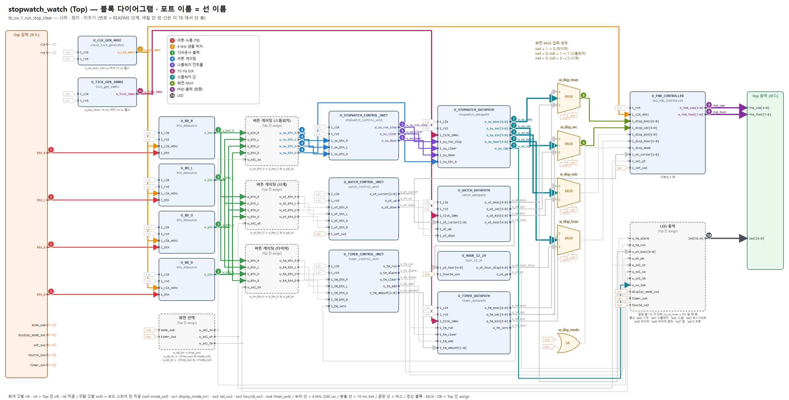
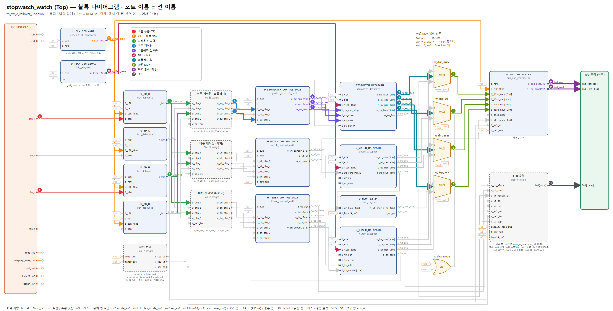
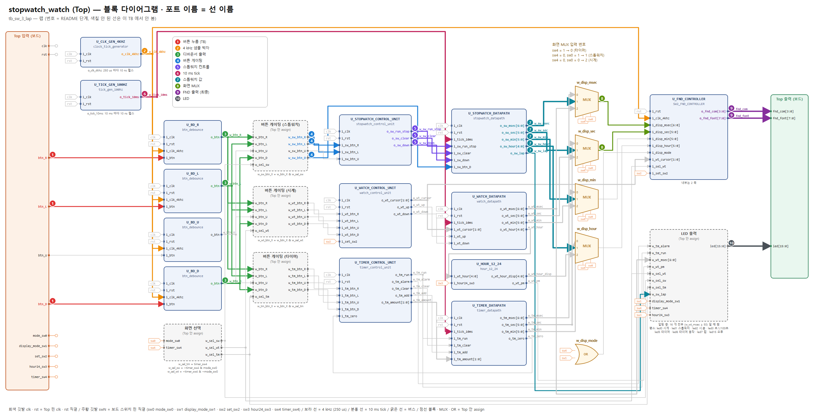

# 01_stopwatch — 스톱워치 동작 확인 안내서 (발표: 이종혁)

블록 다이어그램(`../../block_diagram.pdf`)의 **입력 → 출력 순서**로, 각 단계에서 **어느 블록의 어느 포트**를 파형에 넣어 볼지 안내한다. 그림의 번호 · 색 = 표의 단계 번호.

## 이 기능의 사양

| 버튼 (sw0 = 1, 스톱워치 화면) | 동작 |
|---|---|
| R | 시작 ↔ 정지 |
| L | **정지 중에만** 0 으로 지우기 + 랩 해제 (동작 중 무시) |
| U | **정지 중에만** 업 ↔ 다운 (동작 중 무시) |
| D | 랩: 누른 순간 값을 화면에 고정, 다시 누르면 실시간 (내부 카운터는 계속) |

범위 00:00:00.00 ~ 23:59:59.99 (끝에서 순환). 다른 화면으로 가도 계속 돈다.

## 0. 시작 전에 (처음 한 번)

1. **Vivado 소스**: Design Sources = `../../source_file/*.v, *.sv` / Simulation Sources = 이 폴더의 `tb_*.sv` 하나 + `fnd_monitor.sv` → TB 를 *Set as Top*
2. **Run Simulation → Run All**. 콘솔 마지막 `[SUMMARY] ... => PASS` 면 이 TB 의 모든 기준 통과. `[FAIL]` 이 있으면 그 시각으로 *Go To Time*
3. **파형에 신호 넣기** — 아래 각 TB 의 "단계" 표 순서대로
   - Scope 창에서 `tb_xxx → dut → U_xxx` 인스턴스를 클릭 → Objects 창에 **그 모듈의 포트**가 나온다 → 표의 포트를 우클릭 *Add to Wave Window*
   - `dut (assign …)` 이라고 적힌 것은 모듈이 아니라 Top 안 선이다 → Scope 에서 `dut` 를 클릭하면 Objects 에 같은 이름의 `w_` 선이 있다
   - 이름 규칙: 모듈 출력 `o_xxx` → Top 선 `w_xxx` → 다음 모듈 입력 `i_xxx` (몸통 이름이 같다). 전체 연결은 `../../source_file/PORT_MAP.md`
4. **Radix**: 시간 값(`o_sw_msec` 등) = Unsigned Decimal, `fnd_com` = Binary, `fnd_font` = Hexadecimal
5. **10 ns 펄스 찾기**: `o_clk_4khz`, `o_tick_10ms`, `o_btn` 은 10 ns 짜리라 줌을 당기면 안 보인다 → 신호를 고르고 툴바의 *Go to next transition* 으로 하나씩 이동
6. 파형은 `clk` 를 빼고 보는 것을 권장 (수 초 시뮬이면 파일이 매우 커짐). 긴 TB 는 파일 맨 위 `RUN_PHASE` 를 Phase 번호로 바꿔 그 Phase 만 실행
7. **프리로드**: `[INFO][PRELOAD]` 가 찍힌 시각에 TB 가 카운터에 경계 바로 앞 값(예 23:59:59.95)을 직접 넣는다 (주파수는 그대로 100 MHz). 경계를 넘는 것은 그 뒤 실제 tick 으로 본다

## 1. 시간 단위 (파형에서 먼저 확인할 것)

| 신호 (블록.포트) | 주기 | 펄스 폭 | 의미 |
|---|---|---|---|
| `U_CLK_GEN_4KHZ.o_clk_4khz` | **250 us** (4 kHz) | 10 ns | 디바운서 샘플 박자, FND 자리 바꾸는 박자 |
| `U_TICK_GEN_100HZ.o_tick_10ms` | **10 ms** (100 Hz) | 10 ns | 1/100 초 한 칸. 스톱워치 · 시계 · 타이머 공용, 항상 흐름 |
| `U_BD_x.o_btn` | 누를 때 1 번 | 10 ns | 누른 뒤 **1.75 ~ 2.0 ms** (4 kHz 샘플 8 번) |
| `U_FND_CONTROLLER/U_COUNTER8.o_scan_sel` | 한 칸 **250 us**, 한 바퀴 **2 ms** | — | 0~3 숫자 자리, 4~7 빈칸 · 점 |

## 2. FND 읽는 법 (마지막 판정)

기능이 끝까지 맞았는지는 **FND 출력이 자리마다 맞는 글자를 내는지**로 판정한다.
`fnd_com` 의 0 인 비트가 켜진 자리, 그 순간 `fnd_font` 가 그 자리 글자.

| `o_scan_sel` | `fnd_com` | 자리 | `fnd_font` |
|---|---|---|---|
| 0 | 1110 | AN0 (맨 오른쪽) | 화면 4 번째 글자 |
| 1 | 1101 | AN1 | 화면 3 번째 글자 |
| 2 | 1011 | AN2 | 화면 2 번째 글자 |
| 3 | 0111 | AN3 (맨 왼쪽) | 화면 1 번째 글자 |
| 4 · 5 · 7 | 1110 · 1101 · 0111 | AN0 · AN1 · AN3 | `FF` 빈칸 |
| 6 | 1011 | AN2 | 가운데 점: `7F` (i_disp_msec < 50) / `FF` (≥ 50) |

글자 코드 (active-low): `0`=C0 `1`=F9 `2`=A4 `3`=B0 `4`=99 `5`=92 `6`=82 `7`=F8 `8`=80 `9`=90, 빈칸=FF, 점만=7F

---

## 3. `tb_sw_1_run_stop_clear.sv` — 시작 · 정지 · 지우기

**확인하는 것**: R 로 시작/정지, 정지 중 L 로 지우기, 동작 중 L · U 무시, 다른 화면 버튼이 안 들어오는지

### 단계 (파형에 넣는 순서)

| 단계 | 블록 (Scope 경로) | 꺼낼 포트 | 시간 | 확인할 것 |
|---|---|---|---|---|
| **1** 버튼 누름 (TB) | TB 최상위 | `btn_R` `btn_L` `btn_U` `btn_D` | 5 ms 누름 + 5 ms 뗌 | TB 가 Top 입력 핀을 직접 누른다 |
| **2** 4 kHz 샘플 박자 | `dut/U_CLK_GEN_4KHZ` | `o_clk_4khz` | 250 us 마다 10 ns 펄스 | 디바운서 · FND 스캔이 이 펄스의 상승 엣지로 움직인다 |
| **3** 디바운서 출력 | `dut/U_BD_R` `dut/U_BD_L` `dut/U_BD_U` `dut/U_BD_D` | `o_btn` `o_btn` `o_btn` `o_btn` | 누른 뒤 1.75 ~ 2.0 ms 에 10 ns 펄스 1 개 | 4 kHz 샘플 8 번이 모두 1 이 된 순간 1 클럭. 한 번 누름 = 펄스 1 개 |
| **4** 버튼 게이팅 | dut (assign 버튼 게이팅) | `w_sw_btn_R` `w_sw_btn_L` `w_sw_btn_U` `w_sw_btn_D` | o_btn 과 같은 클럭 | mode_sw0 = 1, timer_sw4 = 0 일 때만 o_btn 이 그대로 지나감. 다른 화면이면 0 |
| **5** 스톱워치 컨트롤 | `dut/U_STOPWATCH_CONTROL_UNIT` | `o_sw_run_stop` `o_sw_clear` `o_sw_down` | run_stop · down: 버튼 펄스 다음 클럭(10 ns 뒤) clear: 버튼 펄스와 같은 10 ns | R → o_sw_run_stop 토글 / L(정지 중) → o_sw_clear 10 ns 펄스 / U(정지 중) → o_sw_down 토글 |
| **6** 10 ms tick | `dut/U_TICK_GEN_100HZ` | `o_tick_10ms` | 10 ms 마다 10 ns 펄스 | 스톱워치 · 시계 · 타이머 공용. 항상 흐른다 |
| **7** 스톱워치 값 | `dut/U_STOPWATCH_DATAPATH` | `o_sw_msec` `o_sw_sec` `o_sw_min` `o_sw_hour` `o_sw_lap` | o_sw_run_stop = 1 동안 tick 다음 클럭에 +1 (다운이면 −1) | 올림은 1 클럭씩 늦게 전달: msec → sec → min → hour (최대 4 클럭) 더 보려면: 내부 카운터: `dut/U_STOPWATCH_DATAPATH/U_MSEC_COUNTER` 의 `o_count`, `o_tick` (SEC · MIN · HOUR 도 같음) |
| **8** 화면 MUX | dut (assign 화면 MUX) | `w_disp_msec` `w_disp_sec` | o_sw_* 와 같은 순간 | timer_sw4 = 0, mode_sw0 = 1 → 입력 1 (스톱워치) 이 지나감 |
| **9** FND 출력 (최종) | `dut/U_FND_CONTROLLER` | `o_fnd_com` `o_fnd_font` | 250 us 마다 자리 바뀜, 2 ms 한 바퀴 | 아래 'FND 결론' 표의 자리별 값과 같아야 기능 완료 |
| **10** LED | dut (assign LED) | `led` | 버튼 펄스 다음 클럭 | led1 스톱워치 화면 · led3 초.1/100초 · led2 시.분 · led7 랩 |

### Phase 별로 볼 곳

| Phase | TB 가 하는 것 | 볼 단계 | 정상 |
|---|---|---|---|
| P1 | 리셋 | 5 · 7 · 9 · 10 | `o_sw_run_stop` = 0, `o_sw_*` = 0, `led` = 000A, FND "00.00" |
| P2 | R → 정확히 1.000 s 뒤 R | 3 · 5 · 6 · 7 | `o_sw_run_stop` 1 구간 = 1000.000 ms ± 20 us, 그동안 tick 99~100 번 → 값 1.00 초 |
| P3 | 120 ms 동작 후 R, 200 ms 대기 | 5 · 7 | 정지 뒤 `o_sw_*` 변화 없음 |
| P4 | 정지 중 D(랩) → L | 4 · 5 · 7 · 9 | `o_sw_lap` 0→1, L 의 `o_sw_clear` 펄스에 `o_sw_*` = 0 · `o_sw_lap` = 0, FND "00.00" |
| P5 | 동작 중 L, 그다음 U | 4 · 5 · 7 | `o_sw_clear` 펄스 **안 나옴**, `o_sw_down` 그대로 0, `o_sw_msec` 계속 증가 (보드 버그 수정 확인) |
| P6 | 정지 중 R 과 L 을 같은 순간 | 3 · 5 · 7 | `U_BD_R.o_btn` · `U_BD_L.o_btn` 같은 클럭 → `o_sw_clear` 펄스 + `o_sw_run_stop` 1 → 0 부터 증가 (`[LIMIT]` 기록) |
| P7 | 동작 중 시계 화면(mode_sw0 = 0)에서 R · L · U · D | 4 · 5 · 7 · 10 | `w_sw_btn_*` 계속 0 (게이팅), `o_sw_run_stop` 1 유지, 값 증가, `led` = 8009 |

### FND 결론 (마지막 단계)

| 순간 | 화면 | AN3 (`fnd_com`=0111) | AN2 (1011) | AN1 (1101) | AN0 (1110) | 가운데 점 (o_scan_sel 6, AN2) |
|---|---|---|---|---|---|---|
| P1 리셋 · P4 지운 뒤 | "00.00" (초.1/100초) | `C0` (0) | `C0` (0) | `C0` (0) | `C0` (0) | i_disp_msec < 50 → `7F` 점 켬, ≥ 50 → `FF` |

---

## 4. `tb_sw_2_rollover_updown.sv` — 올림 · 빌림 경계

**확인하는 것**: 1/100초 → 초 → 분 → 시 올림, 24 시간 순환, 다운 카운트의 0 → 23:59:59.99 빌림

### 단계 (파형에 넣는 순서)

| 단계 | 블록 (Scope 경로) | 꺼낼 포트 | 시간 | 확인할 것 |
|---|---|---|---|---|
| **1** 버튼 누름 (TB) | TB 최상위 | `btn_R` `btn_U` | 5 ms 누름 + 5 ms 뗌 | TB 가 Top 입력 핀을 직접 누른다 |
| **2** 4 kHz 샘플 박자 | `dut/U_CLK_GEN_4KHZ` | `o_clk_4khz` | 250 us 마다 10 ns 펄스 | 디바운서 · FND 스캔이 이 펄스의 상승 엣지로 움직인다 |
| **3** 디바운서 출력 | `dut/U_BD_R` `dut/U_BD_U` | `o_btn` `o_btn` | 누른 뒤 1.75 ~ 2.0 ms 에 10 ns 펄스 1 개 | 4 kHz 샘플 8 번이 모두 1 이 된 순간 1 클럭. 한 번 누름 = 펄스 1 개 |
| **4** 버튼 게이팅 | dut (assign 버튼 게이팅) | `w_sw_btn_R` `w_sw_btn_U` | o_btn 과 같은 클럭 | mode_sw0 = 1, timer_sw4 = 0 일 때만 o_btn 이 그대로 지나감. 다른 화면이면 0 |
| **5** 스톱워치 컨트롤 | `dut/U_STOPWATCH_CONTROL_UNIT` | `o_sw_run_stop` `o_sw_clear` `o_sw_down` | run_stop · down: 버튼 펄스 다음 클럭(10 ns 뒤) clear: 버튼 펄스와 같은 10 ns | R → o_sw_run_stop 토글 / L(정지 중) → o_sw_clear 10 ns 펄스 / U(정지 중) → o_sw_down 토글 |
| **6** 10 ms tick | `dut/U_TICK_GEN_100HZ` | `o_tick_10ms` | 10 ms 마다 10 ns 펄스 | 스톱워치 · 시계 · 타이머 공용. 항상 흐른다 |
| **7** 스톱워치 값 | `dut/U_STOPWATCH_DATAPATH` | `o_sw_msec` `o_sw_sec` `o_sw_min` `o_sw_hour` | o_sw_run_stop = 1 동안 tick 다음 클럭에 +1 (다운이면 −1) | 올림은 1 클럭씩 늦게 전달: msec → sec → min → hour (최대 4 클럭) 더 보려면: 올림 사슬: `dut/U_STOPWATCH_DATAPATH/U_MSEC_COUNTER.o_tick` → `U_SEC_COUNTER.i_tick` → … `U_HOUR_COUNTER` (각 `o_count`) |
| **8** 화면 MUX | dut (assign 화면 MUX) | `w_disp_msec` `w_disp_sec` `w_disp_min` `w_disp_hour` | o_sw_* 와 같은 순간 | timer_sw4 = 0, mode_sw0 = 1 → 입력 1 (스톱워치) 이 지나감 |
| **9** FND 출력 (최종) | `dut/U_FND_CONTROLLER` | `o_fnd_com` `o_fnd_font` | 250 us 마다 자리 바뀜, 2 ms 한 바퀴 | 아래 'FND 결론' 표의 자리별 값과 같아야 기능 완료 |
| **10** LED | dut (assign LED) | `led` | 버튼 펄스 다음 클럭 | led1 스톱워치 화면 · led3 초.1/100초 · led2 시.분 · led7 랩 |

### Phase 별로 볼 곳

| Phase | TB 가 하는 것 | 볼 단계 | 정상 |
|---|---|---|---|
| P1 | 동작 중 00:00:59.95 프리로드 | 6 · 7 | tick 4 번 뒤 59.99 → 5 번째 tick 에 `o_sw_sec` 0, `o_sw_min` 1 (sec 는 msec 보다 1 클럭 늦게) |
| P2 | 00:59:59.95 프리로드 | 6 · 7 | 59:59.99 → **01:00:00.00** (`o_sw_hour` 1) |
| P3 | 23:59:59.95 프리로드 (display_mode_sw1 = 1) | 6 · 7 · 8 · 9 | 23:59:59.99 → **00:00:00.00**, FND "00.00" (시.분). tick 직후 4 클럭 동안 자리가 하나씩 0 으로 |
| P4 | 정지 중 U → R → 00:00:00.05 프리로드 | 3 · 5 · 6 · 7 | `o_sw_down` = 1, 00:00:00.00 → **23:59:59.99** → 23:59:59.98 |
| P5 | 다운 동작 중 U → R → U → R | 3 · 5 · 7 | 동작 중 U: `o_sw_down` 그대로 1 / 정지 후 U: 0 → 다시 증가 |

프리로드 Phase 는 콘솔 `[INFO][PRELOAD]` 시각부터 보면 된다.

### FND 결론 (마지막 단계)

| 순간 | 화면 | AN3 (`fnd_com`=0111) | AN2 (1011) | AN1 (1101) | AN0 (1110) | 가운데 점 (o_scan_sel 6, AN2) |
|---|---|---|---|---|---|---|
| P3 자정 순환 뒤 (시.분) | "00.00" (시.분) | `C0` (0) | `C0` (0) | `C0` (0) | `C0` (0) | i_disp_msec < 50 → `7F` 점 켬, ≥ 50 → `FF` |

---

## 5. `tb_sw_3_lap.sv` — 랩

**확인하는 것**: D 로 화면 고정 / 다시 D 로 실시간, 랩 중 내부 카운터는 계속, 정지 중 L 로 랩 해제

### 단계 (파형에 넣는 순서)

| 단계 | 블록 (Scope 경로) | 꺼낼 포트 | 시간 | 확인할 것 |
|---|---|---|---|---|
| **1** 버튼 누름 (TB) | TB 최상위 | `btn_R` `btn_L` `btn_D` | 5 ms 누름 + 5 ms 뗌 | TB 가 Top 입력 핀을 직접 누른다 |
| **2** 4 kHz 샘플 박자 | `dut/U_CLK_GEN_4KHZ` | `o_clk_4khz` | 250 us 마다 10 ns 펄스 | 디바운서 · FND 스캔이 이 펄스의 상승 엣지로 움직인다 |
| **3** 디바운서 출력 | `dut/U_BD_R` `dut/U_BD_L` `dut/U_BD_D` | `o_btn` `o_btn` `o_btn` | 누른 뒤 1.75 ~ 2.0 ms 에 10 ns 펄스 1 개 | 4 kHz 샘플 8 번이 모두 1 이 된 순간 1 클럭. 한 번 누름 = 펄스 1 개 |
| **4** 버튼 게이팅 | dut (assign 버튼 게이팅) | `w_sw_btn_R` `w_sw_btn_L` `w_sw_btn_D` | o_btn 과 같은 클럭 | mode_sw0 = 1, timer_sw4 = 0 일 때만 o_btn 이 그대로 지나감. 다른 화면이면 0 |
| **5** 스톱워치 컨트롤 | `dut/U_STOPWATCH_CONTROL_UNIT` | `o_sw_run_stop` `o_sw_clear` `o_sw_down` | run_stop · down: 버튼 펄스 다음 클럭(10 ns 뒤) clear: 버튼 펄스와 같은 10 ns | R → o_sw_run_stop 토글 / L(정지 중) → o_sw_clear 10 ns 펄스 / U(정지 중) → o_sw_down 토글 |
| **6** 10 ms tick | `dut/U_TICK_GEN_100HZ` | `o_tick_10ms` | 10 ms 마다 10 ns 펄스 | 스톱워치 · 시계 · 타이머 공용. 항상 흐른다 |
| **7** 스톱워치 값 | `dut/U_STOPWATCH_DATAPATH` | `o_sw_msec` `o_sw_sec` `o_sw_min` `o_sw_hour` `o_sw_lap` | o_sw_run_stop = 1 동안 tick 다음 클럭에 +1 (다운이면 −1) | 올림은 1 클럭씩 늦게 전달: msec → sec → min → hour (최대 4 클럭) 더 보려면: 랩 전 값: `dut/U_STOPWATCH_DATAPATH/U_LAP_CONTROLLER` 의 `i_cnt_msec` … (내부 카운터), 화면 값은 같은 블록 `o_sw_*` |
| **8** 화면 MUX | dut (assign 화면 MUX) | `w_disp_msec` `w_disp_sec` | o_sw_* 와 같은 순간 | timer_sw4 = 0, mode_sw0 = 1 → 입력 1 (스톱워치) 이 지나감 |
| **9** FND 출력 (최종) | `dut/U_FND_CONTROLLER` | `o_fnd_com` `o_fnd_font` | 250 us 마다 자리 바뀜, 2 ms 한 바퀴 | 아래 'FND 결론' 표의 자리별 값과 같아야 기능 완료 |
| **10** LED | dut (assign LED) | `led` | 버튼 펄스 다음 클럭 | led1 스톱워치 화면 · led3 초.1/100초 · led2 시.분 · led7 랩 |

### Phase 별로 볼 곳

| Phase | TB 가 하는 것 | 볼 단계 | 정상 |
|---|---|---|---|
| P1 | 동작 200 ms 후 D, 100 ms 대기 | 3 · 6 · 7 · 10 | `o_sw_lap` = 1, `led[7]` = 1, `o_sw_*` 100 ms 동안 고정, `U_LAP_CONTROLLER.i_cnt_msec` 은 9 번 이상 증가 |
| P2 | D 한 번 더 | 3 · 7 | `o_sw_lap` = 0, `o_sw_*` = `i_cnt_*` |
| P3 | 랩 · 동작 중 L → R → L | 4 · 5 · 7 | 동작 중 L: `o_sw_clear` 안 나옴, 랩 유지 / 정지 후 L: `o_sw_clear` 펄스 → `o_sw_lap` 0, 값 0 |
| P4 | 정지 중 D → R | 5 · 7 | 정지 값 고정 표시, 다시 동작해도 `o_sw_*` 고정 · `i_cnt_*` 만 증가 |
| P5 | 동작 중 00:00:59.98 프리로드 직후 D | 3 · 7 | 랩 값 `o_sw_sec`.`o_sw_msec` = 59.98, 내부 `i_cnt_min` = 1 로 넘어감 |
| P6 | set_sw2 = 1 로 랩 중 FND, 시.분 화면 200 ms | 8 · 9 | FND = 랩 값 (예 "12.34"), set_sw2 = 1 이어도 스톱워치 화면은 **점멸 없음** ("00.00") |

프리로드 Phase 는 콘솔 `[INFO][PRELOAD]` 시각부터 보면 된다.

### FND 결론 (마지막 단계)

| 순간 | 화면 | AN3 (`fnd_com`=0111) | AN2 (1011) | AN1 (1101) | AN0 (1110) | 가운데 점 (o_scan_sel 6, AN2) |
|---|---|---|---|---|---|---|
| P6 랩 값 (초.1/100초) | "12.34" (초.1/100초) | `F9` (1) | `A4` (2) | `B0` (3) | `99` (4) | i_disp_msec < 50 → `7F` 점 켬, ≥ 50 → `FF` |
| P6 시.분 화면 (set_sw2 = 1) | "00.00" (시.분) | `C0` (0) | `C0` (0) | `C0` (0) | `C0` (0) | i_disp_msec < 50 → `7F` 점 켬, ≥ 50 → `FF` |
