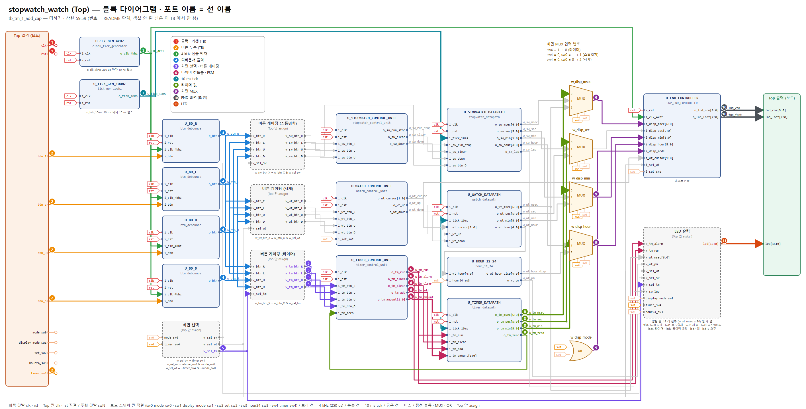
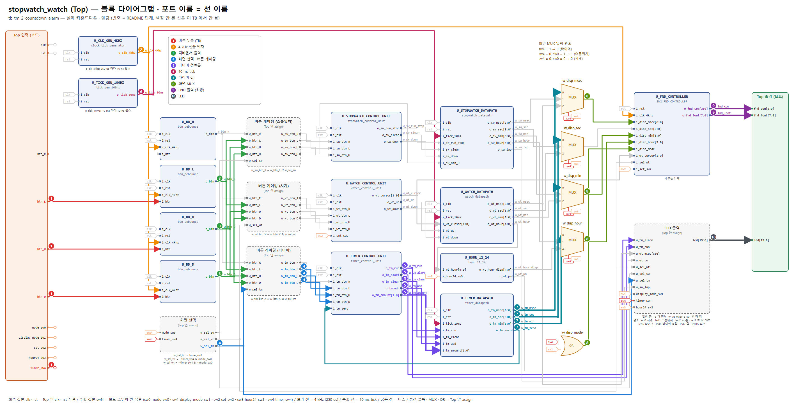
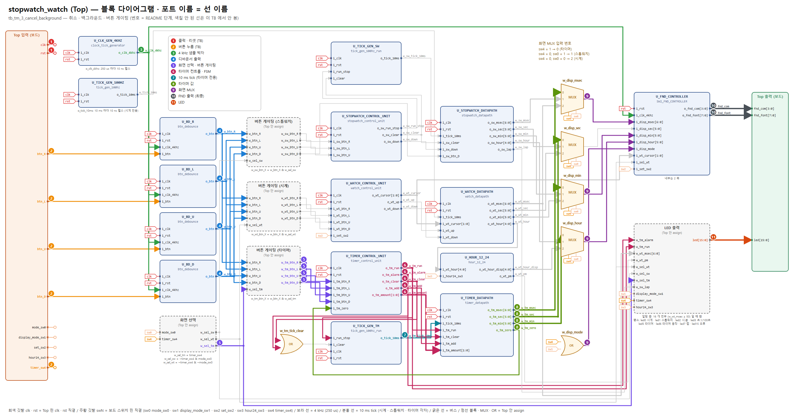

# 02_timer — 타이머 동작 확인 안내서 (발표: 정보윤)

블록 다이어그램(`../../block_diagram.pdf`)의 **입력 → 출력 순서**로, 각 단계에서 **어느 블록의 어느 포트**를 파형에 넣어 볼지 안내한다. 그림의 번호 · 색 = 표의 단계 번호. TB 그림 모음 PDF: [`02_timer_tb_figures.pdf`](02_timer_tb_figures.pdf)

## 이 기능의 사양

| 상태 | 버튼 (timer_sw4 = 1) | 동작 |
|---|---|---|
| SET | U / R / D | +10 초 / +1 분 / +10 분, **최대 59:59** (넘으면 59:59) |
| SET | L | 시작 (남은 시간 0 이면 시작 안 함) |
| RUN | L | 취소 → 00:00, SET |
| RUN | U / R / D | 무시 |
| ALARM | 아무 버튼 | 알람 끄기 → SET (더하기로 안 쓰임) |

0 이 되면 알람: LED 16 개가 0.5 초마다 켜짐/꺼짐 (어느 화면에서나). 화면은 display_mode_sw1 과 상관없이 "분.초".
10 ms tick 은 공용이라 설정 T 초는 실제로 (T − 10 ms) ~ T 사이에 끝난다.

### FSM 상태 (`U_TIMER_CONTROL_UNIT` 의 `c_state` · `n_state`)

| 지금 상태 | 조건 | 다음 상태 | 출력 |
|---|---|---|---|
| SET (리셋) | L & `i_tm_zero` = 0 | RUN | U / R / D → `o_tm_add` 10 ns + `o_tm_amount` 0 / 1 / 2 (같은 10 ns). L 인데 0 이면 SET 그대로 |
| RUN | L | SET | `o_tm_run` = 1. L 이면 `o_tm_clear` 10 ns (값 0). U · R · D 무시 |
| RUN | `i_tm_zero` = 1 (0 이 됨) | ALARM | 다음 클럭에 `o_tm_run` 0 · `o_tm_alarm` 1 이 동시에 |
| ALARM | 아무 버튼 | SET | `o_tm_alarm` = 1. 버튼은 끄기로만 쓰임 (`o_tm_add` 안 나옴) |

## 0. 시작 전에 (처음 한 번)

1. **Vivado 소스**: Design Sources = `../../source_file/*.v, *.sv` / Simulation Sources = 이 폴더의 `tb_*.sv` 하나 + `fnd_monitor.sv` → TB 를 *Set as Top*
2. **Run Simulation → Run All**. 콘솔 마지막 `[SUMMARY] ... => PASS` 면 이 TB 의 모든 기준 통과. `[FAIL]` 이 있으면 그 시각으로 *Go To Time*
3. **파형에 신호 넣기** — 아래 각 TB 의 "단계" 표 순서대로
   - Scope 창에서 `tb_xxx → dut → U_xxx` 인스턴스를 클릭 → Objects 창에 **그 모듈의 포트**가 나온다 → 표의 포트를 우클릭 *Add to Wave Window*
   - `dut (assign …)` 이라고 적힌 것은 모듈이 아니라 Top 안 선이다 → Scope 에서 `dut` 를 클릭하면 Objects 에 같은 이름의 `w_` 선이 있다
   - 이름 규칙: 모듈 출력 `o_xxx` → Top 선 `w_xxx` → 다음 모듈 입력 `i_xxx` (몸통 이름이 같다). 전체 연결은 `../../source_file/PORT_MAP.md`
4. **Radix**: 시간 값(`o_sw_msec` 등) = Unsigned Decimal, `fnd_com` = Binary, `fnd_font` = Hexadecimal
5. **10 ns 펄스 찾기**: `o_clk_4khz`, `o_tick_10ms`, `o_btn` 은 10 ns 짜리라 줌을 당기면 안 보인다 → 신호를 고르고 툴바의 *Go to next transition* 으로 하나씩 이동
6. **`clk` · `rst` 는 항상 같이 넣는다** (1 단계). 모든 "다음 클럭" 타이밍의 기준이다. 수 초짜리 시뮬에서 `clk` 를 넣으면 파형이 커지므로, 긴 TB 는 파일 맨 위 `RUN_PHASE` 를 Phase 번호로 바꿔 그 Phase 만 실행
7. **FSM 상태 보기**: 컨트롤 유닛 (`U_STOPWATCH_CONTROL_UNIT` · `U_WATCH_CONTROL_UNIT` · `U_TIMER_CONTROL_UNIT`) 을 고르면 Objects 창에 포트 말고 `c_state` · `n_state` 도 있다. enum 이라 파형에 숫자 대신 **STOP · RUN · SET_MIN_1 · ALARM 같은 이름**으로 나온다
   - `n_state` = 다음 상태 (조합): 버튼 펄스가 들어온 **그 10 ns** 에 바뀐다
   - `c_state` = 현재 상태 (레지스터): **다음 클럭 엣지**에 `n_state` 값으로 바뀐다 → 출력 (`o_sw_run_stop` 등) 이 이때 바뀜
   - 각 폴더의 "FSM 상태" 표와 Phase 표의 "상태" 를 같이 보면 된다
8. **프리로드**: `[INFO][PRELOAD]` 가 찍힌 시각에 TB 가 카운터에 경계 바로 앞 값(예 23:59:59.95)을 직접 넣는다 (주파수는 그대로 100 MHz). 경계를 넘는 것은 그 뒤 실제 tick 으로 본다

## 1. 시간 단위 (파형에서 먼저 확인할 것)

| 신호 (블록.포트) | 주기 | 펄스 폭 | 의미 |
|---|---|---|---|
| `U_CLK_GEN_4KHZ.o_clk_4khz` | **250 us** (4 kHz) | 10 ns | 디바운서 샘플 박자, FND 자리 바꾸는 박자 |
| `U_TICK_GEN_100HZ.o_tick_10ms` | **10 ms** (100 Hz) | 10 ns | 1/100 초 한 칸. 스톱워치 · 시계 · 타이머 공용, 항상 흐름 |
| `U_BD_x.o_btn` | 누를 때 1 번 | 10 ns | 누른 뒤 **1.75 ~ 2.0 ms** (4 kHz 샘플 8 번) |
| `U_FND_CONTROLLER/U_COUNTER8.o_scan_sel` | 한 칸 **250 us**, 한 바퀴 **2 ms** | — | 0~3 숫자 자리, 4~7 빈칸 · 점 |

## 2. FND 읽는 법 (마지막 판정)

기능이 끝까지 맞았는지는 **FND 출력이 자리마다 맞는 글자를 내는지**로 판정한다.
`fnd_com` 의 0 인 비트가 켜진 자리, 그 순간 `fnd_font` 가 그 자리 글자.

| `o_scan_sel` | `fnd_com` | 자리 | `fnd_font` |
|---|---|---|---|
| 0 | 1110 | AN0 (맨 오른쪽) | 화면 4 번째 글자 |
| 1 | 1101 | AN1 | 화면 3 번째 글자 |
| 2 | 1011 | AN2 | 화면 2 번째 글자 |
| 3 | 0111 | AN3 (맨 왼쪽) | 화면 1 번째 글자 |
| 4 · 5 · 7 | 1110 · 1101 · 0111 | AN0 · AN1 · AN3 | `FF` 빈칸 |
| 6 | 1011 | AN2 | 가운데 점: `7F` (i_disp_msec < 50) / `FF` (≥ 50) |

글자 코드 (active-low): `0`=C0 `1`=F9 `2`=A4 `3`=B0 `4`=99 `5`=92 `6`=82 `7`=F8 `8`=80 `9`=90, 빈칸=FF, 점만=7F

---

## 3. `tb_tm_1_add_cap.sv` — 더하기 · 상한 59:59

**확인하는 것**: U/R/D 더하는 양, 초 → 분 올림, 59:59 에서 고정, 0 에서 L 로 시작 안 함

### 단계 (파형에 넣는 순서)

| 단계 | 블록 (Scope 경로) | 꺼낼 포트 | 시간 | 확인할 것 |
|---|---|---|---|---|
| **1** 클럭 · 리셋 (TB) | TB 최상위 | `clk` `rst` | clk: 10 ns 주기 (100 MHz) rst: 각 Phase 시작에 1 us 펄스 | 모든 '다음 클럭' 의 기준. rst = 1 동안 모든 블록 `i_rst` = 1 → FSM 은 리셋 상태 (STOP · NORMAL · SET), 값은 리셋값, 4 kHz · 10 ms 카운터도 0 부터 다시 셈 (tick 위상의 기준) |
| **2** 버튼 누름 (TB) | TB 최상위 | `btn_R` `btn_L` `btn_U` `btn_D` `timer_sw4` | 5 ms 누름 + 5 ms 뗌 | timer_sw4 = 1 이면 타이머 화면 (mode_sw0 보다 우선) |
| **3** 4 kHz 샘플 박자 | `dut/U_CLK_GEN_4KHZ` | `o_clk_4khz` | 250 us 마다 10 ns 펄스 | 디바운서 · FND 스캔이 이 펄스의 상승 엣지로 움직인다 |
| **4** 디바운서 출력 | `dut/U_BD_R` `dut/U_BD_L` `dut/U_BD_U` `dut/U_BD_D` | `o_btn` `o_btn` `o_btn` `o_btn` | 누른 뒤 1.75 ~ 2.0 ms 에 10 ns 펄스 1 개 | 한 번 누름 = 펄스 1 개 |
| **5** 화면 선택 · 버튼 게이팅 | dut (assign 화면 선택) dut (assign 버튼 게이팅) | `w_sel_tm` `w_tm_btn_R` `w_tm_btn_L` `w_tm_btn_U` `w_tm_btn_D` | o_btn 과 같은 클럭 | w_sel_tm = timer_sw4. 타이머 화면일 때만 o_btn 이 w_tm_btn_X 로 지나감 |
| **6** 타이머 컨트롤 · FSM | `dut/U_TIMER_CONTROL_UNIT` | `o_tm_add` `o_tm_amount` `o_tm_run` `o_tm_clear` `o_tm_alarm` | add · amount · clear: 버튼 펄스와 같은 10 ns run · alarm: 다음 클럭 | SET: U/R/D → o_tm_add 펄스 + o_tm_amount 0/1/2, L → o_tm_run 1 / RUN: L → o_tm_clear / 0 이 되면 o_tm_alarm 1 **FSM**: 같은 블록 Objects 의 `c_state` · `n_state` (SET / RUN / ALARM). `o_tm_run` = (c_state == RUN), `o_tm_alarm` = (c_state == ALARM) |
| **7** 10 ms tick | `dut/U_TICK_GEN_100HZ` | `o_tick_10ms` | 10 ms 마다 10 ns 펄스 | o_tm_run = 1 일 때만 타이머가 줄어든다 |
| **8** 타이머 값 | `dut/U_TIMER_DATAPATH` | `o_tm_msec` `o_tm_sec` `o_tm_min` `o_tm_zero` | 더하기: o_tm_add 다음 클럭 / 줄이기: tick 다음 클럭에 −1 | o_tm_zero 는 TCU 의 i_tm_zero 로 되돌아간다 (0 이면 시작 안 함, 동작 중 0 → 알람) |
| **9** 화면 MUX | dut (assign 화면 MUX) dut (assign) | `w_disp_hour` `w_disp_min` `w_disp_msec` `w_disp_mode` | o_tm_* 와 같은 순간 | timer_sw4 = 1 → 입력 0: w_disp_hour = 분, w_disp_min = 초, w_disp_mode = 1 (화면 "분.초") |
| **10** FND 출력 (최종) | `dut/U_FND_CONTROLLER` | `o_fnd_com` `o_fnd_font` | 250 us 마다 자리 바뀜, 2 ms 한 바퀴 | 아래 'FND 결론' 표의 자리별 값과 같아야 기능 완료 |
| **11** LED | dut (assign LED) | `led` | o_tm_run · o_tm_alarm 과 같은 순간 | led5 타이머 화면 · led6 동작 중 / 알람 중: 16 개 전부 `U_WATCH_DATAPATH.o_wt_msec` ≥ 50 일 때 켬 (0.5 초 점멸) |

### Phase 별로 볼 곳

| Phase | TB 가 하는 것 | 볼 단계 | 정상 |
|---|---|---|---|
| P1 | 리셋 후 timer_sw4 = 1 | 1 · 5 · 9 · 10 · 11 | `w_disp_mode` = 1, `led` = 0020 (led5), FND "00.00" |
| P2 | 00:00 에서 L | 6 | `c_state` SET 그대로 (`i_tm_zero` = 1 이라 `n_state` 도 SET), `o_tm_run` 0, `o_tm_alarm` 0 |
| P3 | U × 5 → U | 6 · 8 · 10 | `c_state` SET 에서 U 마다 `o_tm_add` 펄스 + `o_tm_amount` 0 → +10 초: 00:50 → **01:00** (초 → 분 올림), FND "01.00" |
| P4 | R → D → U | 6 · 8 | `o_tm_amount` 1 / 2 / 0: 01:00 → 11:00 → 11:10 |
| P5 | D × 5 → R × 9 → U × 5 → U | 8 · 10 | 50:00 → 59:00 → 59:50 → **59:59** (60:00 아님), FND "59.59" |
| P6 | 59:59 에서 U, R, D | 6 · 8 | `o_tm_add` 펄스가 나와도 `o_tm_*` 59:59 유지 |
| P7 | 52:10 에서 D → R | 8 | 52:10 + 10 분 → **59:59**, R 에도 59:59 |

### FND 결론 (마지막 단계)

| 순간 | 화면 | AN3 (`fnd_com`=0111) | AN2 (1011) | AN1 (1101) | AN0 (1110) | 가운데 점 (o_scan_sel 6, AN2) |
|---|---|---|---|---|---|---|
| P1 리셋 | "00.00" (분.초) | `C0` (0) | `C0` (0) | `C0` (0) | `C0` (0) | i_disp_msec < 50 → `7F` 점 켬, ≥ 50 → `FF` |
| P3 끝 | "01.00" (분.초) | `C0` (0) | `F9` (1) | `C0` (0) | `C0` (0) | i_disp_msec < 50 → `7F` 점 켬, ≥ 50 → `FF` |
| P5 끝 | "59.59" (분.초) | `92` (5) | `90` (9) | `92` (5) | `90` (9) | i_disp_msec < 50 → `7F` 점 켬, ≥ 50 → `FF` |

---

## 4. `tb_tm_2_countdown_alarm.sv` — 실제 카운트다운 · 알람

**확인하는 것**: 10 초를 프리로드 없이 실제로 흘려 정확도 확인, 알람 LED, 알람 끄기, 빼기 빌림

### 단계 (파형에 넣는 순서)

| 단계 | 블록 (Scope 경로) | 꺼낼 포트 | 시간 | 확인할 것 |
|---|---|---|---|---|
| **1** 클럭 · 리셋 (TB) | TB 최상위 | `clk` `rst` | clk: 10 ns 주기 (100 MHz) rst: 각 Phase 시작에 1 us 펄스 | 모든 '다음 클럭' 의 기준. rst = 1 동안 모든 블록 `i_rst` = 1 → FSM 은 리셋 상태 (STOP · NORMAL · SET), 값은 리셋값, 4 kHz · 10 ms 카운터도 0 부터 다시 셈 (tick 위상의 기준) |
| **2** 버튼 누름 (TB) | TB 최상위 | `btn_L` `btn_U` `btn_D` `timer_sw4` | 5 ms 누름 + 5 ms 뗌 | timer_sw4 = 1 이면 타이머 화면 (mode_sw0 보다 우선) |
| **3** 4 kHz 샘플 박자 | `dut/U_CLK_GEN_4KHZ` | `o_clk_4khz` | 250 us 마다 10 ns 펄스 | 디바운서 · FND 스캔이 이 펄스의 상승 엣지로 움직인다 |
| **4** 디바운서 출력 | `dut/U_BD_L` `dut/U_BD_U` `dut/U_BD_D` | `o_btn` `o_btn` `o_btn` | 누른 뒤 1.75 ~ 2.0 ms 에 10 ns 펄스 1 개 | 한 번 누름 = 펄스 1 개 |
| **5** 화면 선택 · 버튼 게이팅 | dut (assign 화면 선택) dut (assign 버튼 게이팅) | `w_sel_tm` `w_tm_btn_L` `w_tm_btn_U` `w_tm_btn_D` | o_btn 과 같은 클럭 | w_sel_tm = timer_sw4. 타이머 화면일 때만 o_btn 이 w_tm_btn_X 로 지나감 |
| **6** 타이머 컨트롤 · FSM | `dut/U_TIMER_CONTROL_UNIT` | `o_tm_add` `o_tm_amount` `o_tm_run` `o_tm_clear` `o_tm_alarm` | add · amount · clear: 버튼 펄스와 같은 10 ns run · alarm: 다음 클럭 | SET: U/R/D → o_tm_add 펄스 + o_tm_amount 0/1/2, L → o_tm_run 1 / RUN: L → o_tm_clear / 0 이 되면 o_tm_alarm 1 **FSM**: 같은 블록 Objects 의 `c_state` · `n_state` (SET / RUN / ALARM). `o_tm_run` = (c_state == RUN), `o_tm_alarm` = (c_state == ALARM) |
| **7** 10 ms tick | `dut/U_TICK_GEN_100HZ` | `o_tick_10ms` | 10 ms 마다 10 ns 펄스 | o_tm_run = 1 일 때만 타이머가 줄어든다 |
| **8** 타이머 값 | `dut/U_TIMER_DATAPATH` | `o_tm_msec` `o_tm_sec` `o_tm_min` `o_tm_zero` | 더하기: o_tm_add 다음 클럭 / 줄이기: tick 다음 클럭에 −1 | o_tm_zero 는 TCU 의 i_tm_zero 로 되돌아간다 (0 이면 시작 안 함, 동작 중 0 → 알람) |
| **9** 화면 MUX | dut (assign 화면 MUX) dut (assign) | `w_disp_hour` `w_disp_min` `w_disp_msec` `w_disp_mode` | o_tm_* 와 같은 순간 | timer_sw4 = 1 → 입력 0: w_disp_hour = 분, w_disp_min = 초, w_disp_mode = 1 (화면 "분.초") |
| **10** FND 출력 (최종) | `dut/U_FND_CONTROLLER` | `o_fnd_com` `o_fnd_font` | 250 us 마다 자리 바뀜, 2 ms 한 바퀴 | 아래 'FND 결론' 표의 자리별 값과 같아야 기능 완료 |
| **11** LED | dut (assign LED) | `led` | o_tm_run · o_tm_alarm 과 같은 순간 | led5 타이머 화면 · led6 동작 중 / 알람 중: 16 개 전부 `U_WATCH_DATAPATH.o_wt_msec` ≥ 50 일 때 켬 (0.5 초 점멸) |

### Phase 별로 볼 곳

| Phase | TB 가 하는 것 | 볼 단계 | 정상 |
|---|---|---|---|
| P1 | U(00:10) → L, 끝까지 (약 10 초) | 6 · 7 · 8 · 11 | `c_state` SET → RUN → ALARM. RUN 진입 → ALARM 진입 간격 (= `o_tm_run` ↑ → `o_tm_alarm` ↑) **9.990 초 초과 ~ 10.000 초**, 그때 `o_tm_*` = 0, 동작 중 `led[6]` = 1 |
| P2 | 알람 1.5 초 (P1 에 이어서) | 11 | `c_state` ALARM 유지. `o_wt_msec` ≥ 50 이면 `led` = FFFF, 아니면 0000. 저절로 안 꺼짐 |
| P3 | D 로 알람 끄기 (P2 에 이어서) | 6 · 8 · 11 | `c_state` ALARM → SET, `o_tm_add` **안 나옴** → 값 00:00 그대로, `led` = 0020 |
| P4 | 동작 중 01:00.00, 10:00.00 프리로드 | 7 · 8 · 10 | 다음 tick 에 **00:59.99**, **09:59.99** (FND "09.59") |

P2 · P3 은 P1 의 알람을 이어서 쓴다. `RUN_PHASE = 1` 로 실행하면 P1~P3 이 같이 돈다.

프리로드 Phase 는 콘솔 `[INFO][PRELOAD]` 시각부터 보면 된다.

### FND 결론 (마지막 단계)

| 순간 | 화면 | AN3 (`fnd_com`=0111) | AN2 (1011) | AN1 (1101) | AN0 (1110) | 가운데 점 (o_scan_sel 6, AN2) |
|---|---|---|---|---|---|---|
| P1 알람 때 | "00.00" (분.초) | `C0` (0) | `C0` (0) | `C0` (0) | `C0` (0) | i_disp_msec < 50 → `7F` 점 켬, ≥ 50 → `FF` |
| P4 10:00.00 다음 tick | "09.59" (분.초) | `C0` (0) | `90` (9) | `92` (5) | `90` (9) | i_disp_msec < 50 → `7F` 점 켬, ≥ 50 → `FF` |

---

## 5. `tb_tm_3_cancel_background.sv` — 취소 · 백그라운드 · 버튼 게이팅

**확인하는 것**: 동작 중 더하기 무시, L 취소, 다른 화면에서도 줄어들고 알람, 다른 화면 버튼으로 알람 안 꺼짐, sw4 우선

### 단계 (파형에 넣는 순서)

| 단계 | 블록 (Scope 경로) | 꺼낼 포트 | 시간 | 확인할 것 |
|---|---|---|---|---|
| **1** 클럭 · 리셋 (TB) | TB 최상위 | `clk` `rst` | clk: 10 ns 주기 (100 MHz) rst: 각 Phase 시작에 1 us 펄스 | 모든 '다음 클럭' 의 기준. rst = 1 동안 모든 블록 `i_rst` = 1 → FSM 은 리셋 상태 (STOP · NORMAL · SET), 값은 리셋값, 4 kHz · 10 ms 카운터도 0 부터 다시 셈 (tick 위상의 기준) |
| **2** 버튼 누름 (TB) | TB 최상위 | `btn_R` `btn_L` `btn_U` `btn_D` `timer_sw4` | 5 ms 누름 + 5 ms 뗌 | timer_sw4 = 1 이면 타이머 화면 (mode_sw0 보다 우선) |
| **3** 4 kHz 샘플 박자 | `dut/U_CLK_GEN_4KHZ` | `o_clk_4khz` | 250 us 마다 10 ns 펄스 | 디바운서 · FND 스캔이 이 펄스의 상승 엣지로 움직인다 |
| **4** 디바운서 출력 | `dut/U_BD_R` `dut/U_BD_L` `dut/U_BD_U` `dut/U_BD_D` | `o_btn` `o_btn` `o_btn` `o_btn` | 누른 뒤 1.75 ~ 2.0 ms 에 10 ns 펄스 1 개 | 한 번 누름 = 펄스 1 개 |
| **5** 화면 선택 · 버튼 게이팅 | dut (assign 화면 선택) dut (assign 버튼 게이팅) | `w_sel_tm` `w_tm_btn_R` `w_tm_btn_L` `w_tm_btn_U` `w_tm_btn_D` | o_btn 과 같은 클럭 | w_sel_tm = timer_sw4. 타이머 화면일 때만 o_btn 이 w_tm_btn_X 로 지나감 |
| **6** 타이머 컨트롤 · FSM | `dut/U_TIMER_CONTROL_UNIT` | `o_tm_add` `o_tm_amount` `o_tm_run` `o_tm_clear` `o_tm_alarm` | add · amount · clear: 버튼 펄스와 같은 10 ns run · alarm: 다음 클럭 | SET: U/R/D → o_tm_add 펄스 + o_tm_amount 0/1/2, L → o_tm_run 1 / RUN: L → o_tm_clear / 0 이 되면 o_tm_alarm 1 **FSM**: 같은 블록 Objects 의 `c_state` · `n_state` (SET / RUN / ALARM). `o_tm_run` = (c_state == RUN), `o_tm_alarm` = (c_state == ALARM) |
| **7** 10 ms tick | `dut/U_TICK_GEN_100HZ` | `o_tick_10ms` | 10 ms 마다 10 ns 펄스 | o_tm_run = 1 일 때만 타이머가 줄어든다 |
| **8** 타이머 값 | `dut/U_TIMER_DATAPATH` | `o_tm_msec` `o_tm_sec` `o_tm_min` `o_tm_zero` | 더하기: o_tm_add 다음 클럭 / 줄이기: tick 다음 클럭에 −1 | o_tm_zero 는 TCU 의 i_tm_zero 로 되돌아간다 (0 이면 시작 안 함, 동작 중 0 → 알람) |
| **9** 화면 MUX | dut (assign 화면 MUX) dut (assign) | `w_disp_hour` `w_disp_min` `w_disp_msec` `w_disp_mode` | o_tm_* 와 같은 순간 | timer_sw4 = 1 → 입력 0: w_disp_hour = 분, w_disp_min = 초, w_disp_mode = 1 (화면 "분.초") |
| **10** FND 출력 (최종) | `dut/U_FND_CONTROLLER` | `o_fnd_com` `o_fnd_font` | 250 us 마다 자리 바뀜, 2 ms 한 바퀴 | 아래 'FND 결론' 표의 자리별 값과 같아야 기능 완료 |
| **11** LED | dut (assign LED) | `led` | o_tm_run · o_tm_alarm 과 같은 순간 | led5 타이머 화면 · led6 동작 중 / 알람 중: 16 개 전부 `U_WATCH_DATAPATH.o_wt_msec` ≥ 50 일 때 켬 (0.5 초 점멸) |

### Phase 별로 볼 곳

| Phase | TB 가 하는 것 | 볼 단계 | 정상 |
|---|---|---|---|
| P1 | 01:00 시작 후 U, R, D | 6 · 8 | `c_state` RUN 유지, `o_tm_add` **안 나옴**, 값은 약 30 ms 만큼만 줄어듦 |
| P2 | 동작 중 L | 6 · 8 | `c_state` RUN → SET, 그 10 ns 에 `o_tm_clear` 펄스 → **00:00.00** |
| P3 | 01:00 시작 → 시계 화면 → 00:00.30 프리로드 | 5 · 8 · 10 · 11 | 시계 화면에서도 `c_state` RUN → ALARM, `led` 알람 패턴, FND 는 시계 "12.00" |
| P4 | 알람 중 시계 화면 U/D/L/R, 스톱워치 화면 D | 5 · 6 | `w_tm_btn_*` 모두 0 → `c_state` **ALARM 유지** |
| P5 | timer_sw4 = 1 & mode_sw0 = 1 → R | 5 · 6 · 8 · 11 | `w_sel_tm` = 1, R 로 `c_state` ALARM → SET · `o_tm_add` 안 나옴 (1 분 안 더해짐), `led` = 0020 |

프리로드 Phase 는 콘솔 `[INFO][PRELOAD]` 시각부터 보면 된다.

### FND 결론 (마지막 단계)

| 순간 | 화면 | AN3 (`fnd_com`=0111) | AN2 (1011) | AN1 (1101) | AN0 (1110) | 가운데 점 (o_scan_sel 6, AN2) |
|---|---|---|---|---|---|---|
| P2 취소 뒤 | "00.00" (분.초) | `C0` (0) | `C0` (0) | `C0` (0) | `C0` (0) | i_disp_msec < 50 → `7F` 점 켬, ≥ 50 → `FF` |
| P3 시계 화면 (알람 중) | "12.00" (시계 시.분) | `F9` (1) | `A4` (2) | `C0` (0) | `C0` (0) | i_disp_msec < 50 → `7F` 점 켬, ≥ 50 → `FF` |
