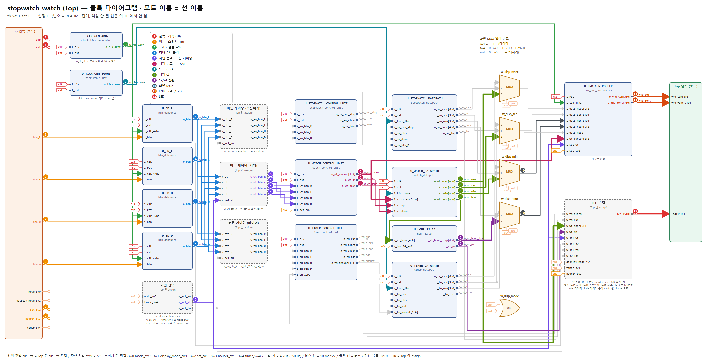
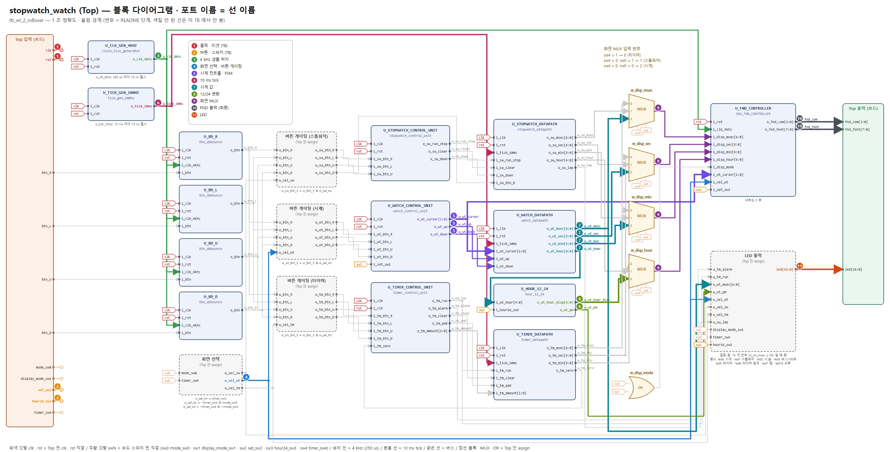
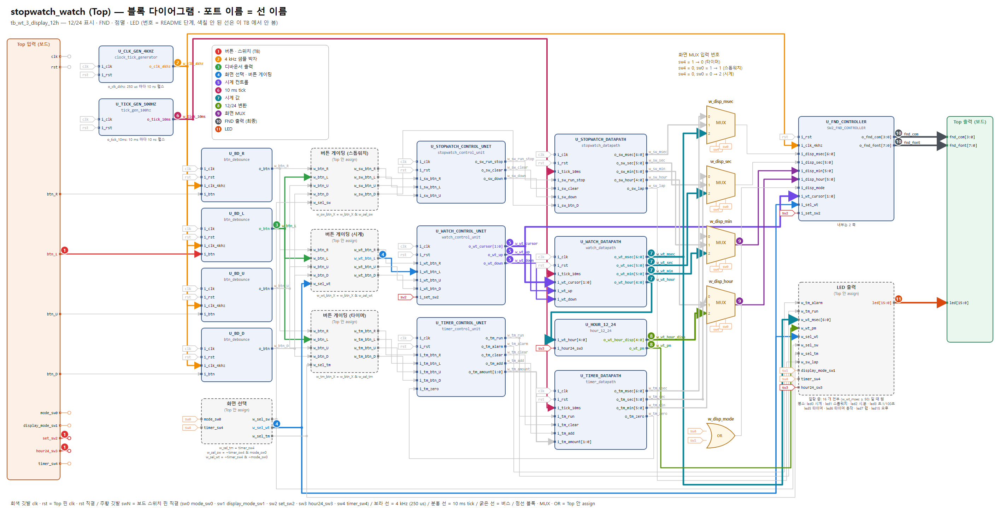

# 03_watch — 시계 동작 확인 안내서 (발표: 정안성)

블록 다이어그램(`../../block_diagram.pdf`)의 **입력 → 출력 순서**로, 각 단계에서 **어느 블록의 어느 포트**를 파형에 넣어 볼지 안내한다. 그림의 번호 · 색 = 표의 단계 번호. TB 그림 모음 PDF: [`03_watch_tb_figures.pdf`](03_watch_tb_figures.pdf)

## 이 기능의 사양

리셋 = **12:00:00.00 (오후 12 시)**, 기본 12 시간 표시. 설정 모드 = 시계 화면(mode_sw0 = 0) + set_sw2 = 1

| 버튼 | 동작 |
|---|---|
| L / R | 커서 이동. L: 분 일 → 분 십 → 시 → 분 일, R: 반대 (양 끝에서 돌아감) |
| U / D | 커서 자리만 ±. 분 일 ±1, 분 십 ±10, 시 ±1. **윗자리로 올림/내림 없음** (분 59 + 1 → 00, 시 그대로) |
| U + D 동시 | U 우선 |

설정에 들어가면 항상 분 일의 자리부터. 초 · 1/100 초는 설정 안 함. 설정 중에도 시계는 흐른다. 설정 중 커서 자리가 0.5 초마다 빈칸 (시.분 화면).

### FSM 상태 (`U_WATCH_CONTROL_UNIT` 의 `c_state` · `n_state`)

| 지금 상태 (커서) | 조건 | 다음 상태 |
|---|---|---|
| NORMAL (3, 리셋) | set_sw2 = 1 | SET_MIN_1 |
| SET_MIN_1 (0) | L / R / set_sw2 = 0 | SET_MIN_10 / SET_HOUR / NORMAL |
| SET_MIN_10 (1) | L / R / set_sw2 = 0 | SET_HOUR / SET_MIN_1 / NORMAL |
| SET_HOUR (2) | L / R / set_sw2 = 0 | SET_MIN_1 / SET_MIN_10 / NORMAL |

우선순위: set_sw2 = 0 → L → R. 출력: `o_wt_cursor` = 상태 (괄호 안 숫자, 무어). `o_wt_up` = U, `o_wt_down` = D & ~U — SET_x 이고 set_sw2 = 1 일 때만, 버튼 펄스와 같은 10 ns (밀리).

## 0. 시작 전에 (처음 한 번)

1. **Vivado 소스**: Design Sources = `../../source_file/*.v, *.sv` / Simulation Sources = 이 폴더의 `tb_*.sv` 하나 + `fnd_monitor.sv` → TB 를 *Set as Top*
2. **Run Simulation → Run All**. 콘솔 마지막 `[SUMMARY] ... => PASS` 면 이 TB 의 모든 기준 통과. `[FAIL]` 이 있으면 그 시각으로 *Go To Time*
   - 콘솔 읽는 법: Phase 마다 `[BEGIN]` 아래 `plan` (TB 가 할 일) · `expect` (정상 결과). 그다음 TB 가 한 일이 한 줄씩 `[RESET]` `[SW]` `[BTN]` `[WAIT]` `[PRELOAD]` 로 찍히고, 오른쪽에 그 전 → 후 값 (지금 화면 값 · FSM 상태). 검사는 `[OK]` / `[FAIL]` (exp = 기대, got = 실제)
   - 줄 맨 앞 `[시각]` 이 파형 *Go To Time* 에 넣을 시각. `[BTN]` 의 `o_btn @` 시각 = 디바운서 펄스 (파형의 X_tick) 위치
3. **파형에 신호 넣기** — 아래 각 TB 의 "단계" 표 순서대로
   - Scope 창에서 `tb_xxx → dut → U_xxx` 인스턴스를 클릭 → Objects 창에 **그 모듈의 포트**가 나온다 → 표의 포트를 우클릭 *Add to Wave Window*
   - `dut (assign …)` 이라고 적힌 것은 모듈이 아니라 Top 안 선이다 → Scope 에서 `dut` 를 클릭하면 Objects 에 같은 이름의 `w_` 선이 있다
   - 이름 규칙: 모듈 출력 `o_xxx` → Top 선 `w_xxx` → 다음 모듈 입력 `i_xxx` (몸통 이름이 같다). 전체 연결은 `../../source_file/PORT_MAP.md`
4. **Radix**: 시간 값(`o_sw_msec` 등) = Unsigned Decimal, `fnd_com` = Binary, `fnd_font` = Hexadecimal
5. **10 ns 펄스 찾기**: `o_clk_4khz`, `o_tick_10ms`, `o_btn` 은 10 ns 짜리라 줌을 당기면 안 보인다 → 신호를 고르고 툴바의 *Go to next transition* 으로 하나씩 이동
6. **`clk` · `rst` 는 항상 같이 넣는다** (1 단계). 모든 "다음 클럭" 타이밍의 기준이다. 수 초짜리 시뮬에서 `clk` 를 넣으면 파형이 커지므로, 긴 TB 는 파일 맨 위 `RUN_PHASE` 를 Phase 번호로 바꿔 그 Phase 만 실행
7. **FSM 상태 보기**: 컨트롤 유닛 (`U_STOPWATCH_CONTROL_UNIT` · `U_WATCH_CONTROL_UNIT` · `U_TIMER_CONTROL_UNIT`) 을 고르면 Objects 창에 포트 말고 `c_state` · `n_state` 도 있다. enum 이라 파형에 숫자 대신 **STOP · RUN · SET_MIN_1 · ALARM 같은 이름**으로 나온다
   - `n_state` = 다음 상태 (조합): 버튼 펄스가 들어온 **그 10 ns** 에 바뀐다
   - `c_state` = 현재 상태 (레지스터): **다음 클럭 엣지**에 `n_state` 값으로 바뀐다 → 출력 (`o_sw_run_stop` 등) 이 이때 바뀜
   - 각 폴더의 "FSM 상태" 표와 Phase 표의 "상태" 를 같이 보면 된다
8. **프리로드**: `[PRELOAD]` 가 찍힌 시각에 TB 가 카운터에 경계 바로 앞 값(예 23:59:59.95)을 직접 넣는다 (주파수는 그대로 100 MHz). 경계를 넘는 것은 그 뒤 실제 tick 으로 본다
   - 파형에서 **tick · 버튼 없이 값이 갑자기 바뀌는 곳 = 프리로드** (버튼 · DUT 동작 아님). 콘솔 다음 줄에 바뀌기 전 → 후 값이 찍힌다

## 1. 시간 단위 (파형에서 먼저 확인할 것)

| 신호 (블록.포트) | 주기 | 펄스 폭 | 의미 |
|---|---|---|---|
| `U_CLK_GEN_4KHZ.o_clk_4khz` | **250 us** (4 kHz) | 10 ns | 디바운서 샘플 박자, FND 자리 바꾸는 박자 |
| `U_TICK_GEN_100HZ.o_tick_10ms` | **10 ms** (100 Hz) | 10 ns | 1/100 초 한 칸. **시계 전용**, 항상 흐름 |
| `U_TICK_GEN_SW.o_tick_10ms` · `U_TICK_GEN_TM.o_tick_10ms` | **10 ms** | 10 ns | 스톱워치 · 타이머 전용. 시작(RUN) 순간부터 셈 → 첫 칸이 정확히 10 ms (10/17 ④) |
| `U_BD_x.o_btn` | 누를 때 1 번 | 10 ns | 누른 뒤 **1.75 ~ 2.0 ms** (4 kHz 샘플 8 번) |
| `U_FND_CONTROLLER/U_COUNTER8.o_scan_sel` | 한 칸 **250 us**, 한 바퀴 **2 ms** | — | 0~3 숫자 자리, 4~7 빈칸 · 점 |

## 2. FND 읽는 법 (마지막 판정)

기능이 끝까지 맞았는지는 **FND 출력이 자리마다 맞는 글자를 내는지**로 판정한다.
`fnd_com` 의 0 인 비트가 켜진 자리, 그 순간 `fnd_font` 가 그 자리 글자.

| `o_scan_sel` | `fnd_com` | 자리 | `fnd_font` |
|---|---|---|---|
| 0 | 1110 | AN0 (맨 오른쪽) | 화면 4 번째 글자 |
| 1 | 1101 | AN1 | 화면 3 번째 글자 |
| 2 | 1011 | AN2 | 화면 2 번째 글자 |
| 3 | 0111 | AN3 (맨 왼쪽) | 화면 1 번째 글자 |
| 4 · 5 · 7 | 1110 · 1101 · 0111 | AN0 · AN1 · AN3 | `FF` 빈칸 |
| 6 | 1011 | AN2 | 가운데 점: `7F` (i_disp_msec < 50) / `FF` (≥ 50) |

글자 코드 (active-low): `0`=C0 `1`=F9 `2`=A4 `3`=B0 `4`=99 `5`=92 `6`=82 `7`=F8 `8`=80 `9`=90, 빈칸=FF, 점만=7F

---

## 3. `tb_wt_1_set_ui.sv` — 설정 UI

**확인하는 것**: 설정 아닐 때 버튼 무시, 커서 이동 · 양 끝 회전, 자리별 ± 회전, U 우선, 재진입 커서, 다른 화면 버튼 차단

### 단계 (파형에 넣는 순서)

| 단계 | 블록 (Scope 경로) | 꺼낼 포트 | 시간 | 확인할 것 |
|---|---|---|---|---|
| **1** 클럭 · 리셋 (TB) | TB 최상위 | `clk` `rst` | clk: 10 ns 주기 (100 MHz) rst: 각 Phase 시작에 1 us 펄스 | 모든 '다음 클럭' 의 기준. rst = 1 동안 모든 블록 `i_rst` = 1 → FSM 은 리셋 상태 (STOP · NORMAL · SET), 값은 리셋값, 4 kHz · 10 ms 카운터도 0 부터 다시 셈 (tick 위상의 기준) |
| **2** 버튼 · 스위치 (TB) | TB 최상위 | `btn_R` `btn_L` `btn_U` `btn_D` `set_sw2` `hour24_sw3` | 5 ms 누름 + 5 ms 뗌 | mode_sw0 = 0, timer_sw4 = 0 (시계 화면). set_sw2 = 1 설정 모드, hour24_sw3 = 0 이면 12 시간 표시 |
| **3** 4 kHz 샘플 박자 | `dut/U_CLK_GEN_4KHZ` | `o_clk_4khz` | 250 us 마다 10 ns 펄스 | 디바운서 · FND 스캔이 이 펄스의 상승 엣지로 움직인다 |
| **4** 디바운서 출력 | `dut/U_BD_R` `dut/U_BD_L` `dut/U_BD_U` `dut/U_BD_D` | `o_btn` `o_btn` `o_btn` `o_btn` | 누른 뒤 1.75 ~ 2.0 ms 에 10 ns 펄스 1 개 | 한 번 누름 = 펄스 1 개 |
| **5** 화면 선택 · 버튼 게이팅 | dut (assign 화면 선택) dut (assign 버튼 게이팅) | `w_sel_wt` `w_wt_btn_R` `w_wt_btn_L` `w_wt_btn_U` `w_wt_btn_D` | o_btn 과 같은 클럭 | w_sel_wt = ~timer_sw4 & ~mode_sw0. 시계 화면일 때만 o_btn 이 w_wt_btn_X 로 지나감 |
| **6** 시계 컨트롤 · FSM | `dut/U_WATCH_CONTROL_UNIT` | `o_wt_cursor` `o_wt_up` `o_wt_down` | cursor: L/R 펄스 · set_sw2 다음 클럭 up · down: 버튼 펄스와 같은 10 ns | o_wt_cursor 0 분 일 · 1 분 십 · 2 시 · 3 설정 아님. 설정 아닐 때 up/down 안 나옴. U 와 D 같은 클럭이면 U **FSM**: 같은 블록 Objects 의 `c_state` · `n_state` (NORMAL / SET_MIN_1 / SET_MIN_10 / SET_HOUR). 커서 = 상태 (SET_MIN_1 → 0, SET_MIN_10 → 1, SET_HOUR → 2, NORMAL → 3) |
| **7** 10 ms tick | `dut/U_TICK_GEN_100HZ` | `o_tick_10ms` | 10 ms 마다 10 ns 펄스 | 시계는 항상 흐른다 (설정 중에도) |
| **8** 시계 값 | `dut/U_WATCH_DATAPATH` | `o_wt_msec` `o_wt_sec` `o_wt_min` `o_wt_hour` | tick 다음 클럭에 +1 / up · down 다음 클럭에 커서 자리만 ± | o_wt_hour 는 0~23 (24 시간 기준). 설정은 윗자리로 올림 · 내림 없음 더 보려면: 내부 카운터: `dut/U_WATCH_DATAPATH/U_MIN_COUNTER` 의 `i_up`, `i_down`, `i_step10`, `o_count` |
| **9** 12/24 변환 | `dut/U_HOUR_12_24` | `o_wt_hour_disp` `o_wt_pm` | o_wt_hour 와 같은 순간 (조합) | hour24_sw3 = 0: 0 → 12, 13~23 → 1~11 / o_wt_pm = (o_wt_hour ≥ 12) |
| **10** 화면 MUX | dut (assign 화면 MUX) | `w_disp_hour` `w_disp_min` | o_wt_* 와 같은 순간 | timer_sw4 = 0, mode_sw0 = 0 → 입력 2 (시계, 시는 o_wt_hour_disp) 가 지나감 |
| **11** FND 출력 (최종) | `dut/U_FND_CONTROLLER` | `o_fnd_com` `o_fnd_font` | 250 us 마다 자리 바뀜, 2 ms 한 바퀴 | 아래 'FND 결론' 표와 같아야 기능 완료. 설정 점멸은 `dut/U_FND_CONTROLLER/U_ANODE_CHOICE_TO_MUX2` 의 `o_an0~3` 에서 커서 자리가 `d`(빈칸) |
| **12** LED | dut (assign LED) | `led` | 스위치 · 버튼 다음 클럭 | led0 시계 화면 · led2 시.분 · led3 초.1/100초 · **led15 오후** (시계 화면 & 12 시간 & o_wt_pm) |

### Phase 별로 볼 곳

| Phase | TB 가 하는 것 | 볼 단계 | 정상 |
|---|---|---|---|
| P1 | 리셋 | 1 · 6 · 8 · 11 · 12 | `c_state` NORMAL, 12:00:00.00, `o_wt_cursor` = 3, `led` = 8009 (led0 · led3 · led15) |
| P2 | set_sw2 = 0 에서 U, D, L, R | 5 · 6 · 8 | `c_state` NORMAL 유지, `o_wt_up` · `o_wt_down` 안 나옴, 12:00 그대로 |
| P3 | set_sw2 = 1 → L × 3 → R × 3 | 6 | `c_state` NORMAL → SET_MIN_1 / L: SET_MIN_1 → SET_MIN_10 → SET_HOUR → SET_MIN_1 / R: 반대 (`o_wt_cursor` 0 → 1 → 2 → 0) |
| P4 | 커서 0, 12:59 프리로드 → U → D → D | 6 · 8 | `c_state` SET_MIN_1: 12:00 (**시 13 아님**) → 12:59 → 12:58 |
| P5 | 커서 1, 12:55 프리로드 → U → D → D | 6 · 8 | `c_state` SET_MIN_10: 12:05 → 12:55 → 12:45 (분 십 ±10 회전) |
| P6 | 커서 2 에서 U → 23:30 프리로드 → U → D | 6 · 8 | `c_state` SET_HOUR: 13:00 → 00:30 (**분 그대로**) → 23:30 |
| P7 | U 와 D 를 같은 순간 | 4 · 6 · 8 | `U_BD_U.o_btn` · `U_BD_D.o_btn` 같은 클럭 → `o_wt_up` 만 1 → 12:01 |
| P8 | 커서를 시로 옮긴 뒤 set_sw2 끔 → 다시 켬 | 6 | SET_HOUR → (끔) NORMAL → (켬) **SET_MIN_1** (`o_wt_cursor` 3 → 0) |
| P9 | set_sw2 = 1 인 채 스톱워치 화면에서 R (스톱워치 RUN) → U · D · L → 0.5 초 대기 → R (STOP) → 타이머 화면에서 U · L · R | 5 · 6 · 8 | `w_wt_btn_*` 모두 0 → `c_state` · 시:분 그대로. 스톱워치가 화면에서 도는 동안 뒤에서 시계 초도 tick 마다 흐름 (콘솔 `[INFO] on screen : stopwatch ...` / `[INFO] background : watch 12:00:00.xx -> 12:00:00.yy`) |

TB 전체에서 상시 감시: `U_WATCH_DATAPATH/U_SEC_COUNTER` · `U_MSEC_COUNTER` 의 `i_up` · `i_down` 은 한 번도 1 이 되면 안 된다 (초 설정 없음).

프리로드 Phase 는 콘솔 `[PRELOAD]` 시각부터 보면 된다.

### FND 결론 (마지막 단계)

| 순간 | 화면 | AN3 (`fnd_com`=0111) | AN2 (1011) | AN1 (1101) | AN0 (1110) | 가운데 점 (o_scan_sel 6, AN2) |
|---|---|---|---|---|---|---|
| P1 리셋 (시.분) | "12.00" (시.분, 12 시간) | `F9` (1) | `A4` (2) | `C0` (0) | `C0` (0) | i_disp_msec < 50 → `7F` 점 켬, ≥ 50 → `FF` |

---

## 4. `tb_wt_2_rollover.sv` — 1 초 정확도 · 올림 경계

**확인하는 것**: 1 초 = 1 억 클럭 실측, 초 → 분 → 시 → 자정 올림, 설정 중에도 흐름

### 단계 (파형에 넣는 순서)

| 단계 | 블록 (Scope 경로) | 꺼낼 포트 | 시간 | 확인할 것 |
|---|---|---|---|---|
| **1** 클럭 · 리셋 (TB) | TB 최상위 | `clk` `rst` | clk: 10 ns 주기 (100 MHz) rst: 각 Phase 시작에 1 us 펄스 | 모든 '다음 클럭' 의 기준. rst = 1 동안 모든 블록 `i_rst` = 1 → FSM 은 리셋 상태 (STOP · NORMAL · SET), 값은 리셋값, 4 kHz · 10 ms 카운터도 0 부터 다시 셈 (tick 위상의 기준) |
| **2** 버튼 · 스위치 (TB) | TB 최상위 | `set_sw2` `hour24_sw3` | 5 ms 누름 + 5 ms 뗌 | mode_sw0 = 0, timer_sw4 = 0 (시계 화면). set_sw2 = 1 설정 모드, hour24_sw3 = 0 이면 12 시간 표시 |
| **3** 4 kHz 샘플 박자 | `dut/U_CLK_GEN_4KHZ` | `o_clk_4khz` | 250 us 마다 10 ns 펄스 | 디바운서 · FND 스캔이 이 펄스의 상승 엣지로 움직인다 |
| **4** 화면 선택 · 버튼 게이팅 | dut (assign 화면 선택) | `w_sel_wt` | o_btn 과 같은 클럭 | w_sel_wt = ~timer_sw4 & ~mode_sw0. 시계 화면일 때만 o_btn 이 w_wt_btn_X 로 지나감 |
| **5** 시계 컨트롤 · FSM | `dut/U_WATCH_CONTROL_UNIT` | `o_wt_cursor` `o_wt_up` `o_wt_down` | cursor: L/R 펄스 · set_sw2 다음 클럭 up · down: 버튼 펄스와 같은 10 ns | o_wt_cursor 0 분 일 · 1 분 십 · 2 시 · 3 설정 아님. 설정 아닐 때 up/down 안 나옴. U 와 D 같은 클럭이면 U **FSM**: 같은 블록 Objects 의 `c_state` · `n_state` (NORMAL / SET_MIN_1 / SET_MIN_10 / SET_HOUR). 커서 = 상태 (SET_MIN_1 → 0, SET_MIN_10 → 1, SET_HOUR → 2, NORMAL → 3) |
| **6** 10 ms tick | `dut/U_TICK_GEN_100HZ` | `o_tick_10ms` | 10 ms 마다 10 ns 펄스 | 시계는 항상 흐른다 (설정 중에도) |
| **7** 시계 값 | `dut/U_WATCH_DATAPATH` | `o_wt_msec` `o_wt_sec` `o_wt_min` `o_wt_hour` | tick 다음 클럭에 +1 / up · down 다음 클럭에 커서 자리만 ± | o_wt_hour 는 0~23 (24 시간 기준). 설정은 윗자리로 올림 · 내림 없음 더 보려면: 내부 카운터: `dut/U_WATCH_DATAPATH/U_MIN_COUNTER` 의 `i_up`, `i_down`, `i_step10`, `o_count` |
| **8** 12/24 변환 | `dut/U_HOUR_12_24` | `o_wt_hour_disp` `o_wt_pm` | o_wt_hour 와 같은 순간 (조합) | hour24_sw3 = 0: 0 → 12, 13~23 → 1~11 / o_wt_pm = (o_wt_hour ≥ 12) |
| **9** 화면 MUX | dut (assign 화면 MUX) | `w_disp_msec` `w_disp_sec` `w_disp_min` `w_disp_hour` | o_wt_* 와 같은 순간 | timer_sw4 = 0, mode_sw0 = 0 → 입력 2 (시계, 시는 o_wt_hour_disp) 가 지나감 |
| **10** FND 출력 (최종) | `dut/U_FND_CONTROLLER` | `o_fnd_com` `o_fnd_font` | 250 us 마다 자리 바뀜, 2 ms 한 바퀴 | 아래 'FND 결론' 표와 같아야 기능 완료. 설정 점멸은 `dut/U_FND_CONTROLLER/U_ANODE_CHOICE_TO_MUX2` 의 `o_an0~3` 에서 커서 자리가 `d`(빈칸) |
| **11** LED | dut (assign LED) | `led` | 스위치 · 버튼 다음 클럭 | led0 시계 화면 · led2 시.분 · led3 초.1/100초 · **led15 오후** (시계 화면 & 12 시간 & o_wt_pm) |

### Phase 별로 볼 곳

| Phase | TB 가 하는 것 | 볼 단계 | 정상 |
|---|---|---|---|
| P1 | 리셋 후 프리로드 없이 2 초 | 1 · 6 · 7 | `o_wt_sec` 바뀌는 간격 = 정확히 **1,000,000,000 ns**, 2 초 뒤 12:00:02.00 |
| P2 | 00:00:59.95 프리로드 | 6 · 7 | tick 4 번 뒤 59.99 → 5 번째 tick 에 **00:01:00.00** |
| P3 | 00:59:59.95 프리로드 | 6 · 7 | **01:00:00.00** |
| P4 | 23:59:59.95 프리로드 (시.분, 12 시간) | 6 · 7 · 8 · 10 · 11 | 직후 `o_wt_pm` 1 · `led[15]` 1 → **00:00:00.00** 에서 `o_wt_pm` 0 · `led[15]` 0, `o_wt_hour_disp` 12, FND "12.00" |
| P5 | 설정 모드에서 23:59:59.95 프리로드 | 5 · 7 | `c_state` SET_MIN_1 (설정 중) 이어도 00:00:00.00 으로 넘어감 |

P4 파형 포인트: tick 직후 4 클럭 동안 23:59:59.99 → 23:59:59.00 → 23:59:00.00 → 23:00:00.00 → 00:00:00.00 (올림이 1 클럭씩 늦게 전달, 30 ns).

프리로드 Phase 는 콘솔 `[PRELOAD]` 시각부터 보면 된다.

### FND 결론 (마지막 단계)

| 순간 | 화면 | AN3 (`fnd_com`=0111) | AN2 (1011) | AN1 (1101) | AN0 (1110) | 가운데 점 (o_scan_sel 6, AN2) |
|---|---|---|---|---|---|---|
| P4 자정 뒤 (시.분, 12 시간) | "12.00" (시.분) | `F9` (1) | `A4` (2) | `C0` (0) | `C0` (0) | i_disp_msec < 50 → `7F` 점 켬, ≥ 50 → `FF` |

---

## 5. `tb_wt_3_display_12h.sv` — 12/24 표시 · FND · 점멸 · LED

**확인하는 것**: 0 시와 12 시가 둘 다 '12' 로 보이는 변환, 화면 문자열, 설정 점멸, LED 조합

### 단계 (파형에 넣는 순서)

| 단계 | 블록 (Scope 경로) | 꺼낼 포트 | 시간 | 확인할 것 |
|---|---|---|---|---|
| **1** 클럭 · 리셋 (TB) | TB 최상위 | `clk` `rst` | clk: 10 ns 주기 (100 MHz) rst: 각 Phase 시작에 1 us 펄스 | 모든 '다음 클럭' 의 기준. rst = 1 동안 모든 블록 `i_rst` = 1 → FSM 은 리셋 상태 (STOP · NORMAL · SET), 값은 리셋값, 4 kHz · 10 ms 카운터도 0 부터 다시 셈 (tick 위상의 기준) |
| **2** 버튼 · 스위치 (TB) | TB 최상위 | `btn_L` `set_sw2` `hour24_sw3` | 5 ms 누름 + 5 ms 뗌 | mode_sw0 = 0, timer_sw4 = 0 (시계 화면). set_sw2 = 1 설정 모드, hour24_sw3 = 0 이면 12 시간 표시 |
| **3** 4 kHz 샘플 박자 | `dut/U_CLK_GEN_4KHZ` | `o_clk_4khz` | 250 us 마다 10 ns 펄스 | 디바운서 · FND 스캔이 이 펄스의 상승 엣지로 움직인다 |
| **4** 디바운서 출력 | `dut/U_BD_L` | `o_btn` | 누른 뒤 1.75 ~ 2.0 ms 에 10 ns 펄스 1 개 | 한 번 누름 = 펄스 1 개 |
| **5** 화면 선택 · 버튼 게이팅 | dut (assign 화면 선택) dut (assign 버튼 게이팅) | `w_sel_wt` `w_wt_btn_L` | o_btn 과 같은 클럭 | w_sel_wt = ~timer_sw4 & ~mode_sw0. 시계 화면일 때만 o_btn 이 w_wt_btn_X 로 지나감 |
| **6** 시계 컨트롤 · FSM | `dut/U_WATCH_CONTROL_UNIT` | `o_wt_cursor` `o_wt_up` `o_wt_down` | cursor: L/R 펄스 · set_sw2 다음 클럭 up · down: 버튼 펄스와 같은 10 ns | o_wt_cursor 0 분 일 · 1 분 십 · 2 시 · 3 설정 아님. 설정 아닐 때 up/down 안 나옴. U 와 D 같은 클럭이면 U **FSM**: 같은 블록 Objects 의 `c_state` · `n_state` (NORMAL / SET_MIN_1 / SET_MIN_10 / SET_HOUR). 커서 = 상태 (SET_MIN_1 → 0, SET_MIN_10 → 1, SET_HOUR → 2, NORMAL → 3) |
| **7** 10 ms tick | `dut/U_TICK_GEN_100HZ` | `o_tick_10ms` | 10 ms 마다 10 ns 펄스 | 시계는 항상 흐른다 (설정 중에도) |
| **8** 시계 값 | `dut/U_WATCH_DATAPATH` | `o_wt_msec` `o_wt_sec` `o_wt_min` `o_wt_hour` | tick 다음 클럭에 +1 / up · down 다음 클럭에 커서 자리만 ± | o_wt_hour 는 0~23 (24 시간 기준). 설정은 윗자리로 올림 · 내림 없음 더 보려면: 내부 카운터: `dut/U_WATCH_DATAPATH/U_MIN_COUNTER` 의 `i_up`, `i_down`, `i_step10`, `o_count` |
| **9** 12/24 변환 | `dut/U_HOUR_12_24` | `o_wt_hour_disp` `o_wt_pm` | o_wt_hour 와 같은 순간 (조합) | hour24_sw3 = 0: 0 → 12, 13~23 → 1~11 / o_wt_pm = (o_wt_hour ≥ 12) |
| **10** 화면 MUX | dut (assign 화면 MUX) | `w_disp_hour` `w_disp_min` | o_wt_* 와 같은 순간 | timer_sw4 = 0, mode_sw0 = 0 → 입력 2 (시계, 시는 o_wt_hour_disp) 가 지나감 |
| **11** FND 출력 (최종) | `dut/U_FND_CONTROLLER` | `o_fnd_com` `o_fnd_font` | 250 us 마다 자리 바뀜, 2 ms 한 바퀴 | 아래 'FND 결론' 표와 같아야 기능 완료. 설정 점멸은 `dut/U_FND_CONTROLLER/U_ANODE_CHOICE_TO_MUX2` 의 `o_an0~3` 에서 커서 자리가 `d`(빈칸) |
| **12** LED | dut (assign LED) | `led` | 스위치 · 버튼 다음 클럭 | led0 시계 화면 · led2 시.분 · led3 초.1/100초 · **led15 오후** (시계 화면 & 12 시간 & o_wt_pm) |

### Phase 별로 볼 곳

| Phase | TB 가 하는 것 | 볼 단계 | 정상 |
|---|---|---|---|
| P1 | 시 0~23 × hour24_sw3 0/1 (48 경우) | 8 · 9 · 12 | 12 시간: 0 → 12, 1~12 그대로, 13~23 → −12 / 24 시간: 그대로. `led[15]` = 12 시간 & 12 시 이상 |
| P2 | 12:34, 13:05 프리로드 | 9 · 11 · 12 | FND "12.34" / 24 시간 "13.05" / 12 시간 "01.05" + `led[15]` 1 |
| P3 | 12:34 에서 설정, 커서 0 · 1 · 2 각 1 초 | 6 · 11 | `c_state` SET_MIN_1 / SET_MIN_10 / SET_HOUR 에서 `o_wt_msec` ≥ 50 동안 커서 자리만 빈칸 (`U_DOT.o_blink_off` = 1): "12.3_" / "12._4" / "1_.34". NORMAL 이면 점멸 없음 |
| P4 | display_mode_sw1 × hour24_sw3 × 오전/오후 (9 시, 21 시) 8 경우 | 12 | `led` = led0 + (sw1 ? led2 : led3) + (12 시간 & 오후 ? led15) |

프리로드 Phase 는 콘솔 `[PRELOAD]` 시각부터 보면 된다.

### FND 결론 (마지막 단계)

| 순간 | 화면 | AN3 (`fnd_com`=0111) | AN2 (1011) | AN1 (1101) | AN0 (1110) | 가운데 점 (o_scan_sel 6, AN2) |
|---|---|---|---|---|---|---|
| P2 12:34 | "12.34" (시.분) | `F9` (1) | `A4` (2) | `B0` (3) | `99` (4) | i_disp_msec < 50 → `7F` 점 켬, ≥ 50 → `FF` |
| P2 13:05, 24 시간 | "13.05" (시.분) | `F9` (1) | `B0` (3) | `C0` (0) | `92` (5) | i_disp_msec < 50 → `7F` 점 켬, ≥ 50 → `FF` |
| P2 13:05, 12 시간 | "01.05" (시.분) | `C0` (0) | `F9` (1) | `C0` (0) | `92` (5) | i_disp_msec < 50 → `7F` 점 켬, ≥ 50 → `FF` |
| P3 커서 0, msec ≥ 50 | "12.3_" (시.분) | `F9` (1) | `A4` (2) | `B0` (3) | `FF` (빈칸) | i_disp_msec < 50 → `7F` 점 켬, ≥ 50 → `FF` |
| P3 커서 1, msec ≥ 50 | "12._4" (시.분) | `F9` (1) | `A4` (2) | `FF` (빈칸) | `99` (4) | i_disp_msec < 50 → `7F` 점 켬, ≥ 50 → `FF` |
| P3 커서 2, msec ≥ 50 | "1_.34" (시.분) | `F9` (1) | `FF` (빈칸) | `B0` (3) | `99` (4) | i_disp_msec < 50 → `7F` 점 켬, ≥ 50 → `FF` |
