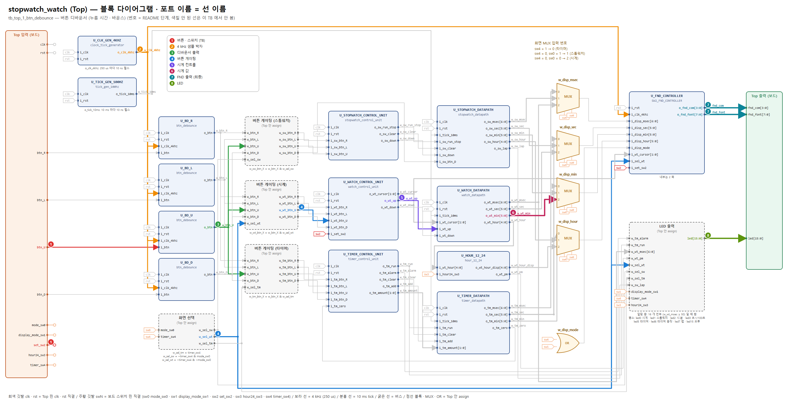
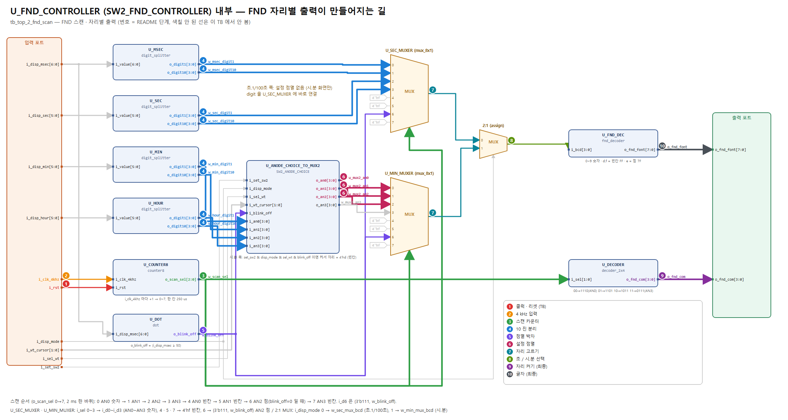

# top — 공통 (버튼 디바운서 · FND 스캔) 확인 안내서

블록 다이어그램(`../../block_diagram.pdf`)의 **입력 → 출력 순서**로, 각 단계에서 **어느 블록의 어느 포트**를 파형에 넣어 볼지 안내한다. 그림의 번호 · 색 = 표의 단계 번호. TB 그림 모음 PDF: [`top_tb_figures.pdf`](top_tb_figures.pdf)

## 이 기능의 사양

| 블록 | 사양 |
|---|---|
| 디바운서 (`U_BD_R/L/U/D`) | 4 kHz(250 us) 로 8 번 샘플, 8 번 모두 1 이면 눌림 → `o_btn` 10 ns 펄스 1 개. 1.75 ms 이하 누름은 무시, 2.0 ms 이상은 1 번 |
| FND 스캔 (`U_FND_CONTROLLER`) | 4 kHz 마다 `o_scan_sel` +1 (0~7). 0~3 숫자 AN0~AN3, 4~7 빈칸 (6 은 AN2 가운데 점). 한 바퀴 2 ms |

두 기능 모두 스톱워치 · 시계 · 타이머가 같이 쓰는 공통 블록이라 여기서 한 번에 확인한다.

## 0. 시작 전에 (처음 한 번)

1. **Vivado 소스**: Design Sources = `../../source_file/*.v, *.sv` / Simulation Sources = 이 폴더의 `tb_*.sv` 하나 + `fnd_monitor.sv` → TB 를 *Set as Top*
2. **Run Simulation → Run All**. 콘솔 마지막 `[SUMMARY] ... => PASS` 면 이 TB 의 모든 기준 통과. `[FAIL]` 이 있으면 그 시각으로 *Go To Time*
   - 콘솔 읽는 법: Phase 마다 `[BEGIN]` 아래 `plan` (TB 가 할 일) · `expect` (정상 결과). 그다음 TB 가 한 일이 한 줄씩 `[RESET]` `[SW]` `[BTN]` `[WAIT]` `[PRELOAD]` 로 찍히고, 오른쪽에 그 전 → 후 값 (지금 화면 값 · FSM 상태). 검사는 `[OK]` / `[FAIL]` (exp = 기대, got = 실제)
   - 줄 맨 앞 `[시각]` 이 파형 *Go To Time* 에 넣을 시각. `[BTN]` 의 `o_btn @` 시각 = 디바운서 펄스 (파형의 X_tick) 위치
3. **파형에 신호 넣기** — 아래 각 TB 의 "단계" 표 순서대로
   - Scope 창에서 `tb_xxx → dut → U_xxx` 인스턴스를 클릭 → Objects 창에 **그 모듈의 포트**가 나온다 → 표의 포트를 우클릭 *Add to Wave Window*
   - `dut (assign …)` 이라고 적힌 것은 모듈이 아니라 Top 안 선이다 → Scope 에서 `dut` 를 클릭하면 Objects 에 같은 이름의 `w_` 선이 있다
   - 이름 규칙: 모듈 출력 `o_xxx` → Top 선 `w_xxx` → 다음 모듈 입력 `i_xxx` (몸통 이름이 같다). 전체 연결은 `../../source_file/PORT_MAP.md`
4. **Radix**: 시간 값(`o_sw_msec` 등) = Unsigned Decimal, `fnd_com` = Binary, `fnd_font` = Hexadecimal
5. **10 ns 펄스 찾기**: `o_clk_4khz`, `o_tick_10ms`, `o_btn` 은 10 ns 짜리라 줌을 당기면 안 보인다 → 신호를 고르고 툴바의 *Go to next transition* 으로 하나씩 이동
6. **`clk` · `rst` 는 항상 같이 넣는다** (1 단계). 모든 "다음 클럭" 타이밍의 기준이다. 수 초짜리 시뮬에서 `clk` 를 넣으면 파형이 커지므로, 긴 TB 는 파일 맨 위 `RUN_PHASE` 를 Phase 번호로 바꿔 그 Phase 만 실행
7. **FSM 상태 보기**: 컨트롤 유닛 (`U_STOPWATCH_CONTROL_UNIT` · `U_WATCH_CONTROL_UNIT` · `U_TIMER_CONTROL_UNIT`) 을 고르면 Objects 창에 포트 말고 `c_state` · `n_state` 도 있다. enum 이라 파형에 숫자 대신 **STOP · RUN · SET_MIN_1 · ALARM 같은 이름**으로 나온다
   - `n_state` = 다음 상태 (조합): 버튼 펄스가 들어온 **그 10 ns** 에 바뀐다
   - `c_state` = 현재 상태 (레지스터): **다음 클럭 엣지**에 `n_state` 값으로 바뀐다 → 출력 (`o_sw_run_stop` 등) 이 이때 바뀜
   - 각 폴더의 "FSM 상태" 표와 Phase 표의 "상태" 를 같이 보면 된다
8. **프리로드**: `[PRELOAD]` 가 찍힌 시각에 TB 가 카운터에 경계 바로 앞 값(예 23:59:59.95)을 직접 넣는다 (주파수는 그대로 100 MHz). 경계를 넘는 것은 그 뒤 실제 tick 으로 본다
   - 파형에서 **tick · 버튼 없이 값이 갑자기 바뀌는 곳 = 프리로드** (버튼 · DUT 동작 아님). 콘솔 다음 줄에 바뀌기 전 → 후 값이 찍힌다

## 1. 시간 단위 (파형에서 먼저 확인할 것)

| 신호 (블록.포트) | 주기 | 펄스 폭 | 의미 |
|---|---|---|---|
| `U_CLK_GEN_4KHZ.o_clk_4khz` | **250 us** (4 kHz) | 10 ns | 디바운서 샘플 박자, FND 자리 바꾸는 박자 |
| `U_TICK_GEN_100HZ.o_tick_10ms` | **10 ms** (100 Hz) | 10 ns | 1/100 초 한 칸. **시계 전용**, 항상 흐름 |
| `U_TICK_GEN_SW.o_tick_10ms` · `U_TICK_GEN_TM.o_tick_10ms` | **10 ms** | 10 ns | 스톱워치 · 타이머 전용. 시작(RUN) 순간부터 셈 → 첫 칸이 정확히 10 ms (10/17 ④) |
| `U_BD_x.o_btn` | 누를 때 1 번 | 10 ns | 누른 뒤 **1.75 ~ 2.0 ms** (4 kHz 샘플 8 번) |
| `U_FND_CONTROLLER/U_COUNTER8.o_scan_sel` | 한 칸 **250 us**, 한 바퀴 **2 ms** | — | 0~3 숫자 자리, 4~7 빈칸 · 점 |

## 2. FND 읽는 법 (마지막 판정)

기능이 끝까지 맞았는지는 **FND 출력이 자리마다 맞는 글자를 내는지**로 판정한다.
`fnd_com` 의 0 인 비트가 켜진 자리, 그 순간 `fnd_font` 가 그 자리 글자.

| `o_scan_sel` | `fnd_com` | 자리 | `fnd_font` |
|---|---|---|---|
| 0 | 1110 | AN0 (맨 오른쪽) | 화면 4 번째 글자 |
| 1 | 1101 | AN1 | 화면 3 번째 글자 |
| 2 | 1011 | AN2 | 화면 2 번째 글자 |
| 3 | 0111 | AN3 (맨 왼쪽) | 화면 1 번째 글자 |
| 4 · 5 · 7 | 1110 · 1101 · 0111 | AN0 · AN1 · AN3 | `FF` 빈칸 |
| 6 | 1011 | AN2 | 가운데 점: `7F` (i_disp_msec < 50) / `FF` (≥ 50) |

글자 코드 (active-low): `0`=C0 `1`=F9 `2`=A4 `3`=B0 `4`=99 `5`=92 `6`=82 `7`=F8 `8`=80 `9`=90, 빈칸=FF, 점만=7F

---

## 3. `tb_top_1_btn_debounce.sv` — 버튼 디바운서 (누름 시간 · 바운스)

**확인하는 것**: 누름 길이에 따른 인식/무시, 바운스 · 긴 누름에서 펄스 1 개, 펄스 폭 1 클럭 (시계 설정 모드 U 로 분 증가량을 셈)

### 단계 (파형에 넣는 순서)

| 단계 | 블록 (Scope 경로) | 꺼낼 포트 | 시간 | 확인할 것 |
|---|---|---|---|---|
| **1** 클럭 · 리셋 (TB) | TB 최상위 | `clk` `rst` | clk: 10 ns 주기 (100 MHz) rst: 각 Phase 시작에 1 us 펄스 | 모든 '다음 클럭' 의 기준. rst = 1 동안 모든 블록 `i_rst` = 1 → FSM 은 리셋 상태 (STOP · NORMAL · SET), 값은 리셋값, 4 kHz · 10 ms 카운터도 0 부터 다시 셈 (tick 위상의 기준) |
| **2** 버튼 · 스위치 (TB) | TB 최상위 | `btn_U` `set_sw2` | 누름 1.0 ms ~ 2 s, 바운스 패턴 | 시계 설정 모드(set_sw2 = 1, 커서 0) 에서 U 를 여러 길이로 누른다 |
| **3** 4 kHz 샘플 박자 | `dut/U_CLK_GEN_4KHZ` | `o_clk_4khz` | 250 us 마다 10 ns 펄스 | 디바운서가 이 펄스 상승 엣지마다 i_btn 을 1 번 샘플 |
| **4** 디바운서 출력 | `dut/U_BD_U` | `o_btn` | 누른 뒤 1.75 ~ 2.0 ms 에 10 ns 펄스 1 개 | 샘플 8 개가 모두 1 이 된 순간 1 클럭. 누르고 있어도 다시 안 나옴 (자동 반복 없음) 더 보려면: 샘플 레지스터: `dut/U_BD_U` 내부 `q_reg[7:0]` (4 kHz 마다 오른쪽으로 밀림) |
| **5** 버튼 게이팅 | dut (assign 화면 선택) dut (assign 버튼 게이팅) | `w_sel_wt` `w_wt_btn_U` | o_btn 과 같은 클럭 | 시계 화면이라 o_btn 이 그대로 지나감 |
| **6** 시계 컨트롤 · FSM | `dut/U_WATCH_CONTROL_UNIT` | `o_wt_up` | 버튼 펄스와 같은 10 ns | 설정 모드라 U 펄스가 o_wt_up 으로 나감 **FSM**: `c_state` · `n_state` 가 TB 내내 SET_MIN_1 (커서 0) 인지 |
| **7** 시계 값 | `dut/U_WATCH_DATAPATH` | `o_wt_min` | o_wt_up 다음 클럭 | 인식된 눌림 1 번 = 분 +1 |
| **8** FND 출력 (최종) | `dut/U_FND_CONTROLLER` | `o_fnd_com` `o_fnd_font` | 250 us 마다 자리 바뀜 | 아래 'FND 결론' 표 |
| **9** LED | dut (assign LED) | `led` | 리셋 직후 | 모든 스위치 0 → `led` = 8009 |

### Phase 별로 볼 곳

| Phase | TB 가 하는 것 | 볼 단계 | 정상 |
|---|---|---|---|
| P0 | 리셋 직후 1 us | 1 · 9 | `fnd_com` · `fnd_font` · `led` 에 X 없음, `led` = 8009, 12:00:00.00 |
| P1 | U 를 1.0 / 1.5 / 1.7 / 2.0 / 2.5 / 5 / 100 ms 누름 | 3 · 4 · 7 | 1.0 · 1.5 · 1.7 ms: `o_btn` **없음** / 2.0 · 2.5 · 5 · 100 ms: `o_btn` **1 개**, `o_wt_min` +1 |
| P2 | 바운스 패턴 (40 us ~ 300 us 튐 + 20 ms 누름) | 3 · 4 · 7 | `o_btn` 정확히 1 개, `o_wt_min` +1 |
| P3 | 2 초 길게 누름 | 4 · 7 | `o_btn` 1 개 (자동 반복 없음) |
| P4 | 누른 중간에 300 us 떨어짐 | 3 · 4 · 7 | `o_btn` **2 개**, `o_wt_min` +2 → `[LIMIT]` 기록 (누른 중 끊김은 새 누름으로 봄) |
| P5 | 지금까지 모든 `o_btn` | 4 | 펄스 폭 = 정확히 10 ns (1 클럭) |

### FND 결론 (마지막 단계)

| 순간 | 화면 | AN3 (`fnd_com`=0111) | AN2 (1011) | AN1 (1101) | AN0 (1110) | 가운데 점 (o_scan_sel 6, AN2) |
|---|---|---|---|---|---|---|
| P1 끝 (설정 모드, 커서 0, msec < 50) | "12.04" (시.분) | `F9` (1) | `A4` (2) | `C0` (0) | `99` (4) | i_disp_msec < 50 → `7F` 점 켬, ≥ 50 → `FF` |
| P1 끝 (msec ≥ 50, 커서 자리 점멸) | "12.0_" (시.분) | `F9` (1) | `A4` (2) | `C0` (0) | `FF` (빈칸) | i_disp_msec < 50 → `7F` 점 켬, ≥ 50 → `FF` |

---

## 4. `tb_top_2_fnd_scan.sv` — FND 스캔 · 자리별 출력

**확인하는 것**: 자리 순서 AN0 → AN3, 한 칸 250 us, 자리별 글자 · 가운데 점 · 설정 점멸이 참조 모델과 같은지 (fnd_monitor 가 전 구간 비교)

### 단계 (파형에 넣는 순서)

| 단계 | 블록 (Scope 경로) | 꺼낼 포트 | 시간 | 확인할 것 |
|---|---|---|---|---|
| **1** 클럭 · 리셋 (TB) | `dut/U_FND_CONTROLLER` | `i_rst` | clk: 10 ns 주기 (100 MHz) rst: 각 Phase 시작에 1 us 펄스 | TB 최상위 `clk` · `rst` 를 같이 넣는다. FND 컨트롤러는 `i_rst` 만 받고 (`i_rst` = Top `rst`), 자리 스캔은 `i_clk_4khz` 로 움직인다. rst = 1 동안 `o_scan_sel` = 0 |
| **2** 4 kHz 입력 | `dut/U_FND_CONTROLLER` | `i_clk_4khz` | 250 us 마다 10 ns 펄스 | `U_CLK_GEN_4KHZ.o_clk_4khz` 와 같은 선 |
| **3** 스캔 카운터 | `dut/U_FND_CONTROLLER/U_COUNTER8` | `o_scan_sel` | 250 us 마다 +1, 2 ms 한 바퀴 | 0 → 1 → … → 7 → 0 |
| **4** 10 진 분리 | `dut/U_FND_CONTROLLER/U_MSEC` `dut/U_FND_CONTROLLER/U_SEC` `dut/U_FND_CONTROLLER/U_MIN` `dut/U_FND_CONTROLLER/U_HOUR` | `o_digit1` `o_digit10` `o_digit1` `o_digit10` `o_digit1` `o_digit10` `o_digit1` `o_digit10` | i_disp_* 와 같은 순간 (조합) | 예: i_disp_min = 34 → o_digit10 = 3, o_digit1 = 4 |
| **5** 점멸 박자 | `dut/U_FND_CONTROLLER/U_DOT` | `o_blink_off` | i_disp_msec ≥ 50 동안 1 (0.5 초 주기) | 1 이면 커서 자리 빈칸, 가운데 점 꺼짐 |
| **6** 설정 점멸 | `dut/U_FND_CONTROLLER/U_ANODE_CHOICE_TO_MUX2` | `o_an0` `o_an1` `o_an2` | o_blink_off 와 같은 순간 | 시계 화면 & set_sw2 & 시.분 & o_blink_off 일 때만 커서 자리를 `d` (빈칸) 로 |
| **7** 자리 고르기 | `dut/U_FND_CONTROLLER/U_SEC_MUXER` `dut/U_FND_CONTROLLER/U_MIN_MUXER` | `o_data` `o_data` | o_scan_sel 과 같은 순간 | o_scan_sel 0~3 → i_d0~3 (초 쪽 = o_digit 바로, 시.분 쪽 = o_an0~3), 4 · 5 · 7 → f (빈칸), 6 → {111, o_blink_off} (점) |
| **8** 초 / 시.분 선택 | `dut/U_FND_CONTROLLER (assign)` | `w_bcd` | o_data 와 같은 순간 | i_disp_mode 0 → 초.1/100초 쪽, 1 → 시.분 쪽 |
| **9** 자리 켜기 (최종) | `dut/U_FND_CONTROLLER/U_DECODER` | `o_fnd_com` | o_scan_sel[1:0] 과 같은 순간 | 00 → 1110 (AN0) … 11 → 0111 (AN3) |
| **10** 글자 (최종) | `dut/U_FND_CONTROLLER/U_FND_DEC` | `o_fnd_font` | w_bcd 와 같은 순간 | 아래 'FND 결론' 표 |

### Phase 별로 볼 곳

| Phase | TB 가 하는 것 | 볼 단계 | 정상 |
|---|---|---|---|
| P1 | 20 ms 동안 `fnd_com` 80 번 바뀜 | 2 · 3 · 9 | 순서 1110 → 1101 → 1011 → 0111 반복, 한 칸 폭 정확히 **250,000 ns** |
| P2 | 시계 시.분: 리셋 → 12:34 프리로드 → 설정 모드 1 초 | 4 · 6 · 10 | "12.00" → "12.34" → 커서 0 점멸 ("12.3_" ↔ "12.34") |
| P3 | 시계 초.1/100초 1 초 | 5 · 7 | o_scan_sel 6 칸의 `o_fnd_font` = 7F (점) 인 프레임이 절반 (i_disp_msec < 50) |
| P4 | 스톱워치 · 타이머 화면 | 8 · 10 | 스톱워치 "34.56" (초.1/100초) · "00.00" (시.분), 타이머 "12.34" (분.초), 타이머 + set_sw2 → 점멸 없음 |

TB 전체에서 `fnd_monitor` 가 `fnd_com` · `fnd_font` 를 참조 모델과 계속 비교한다. 다르면 그 구간마다 `[FAIL] ... FND` + 시각.

프리로드 Phase 는 콘솔 `[PRELOAD]` 시각부터 보면 된다.

### FND 결론 (마지막 단계)

| 순간 | 화면 | AN3 (`fnd_com`=0111) | AN2 (1011) | AN1 (1101) | AN0 (1110) | 가운데 점 (o_scan_sel 6, AN2) |
|---|---|---|---|---|---|---|
| P2 리셋 | "12.00" (시계 시.분) | `F9` (1) | `A4` (2) | `C0` (0) | `C0` (0) | i_disp_msec < 50 → `7F` 점 켬, ≥ 50 → `FF` |
| P2 12:34 | "12.34" (시계 시.분) | `F9` (1) | `A4` (2) | `B0` (3) | `99` (4) | i_disp_msec < 50 → `7F` 점 켬, ≥ 50 → `FF` |
| P2 설정, msec ≥ 50 | "12.3_" (시계 시.분) | `F9` (1) | `A4` (2) | `B0` (3) | `FF` (빈칸) | i_disp_msec < 50 → `7F` 점 켬, ≥ 50 → `FF` |
| P4 스톱워치 00:00:34.56 | "34.56" (초.1/100초) | `B0` (3) | `99` (4) | `92` (5) | `82` (6) | i_disp_msec < 50 → `7F` 점 켬, ≥ 50 → `FF` |
| P4 타이머 12:34 | "12.34" (분.초) | `F9` (1) | `A4` (2) | `B0` (3) | `99` (4) | i_disp_msec < 50 → `7F` 점 켬, ≥ 50 → `FF` |
